## What is Athena
AWS S3 (Simple Storage Service) is the most used AWS resource. In S3 you can
store all types of data in a multitude of file formats: Parquet, ORC, JSON,
CSV, different types of logs, dumps from web scraping, database backups or
snapshots, the list goes on and on. You can use it as a data lake and chuck in
all your data. Just like your favorite desktop junk drawer. But then the day
comes when you actually want to look at your data. This could require heavy ETL
pipelines transforming and loading the data over to a relational database where
you finally could retrieve your data using SQL.

How ever, with Amazon Athena, you can query your data directly from S3 using SQL.

> Amazon Athena is an interactive query service that simplifies data analysis in Amazon S3 using standard SQL. Athena is serverless, so there is no infrastructure to set up or manage, and you only pay for the resources your query needs to run. Use Athena to process logs, perform data analytics, and run interactive queries. Athena automatically scales and completes queries in parallel, so results are fast, even with large datasets and complex queries.

*- AWS about [Amazon Athena](https://aws.amazon.com/athena/)*

## Why you want to use Athena
At first I couldn't  really see then need for Athena. If what you want to do is
query data, shouldn't you use RDS? Or if you want to query some application
logs, why not use CloudWatch insight?

### Athena is serverless
Well, first of all Athena is serverless. You don't need to handle any
infrastructure like managing a server and database but can query massive
amounts of data directly from S3 using SQL. This makes it perfect for using on
a data lake in S3. Athena can query the data as it is and you don't have to
scan the entire database. With good partitioning, it could speed up your
queries even more. 

### Athena is cheap
Storing data in S3 is much cheaper than storing it using RDS. Since it is
Serverless you don't pay for the server where your database would run 24/7. You
could also make use of the S3 life cycle rules and move data to a cheaper S3
type when not needing to access it as often. This would quickly cut cost. As
said, you don't need to search the whole database, so queries would be faster,
which is cheaper. And with the right compression and partitioning even faster.

### Athena is used to analyse data
Athena is used to query and analyse data. Unlike CloudWatch which is used for
looking up logs, monitoring and debugging real-time operations. Athena would
for example be used to analyse data 1 year later finding patterns and insights.
Like "What was the quarterly revenue and profit margin for our top 50 products
over the last 5 years, broken down by sales region?"

## Partitioning data in a data lake
When storing your data in a data lake, you want to think of how you are going
to use this data later. The way you partition the data could greatly affect the
time it would take to query it, which again affects the cost. An easy way of
thinking about it is that you should partition the data in folders based on the
columns that you would use the most in the ``WHERE`` clause of your query.

This is often time. A structure could be ``year/month/day/``. How ever some
businesses will maybe need to query by brand, on customer or region first.

## How does it work?
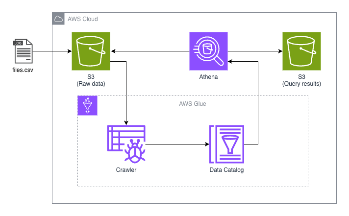

You define a schema. This is what the data tables will look like, columns names
and data types. This can be done manually in the console, with SQL or
automatically using something in AWS Glue called a crawler. This will create a
table with metadata in AWS Glue Data Catalog. We will look at this in the
demonstration. Then you can run normal SQL queries in the Athena Query Editor
and Athena will use its powerful serverless engine to search S3 and store the
results in S3. From the query it will understand to only scan the needed
folders, skipping everything else. You only pay for the data scanned. 5$ pr TB.

## Demonstration

Let's take a look at how to use Athena to get a feel for what we can do. To
demonstrate I have downloaded a small dataset from kaggle [AWS EC2 Instance
Comparison](https://www.kaggle.com/datasets/berkayalan/aws-ec2-instance-comparison).
Feel free to do this along with me, or better yet, download some other dataset
that is interesting to you and do some queries on that data. I'll be working
with CSV format. I would like to transform it into parquet improve on cost and
performance, but this is out of scope.

You can also download the file with curl:
```bash
curl -L -o ~/Downloads/aws-ec2-instance-comparison.zip \
https://www.kaggle.com/api/v1/datasets/download/berkayalan/aws-ec2-instance-comparison
  ```

### Kaggle - About the dataset:
> Amazon EC2 provides a wide selection of instance types optimized to fit different use cases. Instance types comprise varying combinations of CPU, memory, storage, and networking capacity and give you the flexibility to choose the appropriate mix of resources for your applications. Each instance type includes one or more instance sizes, allowing you to scale your resources to the requirements of your target workload.
> 
> This dataset contains easy Amazon EC2 Instance Tabular Comparison.

So the plan is to upload this to S3 and play around with Athena, showing of some of the possibilities. Let's go!

## Storing the data
When we have our data (.csv) ready, we need to upload this to an S3 bucket. We
are going to need two buckets. One for storing the raw data that we wanna
query, and one for storing query results.
Let's create them using the AWS CLI:
```bash
# Create a bucket for storing the raw data
aws s3api create-bucket \
--bucket demo-data-bucket-for-athena-123 \
--region eu-west-1 \
--create-bucket-configuration LocationConstraint=eu-west-1 \
--profile my-demo-user

# Create a bucket for storing the query results
aws s3api create-bucket \
--bucket demo-result-bucket-for-athena-123 \
--region eu-west-1 \
--create-bucket-configuration LocationConstraint=eu-west-1 \
--profile my-demo-user

# The previous commands should give a "Location" as a response, with the bucket URL
# To be sure you could list your aws S3 buckets and confirm that they are there.
aws s3 ls --profile my-demo-user | grep bucket-for-athena-123

# Upload the csv file to the data bucket
aws s3 cp ./ec2-instance-comparison.csv s3://demo-data-bucket-for-athena-123/data/ec2-instance-comparison.csv --profile my-demo-user
```

If we check our S3 bucket in the AWS Console, we can now see our csv-file in our newly created bucket. And so, we're ready for some Athena!
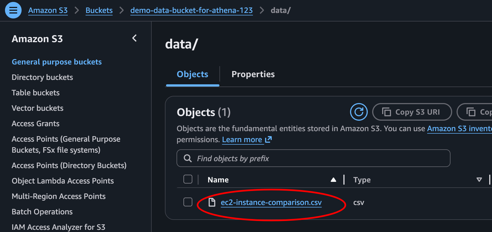

## The Glue that holds everything together
When navigating over to the Athena console, we see a button *Launch query editor*. Clicking this takes us to the Athena query editor.
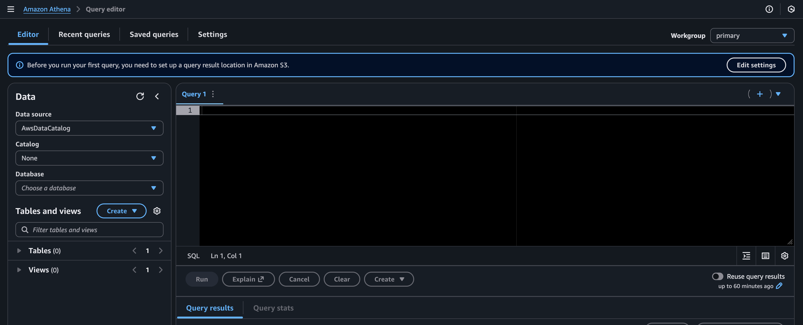

But here we quickly realize that something is missing. How are we supposed to
query our data residing in S3. Even though both me and AWS told you we can
query the data directly, we actually need something to connect Athena to the
data in S3.

We need to create an Athena table pointing to our data in S3. This is not a
complete table with all our data from S3, but a metadata table holding
information like table definitions, schema, and physical location, used to be
able to read and structure the data from S3. The actual data will stay in S3.

There are several ways we could create this table. We can create it manually,
by entering in a lot of needed information like the data format, column names,
table properties and partition details. We could use SQL to create the table
setting up the data relations. Or we could use yet another great AWS resource:
AWS Glue. 

Glue gives us a tool called a crawler. We imagine a bug or a spider crawling through our
data getting oriented and then able to structure our table.

## Athena Query Editor
Before we send of our little crawler friend searching through the csv file,
let's get a bit more familiar with the Athena console.
This is the query editor, here is a little information of what everything is so
we don't feel so lost.

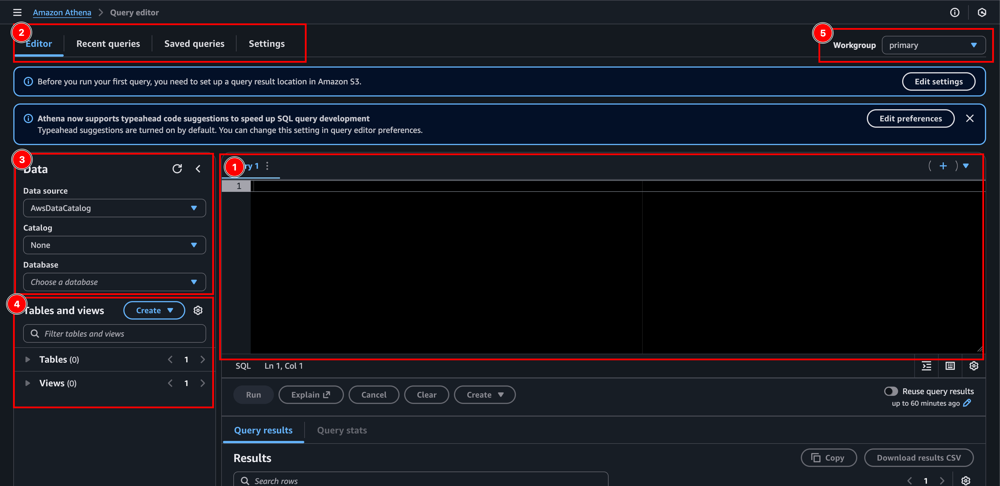

1. **The query editor:** Here we write our SQL queries. We can open multiple tabs. And we can save our queries if we want to.
2. **Tabs:** Here we can navigate between the editor, recent and saved queries, as well as settings.
3. **Data:**
   - **Data Source:** A collection of catalogs. AwsDataCatalog is the default data source that contains the AWS Glue Data Catalogs.
   - **Catalog:** Contains databases and their metadata.
   - **Database:** Contains the tables. Holds only metadata and schema information, not the actual data.
4. **Tables and views:**
   - **Table:** Metadata definition that specifies where our data is located (in S3) and its structure (column names, data types, etc.). The actual data is not stored here, it's like a pointer to our CSV file in S3.
   - **Views:** Just like normal SQL views, but again, they don't store the actual data. Like a custom shortcut to a table created by a query.
5. **Workgroup:** What group of "rules" to use. Like where to store results, security and cost settings etc.

## Setting up Athena
Now that we've gotten to know Athena a little better and feel more at home,
let's create everything we need. Since this is the first time we are using
Athena, we'll see a button saying *Edit settings*. This will take us to the
settings tab of Athena. We can get back here any time by pressing the tab
called settings (2). Here we can choose our demo-result-bucket-for-athena-123
as the location of our query results. Then at *table and views* (4) we can
click *Create* > *AWS Glue Crawler* to create the crawler that will create our
table.

### Creating the table
- **Step 1 - Set crawler properties:** Give the crawler a name and click *next*.
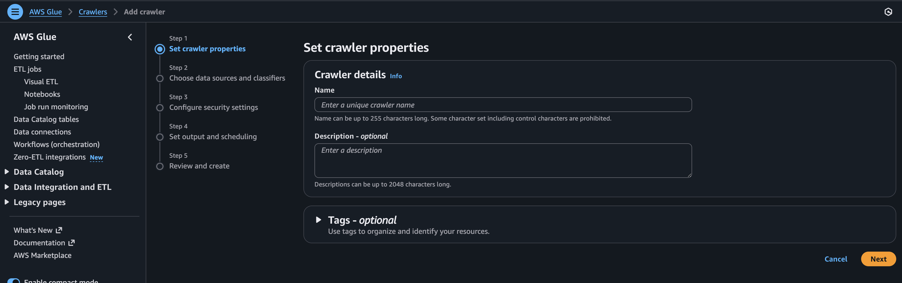
- **Step 2:** Here we need to add a data source and then click *Next*.
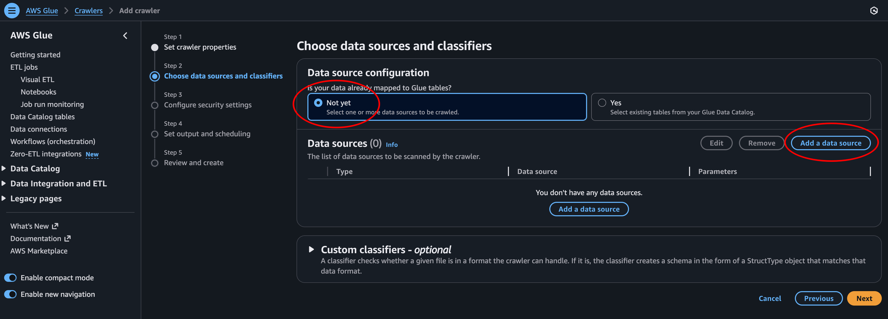
- **Add Data Source:** Click *Browse S3* and select the data bucket where the CSV file is located. Then choose how to perform subsequent crawler runs and click *Add an S3 source*.
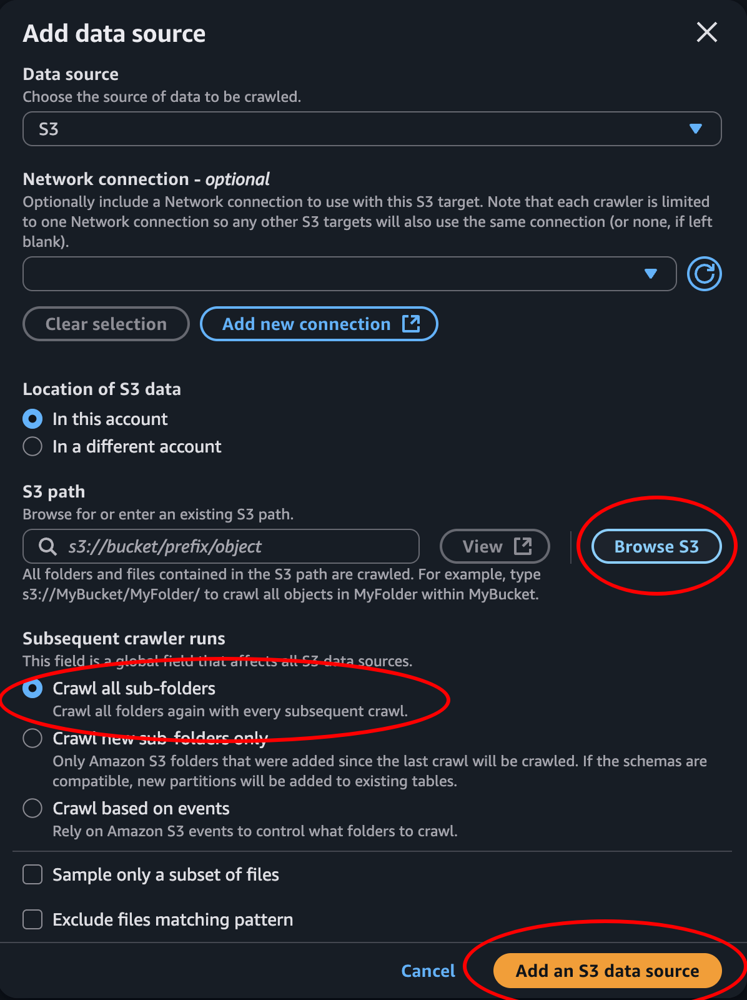
- **Step 3:** Create an IAM role to give the crawler permissions to access our data in S3. We can keep the prefix and add on the name of our crawler. Then click *next*.
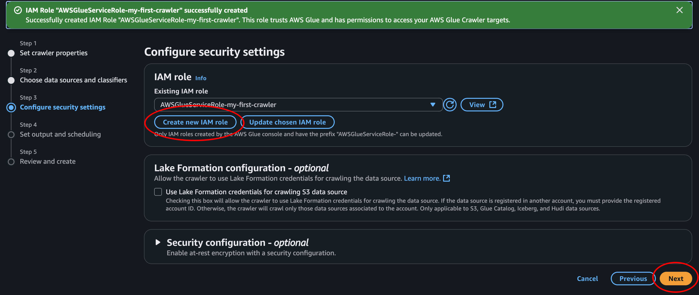
- **Step 4.1:** We need to create a database, so let's click *Add database*
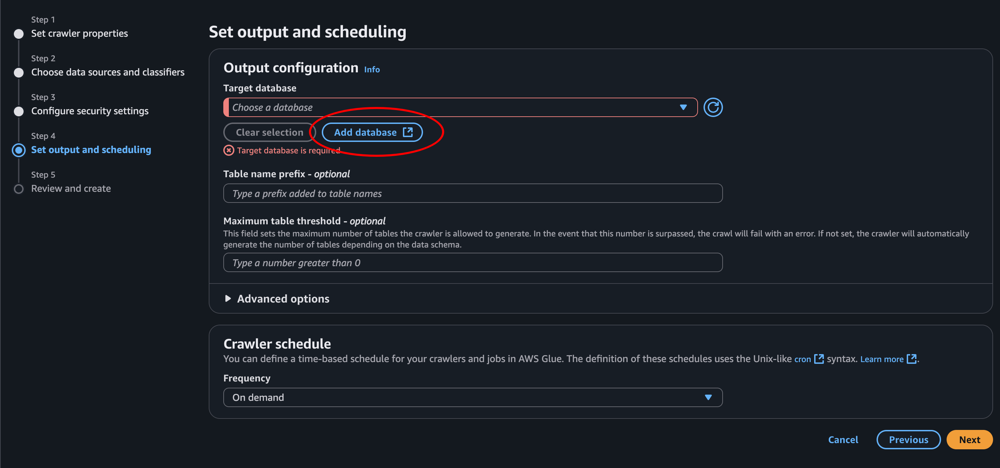
- **Create database:** We give it a name and description then we click *next*. Then we can go back to the previous tab, where we're creating the crawler.
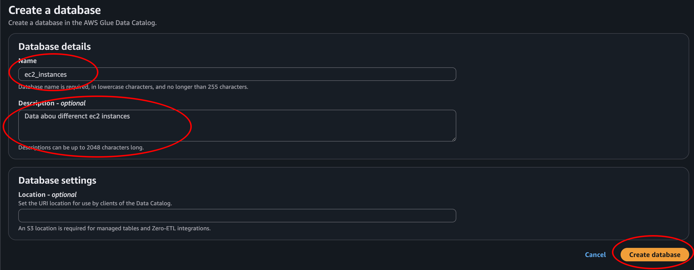
- **Step 4.2:** When we click the refresh button we can find our newly added database in the list. Select it. Then we choose *on-demand* since this is only a demo, and we will only crawl this data once.
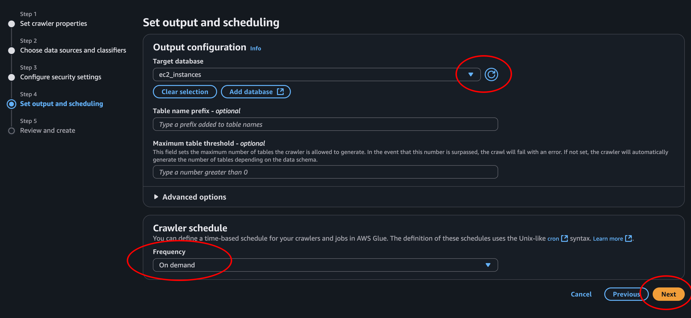
- **Step 5 - Review and create:** LGTM! *Create crawler*
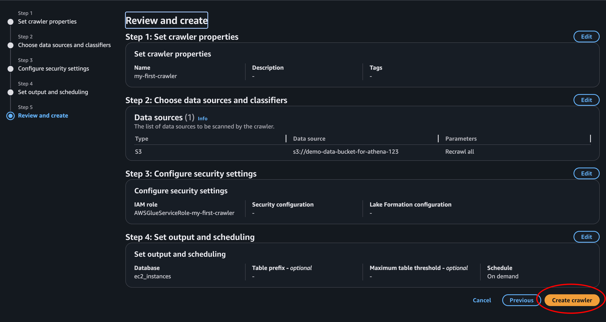
- **Success:** The crawler is created. This is the page of the crawler we just created. Here we can update it, run it, delete it and see a log of all the runs failed and completed.
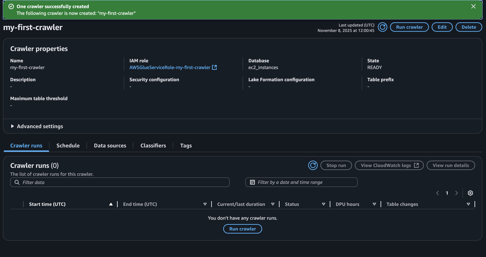
- **Run the crawler:** Let's click *Run crawler* at the top right and create our athena table! This should take under a minute. Don't be scared if it runs for a long time. If we press the refresh button in the *Crawler run* section it will update status, or at lease the time it has been running.
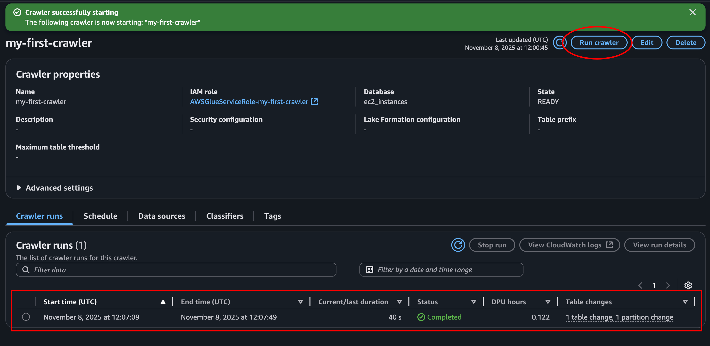

## Query query query
Let's head back to Athena and look at what we got!
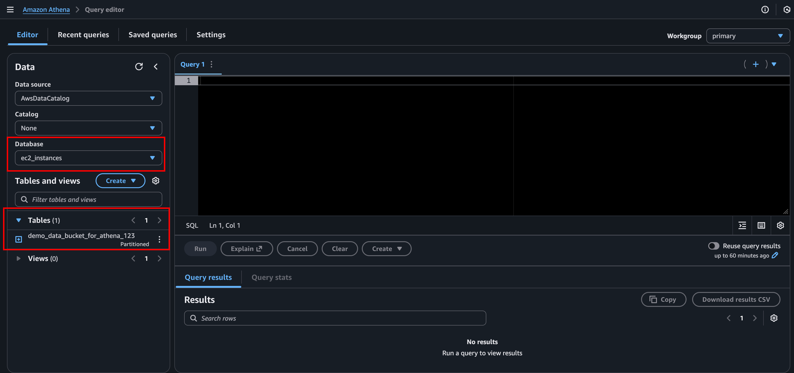

We have our data in S3. We have a database in Athena. And our crawler created a
table. Let's see if we're able to fetch some of our data. 

To see that everything is working as it should we could start by just doing a
simple query to see the first 10 rows. You might notice that the query editor will help us with auto-completion. How ever it does not like to write in CAPS for some reason.
```SQL
select * from demo_data_bucket_for_athena_123 limit 10;
```
Awesome! If we scroll down we're able to see the result, which is the first 10 rows of our data.
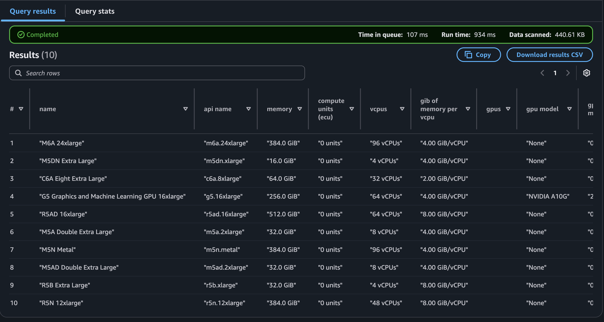

On second though this is not awesome. All our data is wrapped in quotes and I
think some of the columns are a bit messed up. After 20 minutes writing crazy
hacky SQL queries trying to get around this, I think we should just create a
new table. I guess this wasn't the best choice for dataset.. But we'll make it
work. This time the job goes to Amazon Q, not the Crawler. Q lives right on the
right hand side of the console and had a working solution right away.
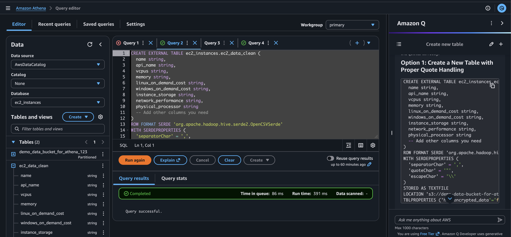

Ok, cool, I guess we got to create a table using SQL after all. Here is the complete query.
```sql
CREATE EXTERNAL TABLE ec2_instances.ec2_data_clean (
	name string,
	api_name string,
	memory string,
	compute_units_ecu string,
	vcpus string,
	gib_of_memory_per_vcpu string,
	gpus string,
	gpu_model string,
	gpu_memory string,
	cuda_compute_capability string,
	fpgas string,
	ecu_per_vcpu string,
	physical_processor string,
	clock_speed_ghz string,
	intel_avx string,
	intel_avx2 string,
	intel_avx_512 string,
	intel_turbo string,
	instance_storage string,
	instance_storage_already_warmed_up string,
	instance_storage_ssd_trim_support string,
	arch string,
	network_performance string,
	ebs_optimized_max_bandwidth string,
	ebs_optimized_max_throughput_128k string,
	ebs_optimized_max_iops_16k string,
	ebs_exposed_as_nvme string,
	max_ips string,
	max_enis string,
	enhanced_networking string,
	vpc_only string,
	ipv6_support string,
	placement_group_support string,
	linux_virtualization string,
	on_emr string,
	availability_zones string,
	linux_on_demand_cost string,
	linux_reserved_cost string,
	linux_spot_minimum_cost string,
	linux_spot_maximum_cost string,
	rhel_on_demand_cost string,
	rhel_reserved_cost string,
	rhel_spot_minimum_cost string,
	rhel_spot_maximum_cost string,
	sles_on_demand_cost string,
	sles_reserved_cost string,
	sles_spot_minimum_cost string,
	sles_spot_maximum_cost string,
	windows_on_demand_cost string,
	windows_reserved_cost string,
	windows_spot_minimum_cost string,
	windows_spot_maximum_cost string,
	windows_sql_web_on_demand_cost string,
	windows_sql_web_reserved_cost string,
	windows_sql_std_on_demand_cost string,
	windows_sql_std_reserved_cost string,
	windows_sql_ent_on_demand_cost string,
	windows_sql_ent_reserved_cost string,
	linux_sql_web_on_demand_cost string,
	linux_sql_web_reserved_cost string,
	linux_sql_std_on_demand_cost string,
	linux_sql_std_reserved_cost string,
	linux_sql_ent_on_demand_cost string,
	linux_sql_ent_reserved_cost string,
	ebs_optimized_surcharge string,
	emr_cost string
)
ROW FORMAT SERDE 'org.apache.hadoop.hive.serde2.OpenCSVSerde'
WITH SERDEPROPERTIES (
	'separatorChar' = ',',
	'quoteChar' = '"',
	'escapeChar' = '\\'
)
STORED AS TEXTFILE
LOCATION 's3://demo-data-bucket-for-athena-123/'
TBLPROPERTIES (
	'has_encrypted_data' = 'false',
	'skip.header.line.count' = '1'
);
```
Now we can finally do a real query. Let's see what EC2 instance that
will give you most bang for your bucks when it comes to vCPUs. Let's say we
need more than 4. What instance will give us most vCPUs pr dollar? 
```sql
SELECT 
    api_name,
    CAST(SPLIT_PART(vcpus, ' ', 1) AS DOUBLE) AS vcpu_count,
    CAST(REGEXP_EXTRACT(linux_on_demand_cost, '\$([0-9.]+)', 1) AS DOUBLE) AS linux_cost_numeric,
    CAST(SPLIT_PART(vcpus, ' ', 1) AS DOUBLE) / CAST(REGEXP_EXTRACT(linux_on_demand_cost, '\$([0-9.]+)', 1) AS DOUBLE) AS vcpu_per_dollar
FROM ec2_instances.ec2_data_clean
WHERE TRY_CAST(SPLIT_PART(vcpus, ' ', 1) AS DOUBLE) > 4
ORDER BY vcpu_per_dollar DESC
LIMIT 10;
```
I'm no SQL expert, so sorry about the messy query using regex and casting..
Again, blame the dataset. (Don't remind me that I chose it..) To give a short
explanation, we turn vcpu and on demand cost to doubles then divide vcpu on the
price to get vcpu pr dollar.
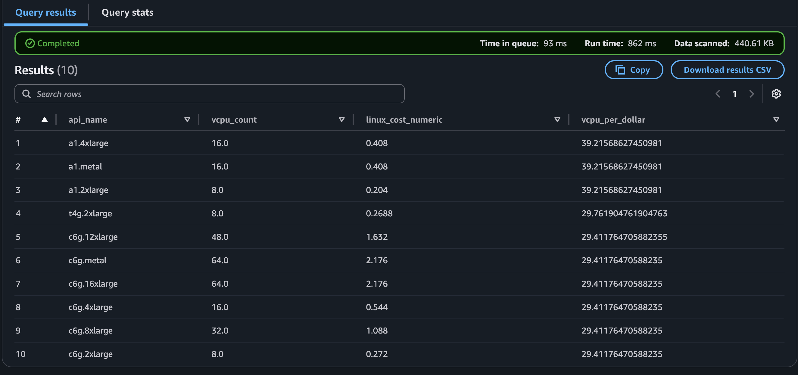

Looks like a1 is the way to go. But it does not look like you get a lot of
reduction in price doubling the vcpu count from 8 to 16.

Cool. Ok, that's enough fooling around with SQL commands. This was just en
example to show that we could query our data.

## Conclusion
This has been an introduction to Amazon Athena. And a demonstration showing how
to get started. Athena is a great tool when needing to query data without going
through the hassle of setting up and managing a database.

