In early may I attended the AWS Summit in Stockholm. Not only was it my first
ever Summit, I also had the pleasure of doing a presentation on the pre-summit
event hosted by the AWS Nordic User Group.

All in all it was a great experience! And to be able to better look back on it
in the future, I wanted to try writing a summary of the event. Mostly my
thoughts about it and my experience as a first timer at an AWS Summit.

## Housewarming
The day before a summit there's usually an AWS housewarming, which is a free,
community building event with hands-on workshops led by AWS experts. There
where a lot of workshops to choose from. I arrived with plane in Stockholm
around 10 AM and went straight for the hotel to check in.

I had a little time to kill before the housewarming, and feeling the nerves
from thinking of the presentation I was going to do later this day, I decided
to distract myself by going for a run outside. Then it was off to the AWS
building for the housewarming.

I attended the "EKS auto mode" workshop. I choose that one because I want
to learn more about EKS and I thought the summit would be packed with AI talks,
so I wanted a non-AI workshop to start with, while I still had the chance.

In the workshop we got some a short presentation about EKS auto mode and then
we got some hands-on experience. Deploying an app, launching nodes, setting up
network and updating the cluster. I didn't have time to do the last part about
migrating an EKS cluster over to auto mode.

Auto mode feels really nice. You get the "zero to prod in one click"-dream when
AWS handles compute, storage, network, and complete a cluster upgrade in
literally one click. It is not free though. EKS is complex, so its hard to say
a general total price, but the thing I noted was that you got about 12% increase
in the price when running auto mode on your compute nodes.

The workshop was fun. After traveling it was nice to do something hands-on and
not just listen to a presentation. And I also like the situation where you're
in a room with experts working in AWS who you can just ask anything.

## AWS Nordic User Group
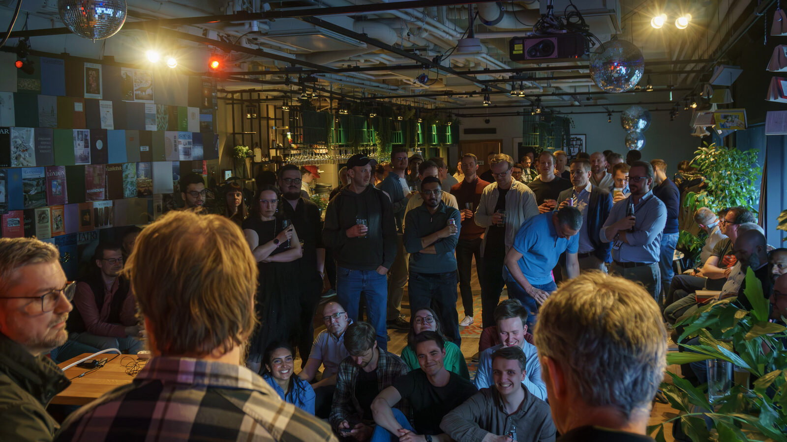
After the housewarming, I had one hour before the User Group pre-summit
event started. I was excited and nervous. Specially because everyone else
speaking was experienced AWS veterans who have done talks like this for years
on way bigger stages.

The one to open the show was Gunnar Grosch who talked about the AWS Community.
The importance of community and his own journey from a User Group attendee to
speaking on stage at re:invent. His call to action was to attend User Groups
and reach for being an active part of the community, which made me feel good
about my choice to say yes to presenting.
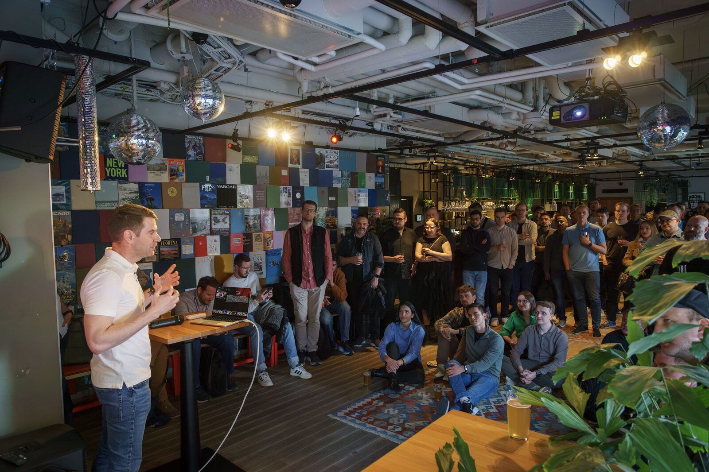

I was up next after Gunnar. I talked about Crossplane. A framework you use in
Kubernetes as infrastructure as code. It can be used to create a self-service
platform where developers can "order" resources simply by pushing YAML to a
repository.
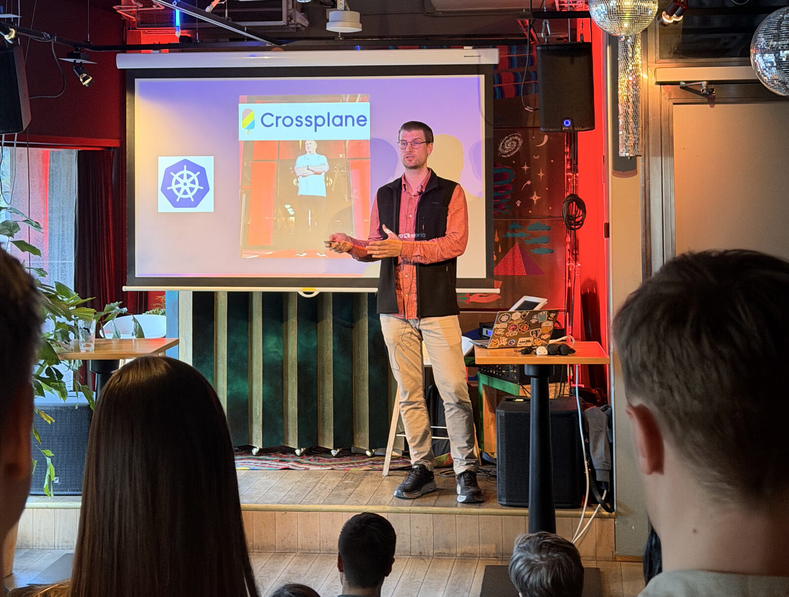

Crossplane is something I started working with last year. And as I started
looking into how it works, I set a goal for myself to do a presentation in 2026
about Crossplane. I sat the goal since I've experienced that the best way of
learning something is trying to teach it. Then you realize fast how well you
know you stuff.
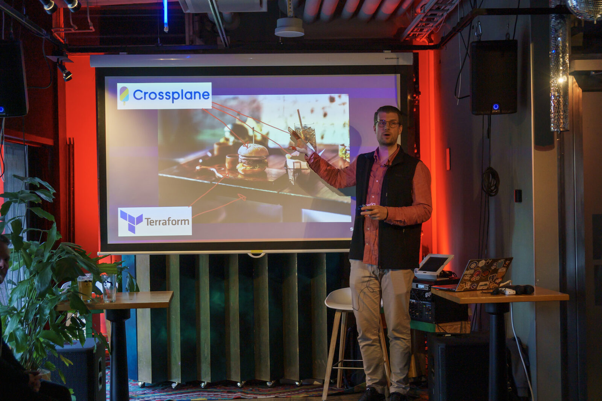

The presentation went well and I got a lot of positive and friendly feedback,
which felt great. Such a high doing a presentation, finally completing
something you have worked on for a long time. It is one of the scariest things
I know, but it also feels great. Kinda like extreme sport I guess. Except it's
extremely safe. Ha-ha.

Then we had something called a fireside chat. Here AWS Hero Anders Bjørnestad talked with 
Martin Elwin (Technology Director, Europe North, AWS) and Johan Broman (EMEA
ISV Head of Solutions Architecture AWS) about the past 20 year of AWS. Where it
started and where we are going.
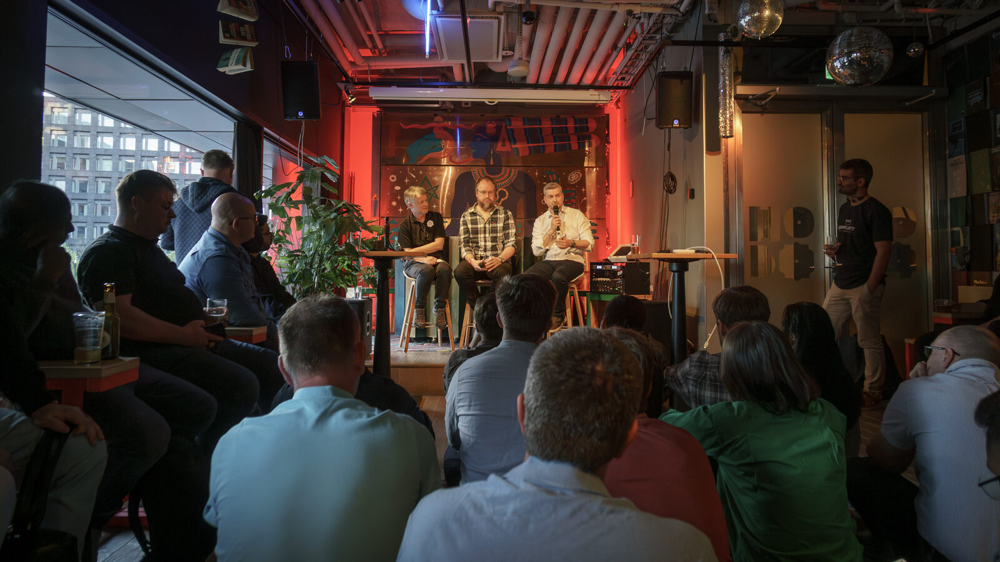

Last was Ari Palo, Tech lead and AWS Community Builder. He talked about
Practical tips for Developing AWS Lambda functions with TypeScript, which also
was the title of his presentation.
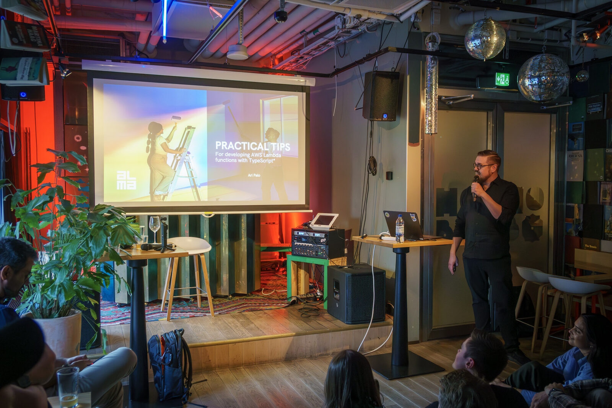

Then we got music from DJ Håkon Eriksen Drange, AWS Ambassador and Community
Builder. And I could finally breath out, drink a beer and talk to everyone
there. User Groups are informative and great for sharing experience, hearing
what other people have done with AWS. But it is also a really nice social arena
where you get to eat some pizza, grab a drink and hang out with friends and
colleges in the community.
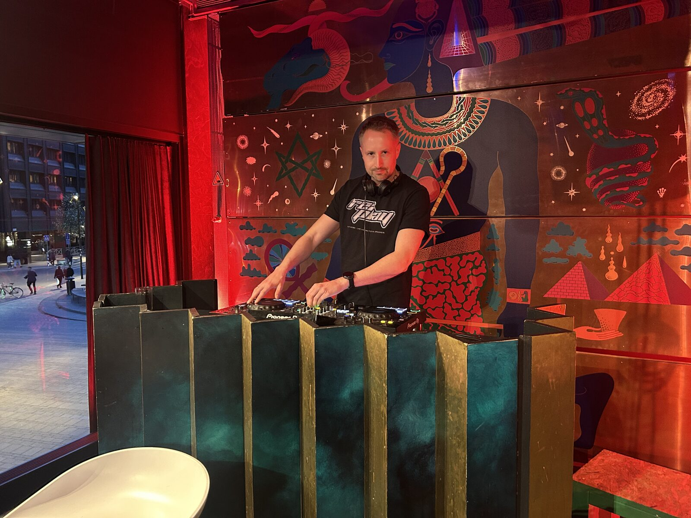

## The Summit
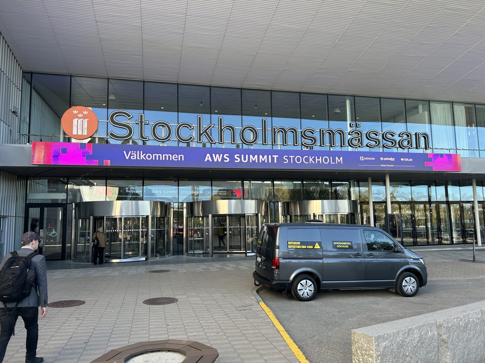
This was my first AWS Summit ever. So I don't have anything to compare it with
other than my expectations. But it lived up to my expectations. An AWS Summit
is an AWS hosted convention where there is held different presentations from
AWS and partners and users of AWS services. The location was Stockholmsmässan.
It was a big hall with lots of stands or booths where different companies could
show of what they did and how AWS played a part. Then there where 8 different
breakout rooms where the different presentations happened.

The AWS Community Builders also had an area, and being an AWS Community builder
it was great to finally meet some other builders in person.

### My impression of the Summit
There is an app for AWS events, called AWS Events, where you will find all the
different presentations that are happening in the conference. The title, a
description and what stage or breakout room they are held. Then you can create
you own time table with talks.

There was also an AI feature, where you could answer some questions about what
topics interest you, then you got 5 presentations that you must rate how much
they interest you. And from that information the AI will create your entire
time table of presentations for the event. I first did this, then I went
through my day and search the talks, filtering on time and double checked if
there was anything I would find more interesting than what the AI suggested.

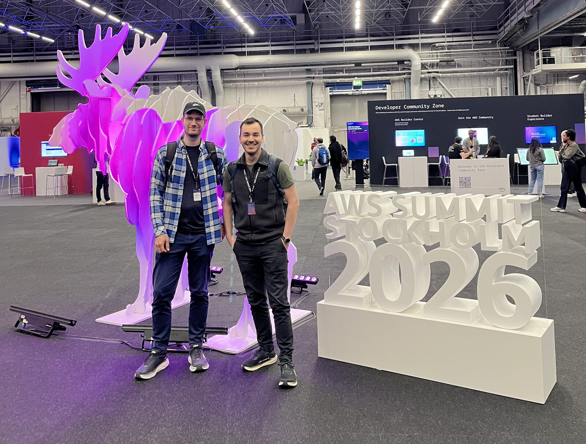

### What I did at the Summit
I came pretty early to the location the day of the summit to pick up my badge.
I did not want to start my day by standing in line for an hour. To be honest I
have no idea if there ever was much waiting, because there was a lot of people
there helping with registration and it seemed pretty frictionless.

When I entered the main hall I was thrilled to see all the stands. Curious to
explore. I was overwhelmed with possibilities, and even though I tried to get a
good overview and experience as much as possible, I'm afraid that I actually
missed a bunch too. I started of with at walk around to see what everything was
and get oriented.

There was the developer community zone, where you could talk to
representatives from the AWS community, learn about building on AWS, and do a
certification prep. They also had some exciting presentations, from I think
mainly AWS Community Builders, where they showed of cool projects made on AWS
and what they have learned on the way.

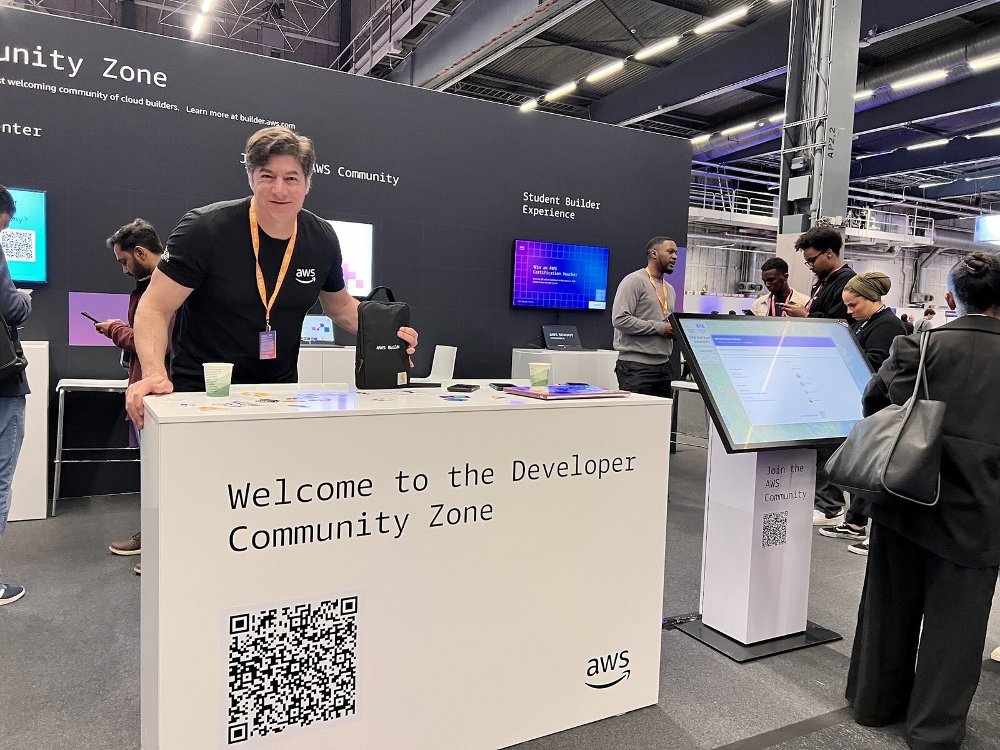

My colleague Håkon Drange did a presentation there about his project about a
naught christmas elf idea generator. The naughty elf is this Christmas advent
calender thing that is really popular with the kids in Norway (and some other
countries). A web app that will create creative ideas on mischievous and fun
stuff the elf can do, to help parents come up with ideas for the calender. It
was really good. He went through a lot of lessons learned from the project, and
I learned a lot about prompting and how choosing the correct AI model is much
more important than you would think. Check out the project: [naughtyelfideas.com](https://naughtyelfideas.com/en/).

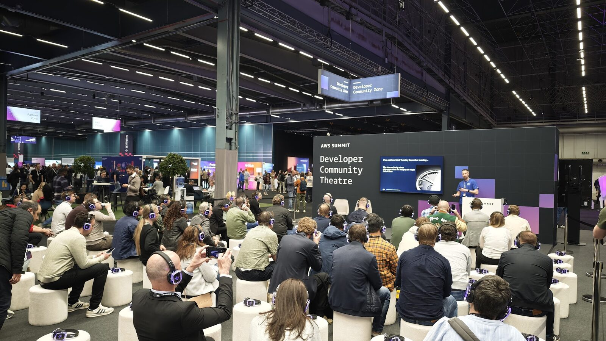

The key note was cool. They have these short movie clips that they really try
to make super epic and big. Playing on all strings with music, colours,
camera angels and inspiring messages. It is pretty cool, but also feels a
little bit try hard. How ever you can't help but feel inspired,
motivated and like you are part of something big. So I guess they get the
result they are aiming for.

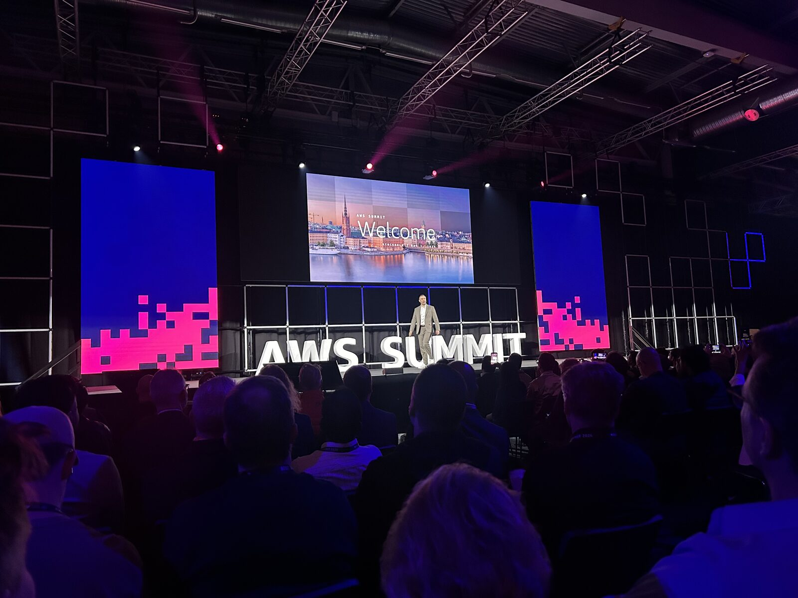

The key note speakers where Kellen O'Connor and Martin Elwin from AWS. And we
got to hear some really interesting customer stories from Ödgärd Andersson from
Zenseact and Siv Rosseland from DNB.

Mainly it was all about AI and how it changes everything. (I guess that could be
said about every presentation in the conference).

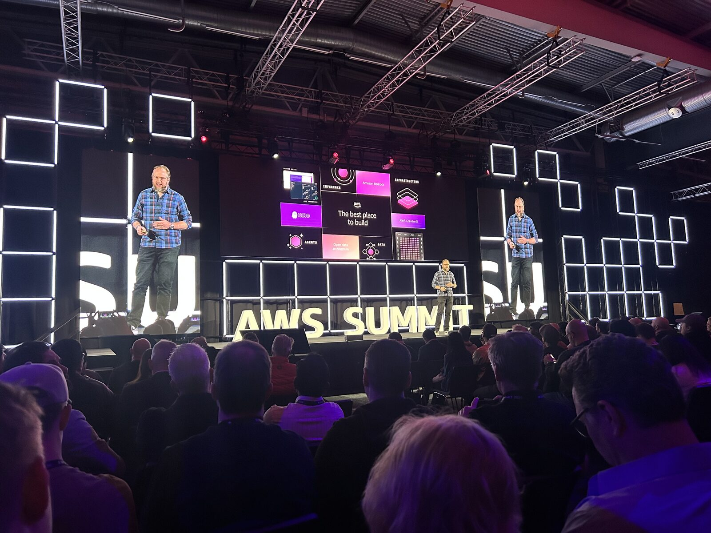

All around the main hall, there was refreshment stalls where you could grab
water and coffee. And at some points they served food as well. This was maybe
the only disappointing thing about the event. I think someone really messed up
when it came to planning the amount of food they needed for the lunch. According
to the program it was serving from 12-14. At 12:20 it was no more left. And
still long lines all over. I was lucky enough to get a chicken wrap from a
kiosk nearby before they also run out of food.

I went to a few presentations, they where, like the key note, about how a
company used AI and how AI has change they ways they work or how to introduce
AI into your work. I also did a workshop about AWS DevOps Agent, which I find
interesting. I have read about and it was interesting to finally do some
hands-on testing, which I actually have been meaning to do for a while.

I did not go to any chalk talks, which I regret, because everyone has told me
that that usually is one of the most interesting stuff at these events. I would
also have liked to see more of the presentations in the developer community
zone. I liked the presentations there better than the typical "Hi, at my
company we did this thing. Speaking of my company, wanna hear some more about
my company?"

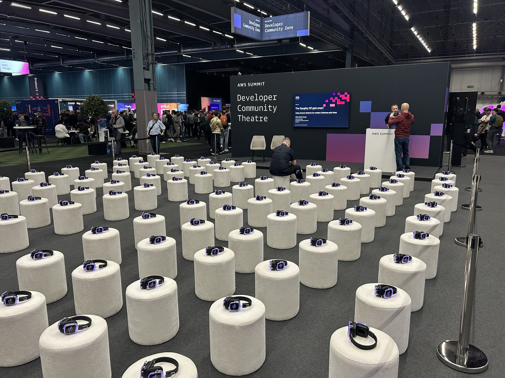

## Thoughts about future Summits or other tech conferences
Next time I go to a conference I will take more photos. I felt like I took a
lot of pictures, but I really didn't. I knew I was going to write a post about
going to the event, still I postponed writing about it. Next time I'll write
summaries of everything I experience right away. Because trying to recall
everything that happened was way harder than I thought it would be.

I will prepare more. I knew this before I got there, but at the same time I
choose to go into it a bit blind and just go with the flow once there. I blame
the presentation I did at the User Group. I decided to just focus on that, and
when that was completed, then I could start thinking about the summit.

The next time I'll try to get a better overview of all the presentations and
choose more carefully what to go to. I will also, as I mentioned earlier, spend
more time at the developer community zone. I met a lot of nice and interesting
people there, and regret not getting in contact earlier.

### Community Builder dinner
After the summit, AWS hosted a dinner for the AWS Community Builders, User
Group Leaders, Ambassadors and Heroes. This might have been the highlight for
me this trip. Hanging out with the community, talking and having fun. I've
always seen people everywhere online, in all types of communities, talk about
how the best part is the community and the people. Not really getting it. But I
guess I understand it better now.

I know I had never ended up speaking at the pre-summit event if it wasn't for
hanging out with the community. Showing up at User Groups, going out after, and
talking to people. Networking without realizing.

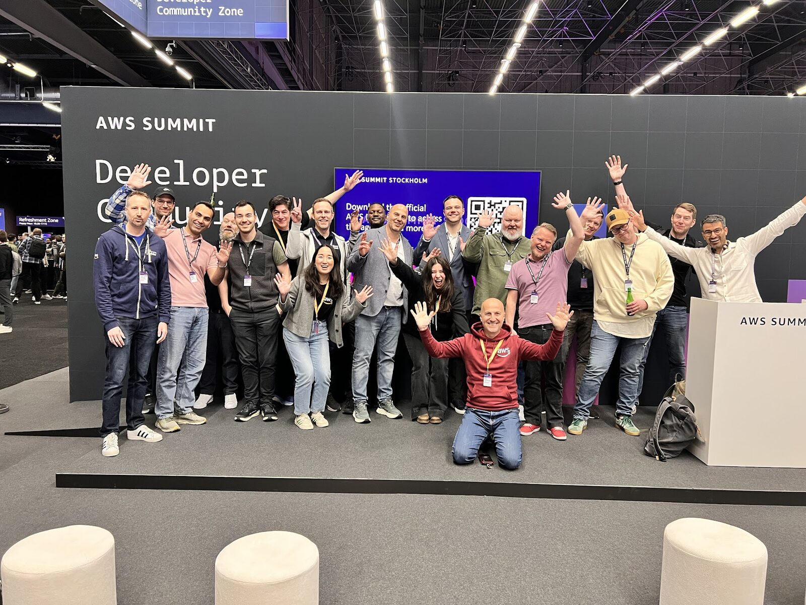

## Conclusion
I would absolutely recommend going to an AWS Summit if you have the chance. Also
User Group meetups. I have learned that AI is still the most popular and
interesting thing that's happening. After all that AI-talk, I got to admit that
the first thing I did when I got back home was to vibe code, or through spec
driven development, create a web app from start to a working version running
online.

It feels good to have my first conference under my belt and, with that
experience, be better prepared to get the most out of the next one I attend.
I’m fortunate to work for a company that values continuous learning and
professional development and is willing to invest in its employees by sending
them to events like this. I’m grateful for the opportunity and already looking
forward to the next conference.
