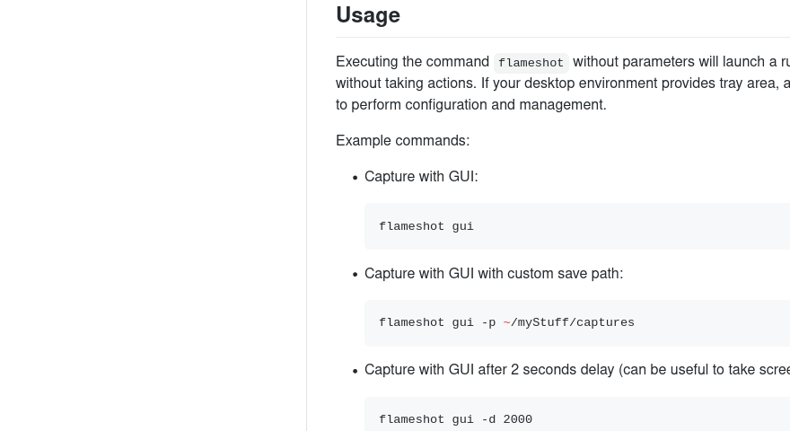
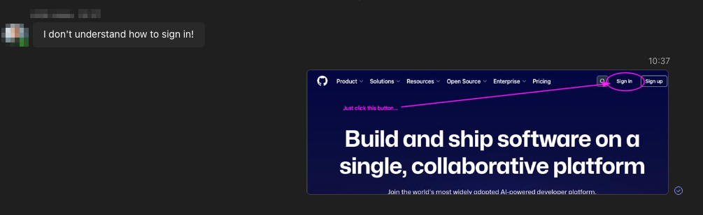
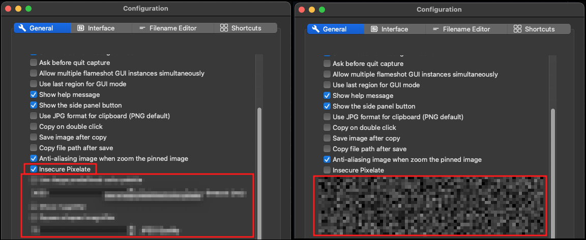
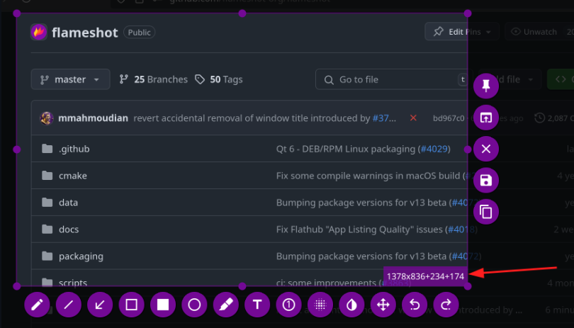
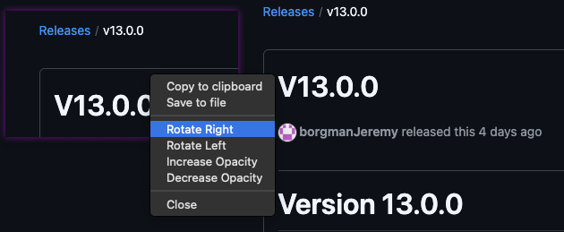
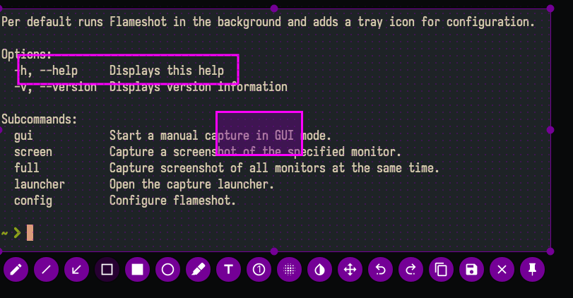
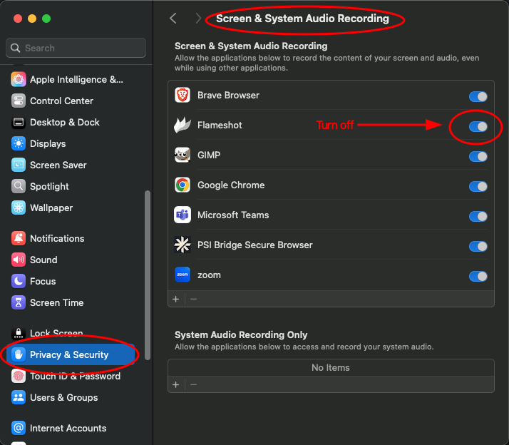

tl;dr: Use Flameshot to take screenshots and edit them directly before saving to a file or to the clipboard. Download at [flameshot.org/download](https://flameshot.org/#download).

## Flameshot
Flameshot is my favorite screenshot app and I have been using it for years.
I've shown this app to lots of co-workers over the years since I find it super
practical. I have to admit that windows and mac has stepped up their
screenshot tools the last years, so everything isn't as unique as it was the
first time i tried out Flameshot. Still I find it the best tool for taking
screenshots and I use it daily.

Last week Flameshot got a new update after 3 years (last was in June 2022). So
I thought this was the perfect time to introduce my favorite screenshot tool
and talk about some of the new changes.

## How does it work?
So with Flameshot you press a hotkey to trigger a screenshot. Then you mark the
part of the screen you want to capture. The cool part is all the tools you have
at your disposal to draw, write, mark, pixelate,  etc..


I find this perfect for sending a quick screenshot to a co-worker to show something. Adding text and an arrow or circling what ever I'm trying to show make it super practical.


## Command Line Interface
Flameshot comes with a CLI. With this you can programmatically take screenshots.
This is great for automating screenshots in scripts or integrating it into
workflows. On Linux it is very fast and efficient to be able to specify the
screenshot command and bind it to a shortcut. You could for example have
different shortcuts for taking screenshot saving them in specific directories.

To take a screenshot from the CLI, simply run the command ``flameshot gui`` in
the terminal. Add the ``--help`` flag to see the different options.
```bash
flameshot gui --help
Usage: flameshot gui [gui-options]

Per default runs Flameshot in the background and adds a tray icon for configuration.

Options:
  -p, --path <path>             Existing directory or new file to save to
  -c, --clipboard               Save the capture to the clipboard
  -d, --delay <milliseconds>    Delay time in milliseconds
  --region <WxH+X+Y or string>  Screenshot region to select
  --last-region                 Repeat screenshot with previously selected region
  -r, --raw                     Print raw PNG capture
  -g, --print-geometry          Print geometry of the selection in the format WxH+X+Y. Does nothing if raw is specified
  -u, --upload                  Upload screenshot
  --pin                         Pin the capture to the screen
  -s, --accept-on-select        Accept capture as soon as a selection is made
  -h, --help                    Displays this help
```


## The new update v13.0.0


To see all changes checkout the [release notes](https://github.com/flameshot-org/flameshot/releases/tag/v13.0.0), but here are some of the most interesting changes in this update.

**New Features:**
- The pixelation feature has been replaced with a new "secure" implementation that only uses pixels outside of the area to be redacted.

- Screenshot dimensions are now interactively shown in the capture widget.

- Pinned images can now be rotated and made transparent.

- A grid can be enabled and resized to have annotations snap to grid


**Changes:**
- The tabs in the configuration has been reordered by importance to users.
- Flameshot will exit with exit code 1 if canceled (Used to be 0).
- Imgur uploader is disabled by default.
- Snap packages are likely to be dropped.

## How to fix error on macOS after update
After I upgraded to version 13, when trying to create a screenshot everything would disappear from the screen and I would only see my desktop background.

This an mac specific error that occurs since the app no longer recognizes its permissions to capture the screen.

To fix this, simply remove the old permissions, restart your system, run Flameshot and give the permissions again when prompted.


## Conclusion
Flameshot is an awesome free and open source software tool and I highly recommend using it. [Download](https://flameshot.org/#download) it today!
