**tl;dr:** I created an app through spec driven development. The result was
better than I expected. I now have a cool and fully functional flashcard app
for practicing with spaced repetition.

## Sometimes you need an app
Have you ever wanted to do something on your phone and though "surely there is
an app for that"? And of course there is, BUT the app either has tons of
annoying adds, or you have to pay a one time price or even worse, a
subscription.

Well in today's world with generative AI, one shouldn't have to buy an app. If
you want something, you can just create it yourself, with the help of AI. At
least that was my thought. And I tried it, and was surprised by the result.

This is the story of how I had a need, found a great app, but didn't want to
pay $30. So I build my own app with Claude code and hosted it with the
help of AWS. It only cost me a weekend of fun in front of the computer and is
hosted serverless on AWS for free, since it's within the free tier.

## The motivation

So I have been using GenAI for a while now. And recently done a bit of spec
driven development, which I actually find kinda fun. But so far I haven't
really had a good motivation for creating something. With AI it is also very
easy to become too lazy. Writing short, bad prompts, because you don't even
really know what it is you want.

The passed week I suddenly got back into wanting to learn a language. Not a
programming language, but a spoken language. After talking about vacation
destinations, watching the Aristocats with the kids and following the tour de
France every day on TV, French suddenly seemed like the coolest language ever.

So I did what every normal person does in that situation. I downloaded
Duolingo. I also look at a ton of "learn french" content on YouTube. There,
everyone hates on Duolingo, saying it is an addictive game, that is fun to
play, but can't teach you how to speak a language.

So I had to do it the hard way (while also playing Duolingo daily of course),
looking at videos on YouTube, reading and writing and practicing speaking out
loud.

And when learning a language, you need to build your vocabulary. And how do you
do that? With flashcards. But this is 2026 and no one use pen and paper
anymore. You use an app. So I did a search for flashcards apps and found a lot
of promising apps. BUT none of the ones I wanted were free or without adds. I
considered just using apple notes, or fall back to physical paper. But I wanted
something that would be easy to use, at any time. And something I would want to
use.

Maybe just create it myself? I mean its it only a key/value database with
words. Show the key, click, and show the value. Should only take me an hour.
Maybe a week to turn it into an web app with a half decent GUI. I have looked
for new project for learning Rust or improving my Go... Maybe see if python is as
easy as they say and try to write it in that?

No! I already have a project. I want to practice french, not Rust. I wanted
something easier than just writing down words on a paper. Weeks of programming
Rust is not the answer here, AI is.

## Programming with AI

So the way I program with AI now days is by using Claude code (Sonnet 5). The
first thing I did was to create a plan. So I could use Claude Code as an agentic
coding assistant, and run the project spec-driven. I first wrote out my idea.
Describing the MVP as detailed as I could. That meant the functionality, the
stack and the design. Telling Claude to setup markdown files to use as
persistent external memory.

My first prompt was something like this: 
> I want to build a flashcard app. It should be a key value system, showing
cards with the key, then when clicked it should show the value. It is for
learning a language. So an English on one side and french on the other. Ex.
"Hello" on the front, "Bonjour" on the back. I want to add gamification after
we got a working MVP. So experience, gold, achievements, daily quests,
lootboxes etc. Set up tasks and I will edit and add more later. I
would like the backend to be written in python using FastApi and the frontend
should be a react app. I want the app to run serverless in AWS using lambda,
DynamoDB, API GW, S3 and CloudFront. I want this to be spec driven programming,
so create a claude.md with instructions on how to work, a spec.md with
information about the spec and a task.md with all the tasks divided in phases.
Everything created in the app should be a task. And when ever completing tasks
I would like you to do the task, commit and push to github and deploy, then I
will do a manual review and tell you to continue to the next phase. Before
doing anything please ask me questions to clarify anything unclear.

Usually I am pretty strict on reading everything Claude suggests, always making
sure I understand everything in the code before accepting it. But in this
project writing good code wasn't the goal. The goal was to get a working app,
and see how easy it would be to create it using prompts only. So it didn't take
long before I turned on God mode, allowing Claude to read and write without
approval.
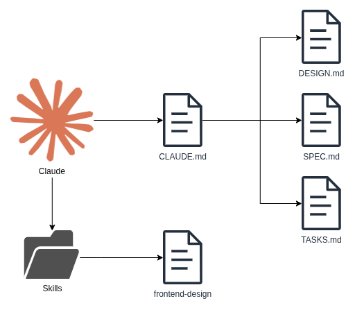
*(Spoiler alert: I added the frontend-design skill later)*

After some more prompting, I ended up first creating a version that could run
locally on my machine, using SQLite as a db. I also had some problems running
the app on my phone on the local network, but Claude said it was because of the
way the frontend was running locally and I prompted it to create a docker image
instead, which fix the issue.
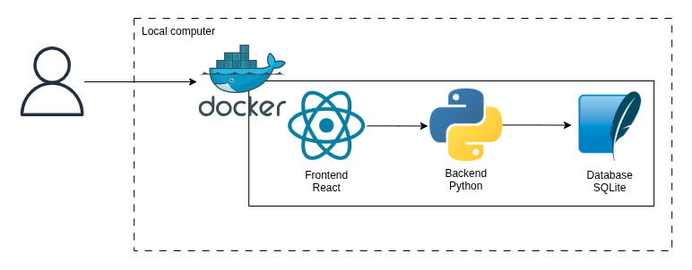

And after a short while I had a running MVP: 

I could add cards
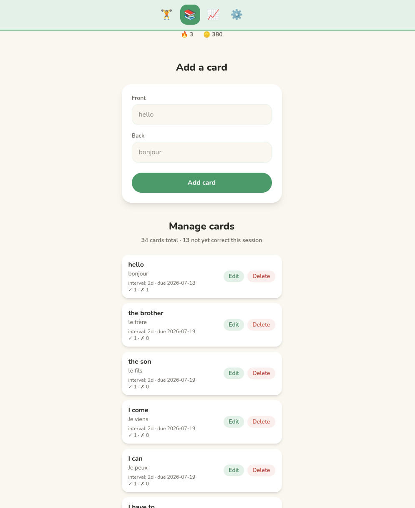

Practice them
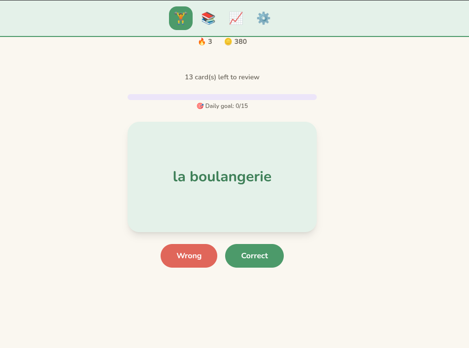

See my stats
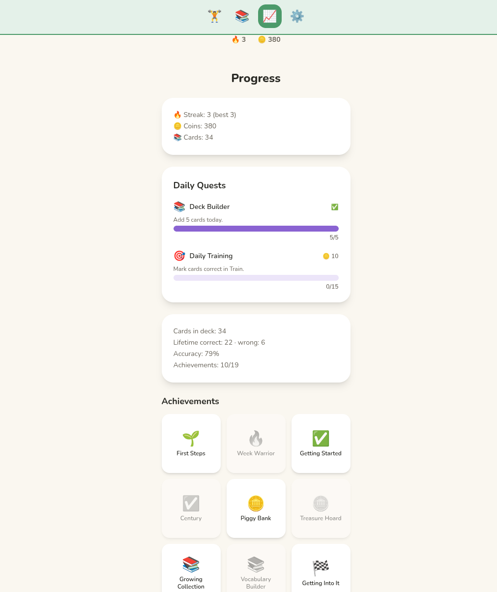

And reset for testing purposes
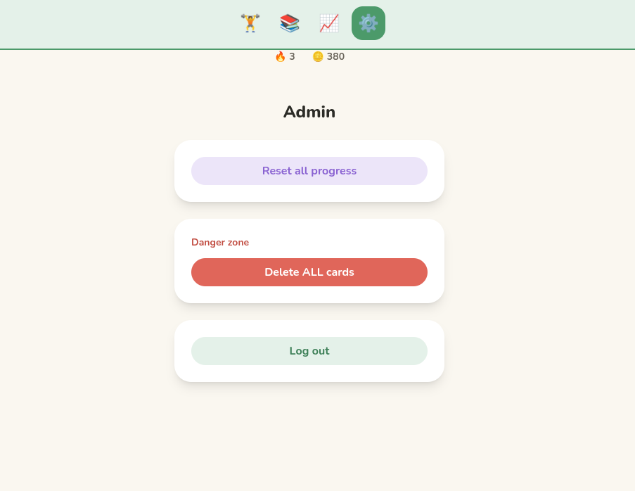

I had added coins and achievements, but not yet anything to spend the currency
on. I had also added a streak counter and daily quests.

This felt like a complete PoC and I prompted Claude to migrate it to AWS.
Making it accessible for anyone. It first wanted to just reuse the docker image
using ECS and Fargate and use RDS as a DB. I think this plan would have costed
me around $30-$40 a month. So I promptly prompted a prompt, telling it wrap the
python code with Mangum, which as far as I knew was the way of creating a
python API with Lambda. And use Lambda, API Gateway and DynamoDB as a database.
I told it I didn't mind loosing all the data I had so far.

Claude agreed that this solution, although a tiny bit more work,
would be better since $0 is less than $40. The possibilities with GenAI are
pretty amazing, but I still get frustrated by how stupid it can seem when I
don't give it enough information. It is so easy to forget that it only has the
context it has. Not the same as a human.

I told Claude to start using version control, which I actually hadn't used
that far. Then to use infrastructure as code to create all the AWS resources
using Terraform. I also wanted to let others try my app, so I added a task for
using Cognito for login and do the necessary updates to the backend and
databases to support multiple users.

The last time I used Claude to create a project with Cognito login, I had it
create a user for me. But after logging in, no API calls would work. The
problem was that I was prompted to create a new password after logging in the
first time. But there was no user interface to do it. So I couldn't authorize
any API calls.

This time however, I had no problems. Throughout this whole project I actually
have had no bugs that Claude hasn't been able to fix by it self. I'm not sure
if this is because I have gotten better at prompting, expecting possible
problems and been precise enough to avoid them. Or if the models now are just
that much better. Maybe a bit of both?
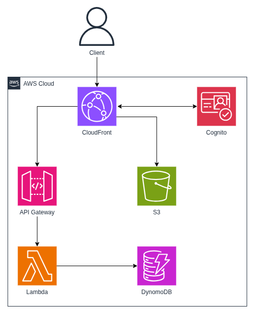

## Extend AI with agent Skills
Super proud of my creation, I added cards for my, so far, small french vocab.
And the next day I proudly showed of my app to a friend. The first feedback I
got, after a 2 second review was: "this is looks really bad. The UI design
screams made by AI. You should use the anthropic frontend-design skill". And that
would become, as much as I'm sick of the expression (because ChatGPT says it
all the time), the real game changer.

I added the skill. Wrote a short description of how I wanted the app to look. I
gave very few instructions. Just what pages I wanted and what they should
include, and that I wanted the menu bar at the bottom.

I was very pleased with the result. I spent the day doing whatever I was doing
that day, but whenever I came up with a new design or feature ideas for the
flashcards app, I wrote them down on my phone. And then, when the evening came,
I had a fairly comprehensive list of things and changes I wanted.

I created a big prompt adding inn all the notes from throughout the day. Told
Claude to create a plan only, show me, then proceed. I got a 8 phased plan with
multiple steps per phase. Turned on "yes-to-all", and told Claude to let me
manually test between each phase before he continued. The rules was already to
commit, push and deploy after each phase. And I had also told it earlier that
*"this is a personal project, where we are cowboys and do our testing in prod."*

Then the rest of the evening I just popped down to my office every once in a
while and checked the progress, tested the newly added features on my phone,
then told it to keep going. And by the end of the evening, before going to bed,
I had a result I was very satisfied with.

## The result
Flashcards is an app for creating flashcards and practicing them. You can add a
label to a card creating a separate deck to make it possible to filter cards.
You will earn XP and achievements as well as coins and lootboxes for training.
There is also an extra practice feature where you can try out pre-built decks
for extra practice as well as all your added cards or labeled decks.

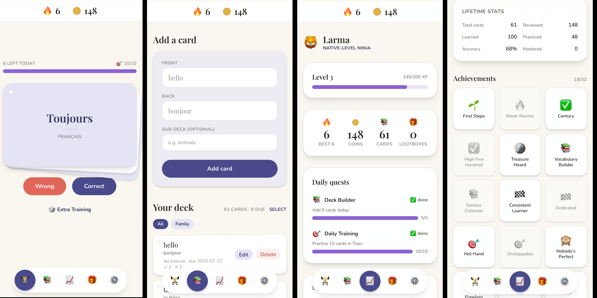

**Training:** Here you can practice due cards as well as do extra training with self-created or pre-built decks.

**Deck:** This is where you add cards. You can also label them to create themes decks to be used in extra training.

**Profile:** This is your profile page where you see your experience, stats, quest progress, and achievements.
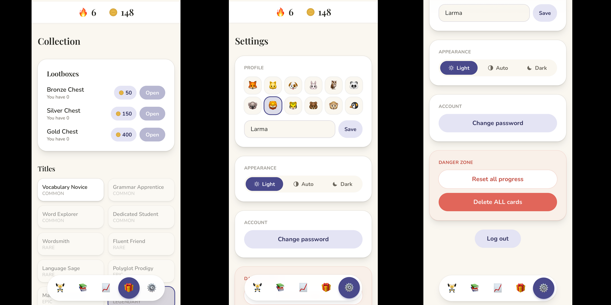
**Collection:** Here you can buy and open lootboxes. Here you can see and select the titles and colour themes unlocked from lootboxes.

**System settings:** Here you can choose a username and avatar. Chose appearance (light/dark mode),
change password, reset progress, delete all cards or log out.

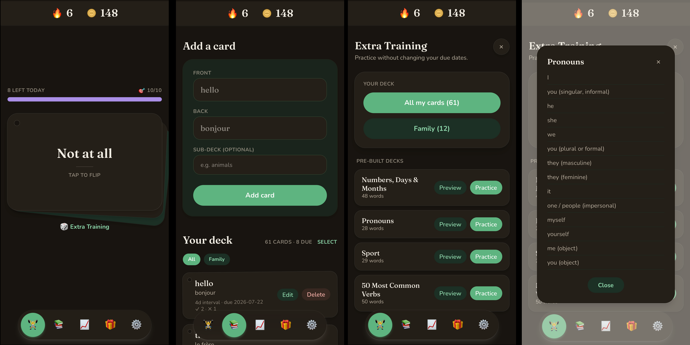
**Dark mode:** You can switch between light and dark appearance.

## The future of the app
For now I think bug fixes and minor changes are the only thing I need to
focus on the next couple of days while using the app. As of now, it has all the
features I can think of that I would need, as well as gamification, making it a
bit more fun to use.

And as for the future of this app. I have a lot more ideas for the gamification
part, so I will continue to write them down and implement them sometime when I
feel like it in the future. The app was firstly created just for me to write
down flashcards, and at the same time test out how well spec-driven development
with sonnet 5 would work with me as a prompter.

One thing that I would really like to get done though, is to create custom
icons. For now I told Claude only to use emojis for everything, which looks
pretty horrible. I also really want to add sounds, since that is great for
feedback and also to stimulate the brain giving me that sweet sweet dopamine so
I will practice more.

## Conclusion
My thoughts after finishing the PoC, and building a fully functional version 1.0 of an app with GenAI, using
spec-driven development with my agentic AI assistant, is that this was as easy
as I though it would be, but the result was way better than I would have
expected. The app is pretty slow, so I think there is a lot of improvements
that could be done to the code. The whole backend is in one big lambda
function, which is a pretty awful design choice and cause latency. I know.

But the goal here wasn't to create good code or write a great app. It was to
see how easy you could create an app that will get the job done, without
needing to spend time writing code.

On one hand this feel terrible, I outsourced the thing I love to do, which is
programming, to AI, which is something I'm actually pretty sceptical to. But on
the other hand I got a working app, that actually works. And to be honest, it
looks way better than I would have been able to designed myself, being a
backend developer, not interested in frontend, colours or UI/UX.

A note is that my background in programming, and knowing a lot about AWS, and
working with this every day, helps me creating way better prompts and
understanding any questions and suggestions Claude might have, compared to
someone who doesn't know anything about that stuff. I feel that the best
working mentality, is to think of using AI as just another abstraction layer.
As python is for C, and C is for assembly etc.

I think the cool take away from this project is that I needed a tool, and got
it, custom made, the way I wanted it, instead of buying something I might not
even like that much. And after 10 days, I still use it every day.

Being pro FOSS and a Linux user, I like the whole DIY-mentality. But I also see
the problem with everyone needing to create their own version, just because
they can. Like the flood of Linux distros available. Then again, the more tools
and apps built, the better they will become. At least I hope so.

## What could I have done different
If this was a project I wanted to really stick with and turn into a real app, I
would use this as a proof of concept and recreate it from scratch. Still using
AI, but writing some code myself. Creating templates and stricter rules for the
architecture and backend design. Spending more time on good prompts after
having fully decided on the architecture. I would also choose another backend
language than python. And I would focus on better caching and setting up the
API to be more efficient, using multiple lambda functions. I'd also add on more
security measures, like rate limiting and throttling. I'll probably take a look
at that security bit before posting this to be honest. Just in case.

I would also have created more agents. One for frontend, one for backend, one
for design, one project manager. Maybe more? And I would have treated them all
as my team of stupid fast working juniors with unlimited knowledge. Always
remembering that the prompts never can be too precise.

In the future I'd like to experiment with this way of doing a project, using
AWS bedrock AgentCore, which is created for this exactly.
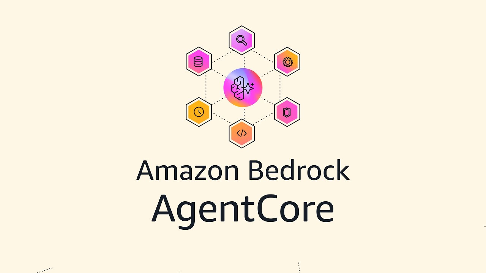

## Call to action
What is an app you need or want but don't bother buying? Why not try to create
it yourself with GenAI and spec driven programming? Have fun and let me know
how it goes! And feel free steal my app and make it better. The code is open
source and available on [github.com/l4rma/flashcards](https://github.com/l4rma/flashcards),
with all the markdown files used to instruct Claude included.
