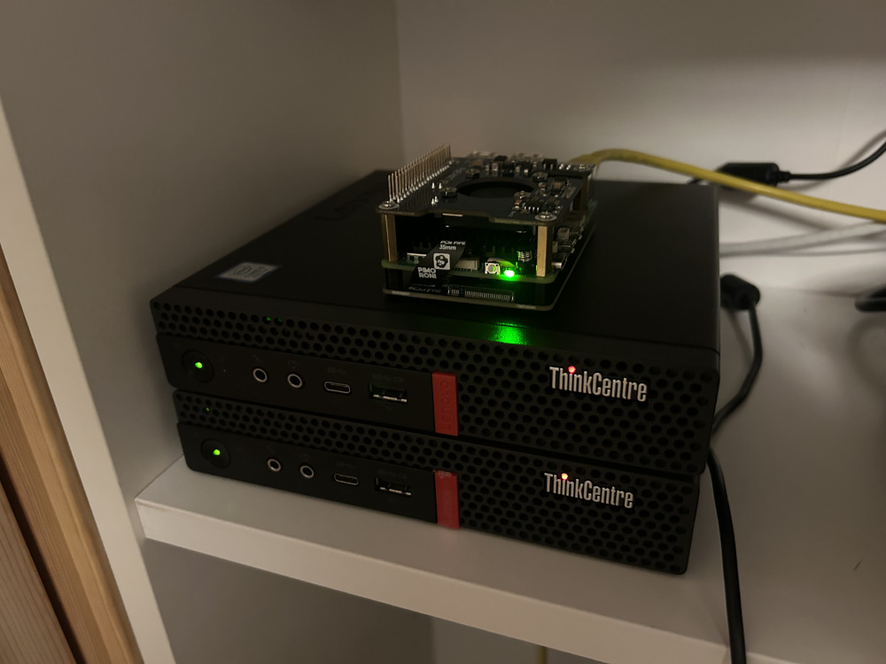
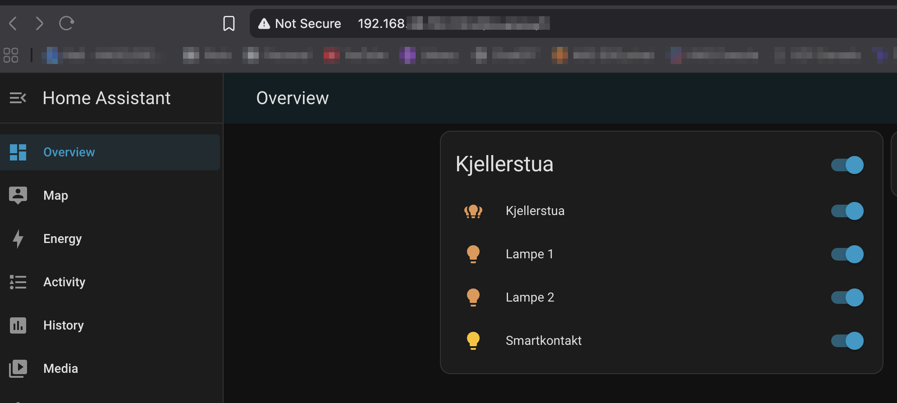

## My homelab is growing
In December my Christmas gift to my self was a Raspberry Pi 5 and two Lenovo
Thinkcenter m720q. Yes, I guess I was nice this year. It was going to be three
or four Raspberry Pi 5s, but I change my mind after ordering one Pi and ended
up with a mix. Oh well, shouldn't matter too much.


The reason I bought this was to finally set up a Kubernetes cluster in my
homelab on bare metal. I have done some experimenting with setting up a K8s
cluster in Proxmox. But I didn't want to have a combined NAS, hyperscaler AND
Kubernetes cluster all in one physical machine. And have been wanting to create
a Raspberry Pi cluster for a long time. And in my humble opinion, bare
metal is just cooler than VMs.

So this will be the first post in a series documenting my learning while I
expand and evolve my homelab Kubernetes cluster. I will go through my current
plan (it will most certainly change along the way), and the first step which I
have already completed.

## The plan
Ok, so I wanna do this right from the start. Right being trying to follow best
practice and using GitOps principles. Building my cluster as if I was my own
platform team building a platform for me, being my own development team as well.
Me, myself and I. So the goal here isn't to make an app available on my server.
Then I'd just ``./my-app``. The goal is to learn about Kubernetes by doing, and
learning by sharing. Getting a better overview and insight in the world of
Kubernetes and platform engineering.

Here is my current **10 step plan** on how I want to set up my cluster:

0. **Foundation**
    - Install OS on three+ computers
    - Setup K8s with kubeadm
    - Deploy something
    - Bonus: Automation with USB OS autoinstall and Ansible to setup Kubernetes
    - **Goal:** Have app connecting to persistent storage from NAS
1. **Introduce GitOps**
    - Install Flux
    - Structure a K8s-repository
    - **Goal:** Commit change and see flux reconcile
2. **Network**
    - Setup ingress (with nginx or traefik)
    - Setup local DNS
    - Bonus: Migrate to Gateway API. Istio?
    - **Goal:** Access app through domain name (http)
3. **Certificate and Secrets**
    - Setup Cert-Manager
    - Setup External-Secret to store AWS credentials
    - Bonus: Use OIDC
    - **Goal:** Access app through owned domain (https)
4. **Observability**
    - Setup Prometheus and Grafana
    - Setup alerts
    - Bonus: Logging. Loki?
    - **Goal:** Dashboard. Monitor: Nodes, pods, storage, ingress, apps
5. **Policies**
    - Kyverno?
    - Setup some guardrails
    - **Goal:** TBD
6. **Application standardization**
    - Define what should be in each app dir
    - Health checks and defaults (ingress, requests, limits, deployment strategies)
    - **Goal:** Documentation on how to deploy a new app in cluster
7. **Cloud Provisioning**
    - Install Crossplane
    - Add AWS Provider
    - Bonus: Compositions
    - **Goal:** Run my own serverless app in AWS, provisioned from Kubernetes
8. **Backups and disaster recovery**
    - Backup in AWS through Crossplane
    - Create DR documentation
    - **Goal:** Format all three nodes and rebuild cluster (timed).
9. **Internal Developer Portal (IDP)**
    - Documentation for dev to setup resources
    - Bonus: GUI
    - **Goal:** TBD

## Step 0: Building a foundation
Like I mentioned I have already setup Kubernetes a couple of times in Proxmox.
After setting up my new computers, giving them static IPs in my home network,
I was ready for the bare metal experience.

I chose to setup Kubernetes with kubeadm. This is also what I did on Proxmox
earlier. My only problem while setting everything up was related to having
overlapping IPs in my home network and in the Kubernetes network. In stead of
fixing it I just swapped out Calico for Flannel. At this time I don't really
know what the difference was between the two, but according to AI, Flannel was
supposed to be pretty simple just to get things working. A draw back is the
lack of support for network policies for pod to pod communication. But that can
be dealt with later. I'll consider changing network plugin again when I get to
step 5, securing the cluster.

Usually when I try out new stuff like this I like to follow a guide/tutorial and
just do as they do. I couldn't find a guide I really liked, so I ended up doing
a combination of following a guide on Youtube, and at the same time double
check everything with the Kubernetes documentation. It was mostly the same, and
it felt good to at least almost install something only following the
documentation.

After adding each node to the cluster with the join-command given when initializing kubeadm, I could run ``kubectl get nodes`` and see all nodes as ready
```bash
larma@lenovo1:~$ k get nodes
NAME      STATUS   ROLES           AGE   VERSION
lenovo1   Ready    control-plane   10m   v1.33.2
lenovo2   Ready    <none>          10m   v1.33.2
pi5       Ready    <none>          10m   v1.33.2
```
Don't mind the old version. I want experience upgrading the cluster in the
future. So this is perfect. After confirming everything working with deploying
an nginx image. ``kubectl create deployment my-nginx --image=nginx``. I was
ready to achieve my first goal. I have a NAS running in my homelab, and I want
to use it to provide storage for apps running in my cluster.

## Running my first app
I had home assistant running on an old Raspberry Pi. This seemed like a perfect
first app to migrate over to my newly established Kubernetes cluster. Home
assistant can run in a container and it needs persistent storage to store the
config. The first thing I did was copying the home assistant config from the Pi
over to my NAS. Then I needed a way to access the config from the cluster.

## Persistent storage
I don't want to use local storage saving the config on the node where the pod is
running. This would break everything if the pod changed node for some reason.
Like if a node went down or the pod crashes and gets rescheduled on another
node. So the way to go is using Persistent Volumes and Persistent Volume Claims.

The way this works in Kubernetes is that you first create a PV. This defines a
storage. In my case my NAS. To reach the NAS I created a NFS on the NAS and
mounted this on all the nodes. Then I can reference the mounting point in the
PV manifest at ``spec.nfs.path``.
```yaml
apiVersion: v1
kind: PersistentVolume
metadata:
  name: home-assistant-pv
spec:
  capacity:
    storage: 512Mi
  accessModes:
    - ReadWriteOnce
  persistentVolumeReclaimPolicy: Retain
  storageClassName: ""
  nfs:
    server: <NAS IP address>
    path: /mnt/path/in/my/NAS/home-assistant
```

The I can claim part of this storage for an app by creating a PVC.
```yaml
apiVersion: v1
kind: PersistentVolumeClaim
metadata:
  name: home-assistant-pvc
  labels:
    app: home-assistant
spec:
  accessModes:
    - ReadWriteOnce
  storageClassName: ""
  resources:
    requests:
      storage: 512Mi
```

## Deployment
The config should now be available for the home assistant pod. Now I just
needed to deploy home assistant on the cluster. I created a deployment manifest
using the home assistant image. Notice how the PVC ``metadata.name`` is
referenced in the deployment to set the storage location for the pod at
``spec.template.spec.volumes.persistentVolumeClaim.claimName``. Then that
volume is referenced in the container and mounted at
``spec.template.spec.containers.volumeMounts``.
```yaml
apiVersion: apps/v1
kind: Deployment
metadata:
  name: home-assistant
  labels:
    app: home-assistant
spec:
  replicas: 1
  selector:
    matchLabels:
      app: home-assistant
  template:
    metadata:
      labels:
        app: home-assistant
    spec:
      containers:
        - name: home-assistant
          image: "ghcr.io/home-assistant/home-assistant:stable"
          securityContext:
            privileged: true
          ports:
            - containerPort: 8123
          volumeMounts:
            - mountPath: /config
              name: home-assistant-config-volume
            - mountPath: /etc/localtime
              name: home-assistant-time-volume
              readOnly: true
      hostNetwork: true
      volumes:
        - name: home-assistant-config-volume
          persistentVolumeClaim:
            claimName: home-assistant-pvc
        - name: home-assistant-time-volume
          persistentVolumeClaim:
            claimName: home-assistant-time-pvc
```

Now I can run ``kubectl get pod -n home-assistant`` and see that every thing is
running like it should. 
```
NAME                              READY   STATUS    RESTARTS   AGE
home-assistant-57b94986b4-hhnkn   1/1     Running   0          2d
```
(Except I didn't actually put it in its own namespace. I will fix this later).

Last step for now is accessing home-assistant in a browser on my local network
and confirming that I can log into my account and find all my light bulbs still
available.

## Service
To access Home Assistant a simple NodePort service will do for now as a PoC until I get ingress up and running.
I created a service manifest and applied it:
```yaml
apiVersion: v1
kind: Service
metadata:
  name: home-assistant-svc
  labels:
    app: home-assistant
spec:
  type: NodePort
  ports:
    - port: 8123
      targetPort: 8123
      nodePort: 31234
      name: home-assistant-web
  selector:
    app: home-assistant
```

Now for the moment of truth. Let's navigate over to `<IP-address>:31234` and see what we can find.


Success! My user account was there and I could finally turn the lights back on in my basement.

## What would I have done different?
Setting up a Kubernetes cluster at home has been something I have wanted to do
for a long time. And with only a few hours available in the week to actually
work on this, I find it really difficult to stay patient and do things slowly.
When I'm done with one step, the only thing I want to do is keep going.

Looking back I would have liked to go for a "one step back, two steps forward"
strategy. Every time I complete a step I should go back and improve on it. For
example after installing the OS on each computer. The thing I wanted to do (but
skipped) was creating an autoinstaller USB and reinstall the OS on each node
using that. This way I could really break my cluster and everything and just
format the disks and reinstall the OS super fast without needing to manually
select host names and languages and everything else you need to enter when
installing an operating system.

And after installing kubeadm etc getting the cluster up and running. I actually
wanted to delete everything and setup an Ansible playbook and reinstall
Kubernetes using that. That way I could go from formatted computers to a ready
to use Kubernetes cluster in minutes.

Now, for each new step I take I need to go yet another step back if I want to
get this done. I think when I get a nice GitOps workflow it should be easier to
restart with formatted computers since all my configurations and manifests will
be version controlled and automatically reconciled. And as you can tell by my
plan I want to run a disaster recovery in the future so this is something I
will do at some point.

## Conclusion
I am really happy with the results so far. I now have a real Kubernetes cluster
running on bare metal at home with home assistant deployed using persistent
storage on my NAS. I am able to reach Home Assistant from the node IP and
control my light bulbs from my phone. I hope you enjoyed reading about my
journey and maybe learned something as well.

I for one can't wait to continue on this adventure. 2026, the year of
Kubernetes. In the [next post](/blog/k8s-part1-gitops) I will introduce GitOps which will be a game
changer! See you then.

