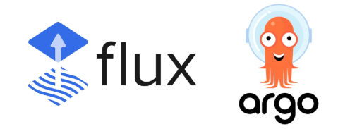
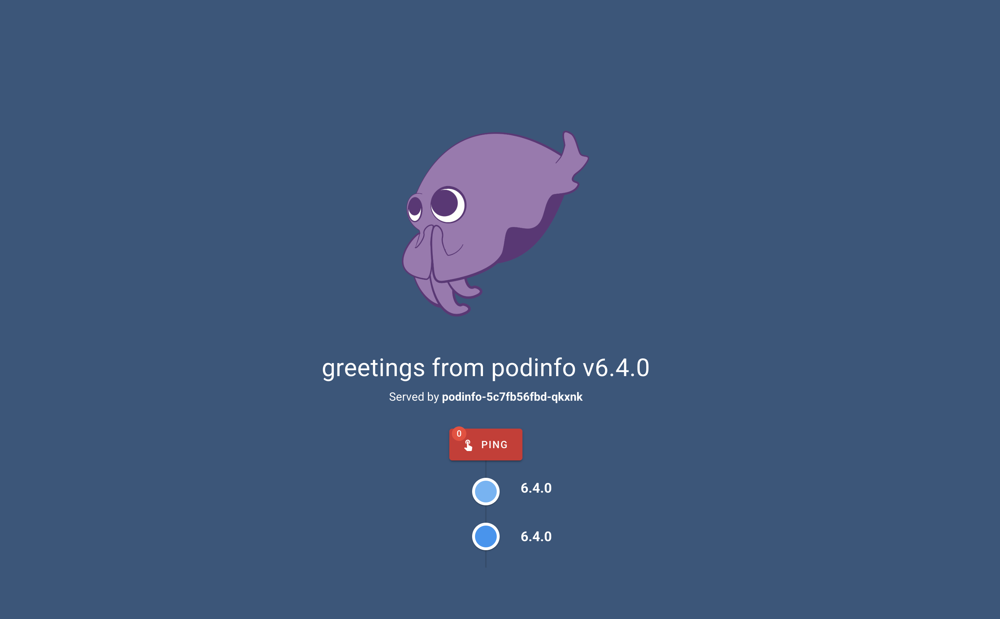
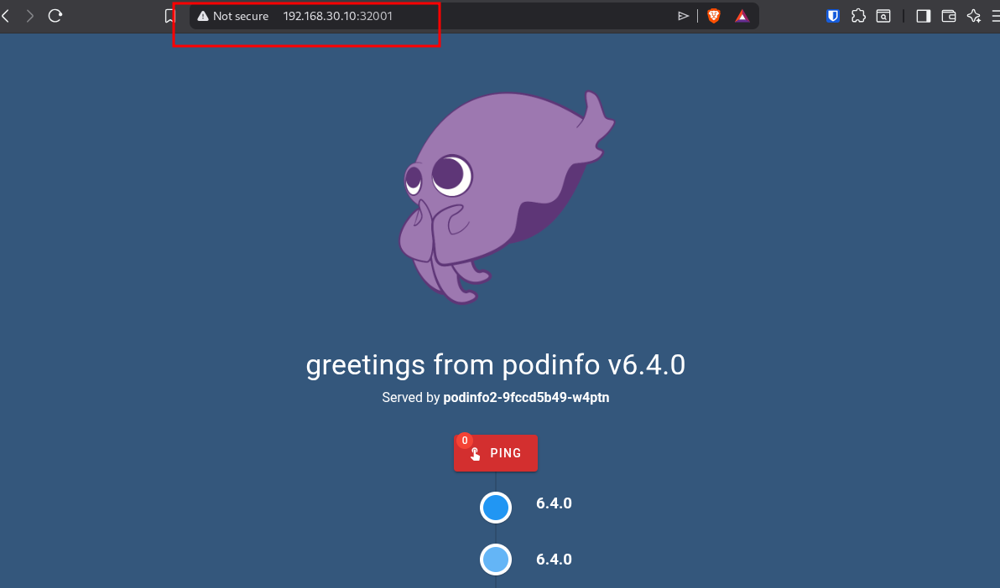

## What is GitOps?
GitOps? So... Using Git to Operate? Git runs operations? Like CI/CD pipelines?
Well, yeah, kinda. In short GitOps is using GitHub or any other version
control system to act as a source of truth. Then when ever a change is made to
Git, it should be reflected in the Kubernetes cluster.

In practice for this means that I will have a repository on GitHub, and when
ever I push to main, there will be a system living in my cluster watching this
repository, reconciling the resources in the cluster according to what ever is
in the repository.

So another way to see it is that in contrast to pushing changes into the
cluster from outside. There is a service pulling changes into the cluster from
inside. Why is this good? Because this means that we don't need to give any
outside services access to our cluster, dragging who knows what into our safe
environment.

## Step 1: Deploy through Git with GitOps
[Last post](/blog/k8s-part0) I managed to set up my Kubernetes cluster and run an application.
How ever, if I want to do this the right way, I shouldn't apply my resources
manually. So far I have deployed apps imperatively ``kubectl create deployment
nginx --image=nginx``, and declaratively ``kubectl apply -f
home-assistant.yaml``. The declarative method is good since it leaves us with
files that could be edited and reapplied as wanted. How ever an even better way
of doing it is running a service that can look at a repository with all our
YAML-files and just reconcile when ever something changes.

To do this I have found there are two contenders. ArgoCD and FluxCD. Without
looking into any of them my impression is that ArgoCD has a GUI and Flux does not. So
therefor I'm pulled towards Flux. How ever, I think I should try to find out at
lease a bit more about them both before choosing.

## Flux vs Argo


Ok, after looking into the differences between Argo and Flux it seem like my
first impression was enough to make a choice. In short, Argo gives more
quality of life for you developers to check out whats going on in the cluster
without needing to know too much Kubernetes. You could also argue that a
graphical user interface would make troubleshooting easier when ever there is
problems.

How ever I don't mind needing to know more Kubernetes, that's kinda why I am
doing this whole thing. And I don't want to spend time getting to know a GUI
right now. Maybe I'll look into ArgoCD later. Yes, I most definitively will, but
for now I choose Flux.

## Structuring the repository
Before going into how to install Flux, let's take a look at how to structure
the repository. As far as I know you mainly have a mono repo, putting all your
configurations in one repository, or a poly repo where you split it up in
multiple repositories. The latter would be needed for large enterprises that
want to split up the configuration for the developer teams and the platform
team. I would like to try poly repo to replicate the big enterprise feeling, but
it also seem a bit unnecessary for now.

Looking at the FluxCD documentation for [repository structure](https://fluxcd.io/flux/guides/repository-structure/)
how you want to set up your mono repo is by splitting the configuration in to
three parts: Apps, Clusters and Infrastructure.
```bash
$ tree -a -L 1
.
├── .git
├── apps
├── clusters
├── infrastructure
└── README.md
```
It is pretty self explanatory, but ``apps/`` will be where we put our
applications. ``clusters/`` will hold Flux configurations for our clusters (which is
only one cluster). And ``infrastructure/`` is where infrastructure stuff like
ingress-nginx, cert-manager and other stuff we add on to the cluster later will
be stored.

## Installing FluxCD
Installing Flux was pretty straight forward. I simply followed the
[documentation](https://fluxcd.io/flux/installation/). The way
you do it is by first installing the CLI tool. Then bootstrapping Flux,
deploying the flux controller which will sync your clusters state from a Git
repository. The bootstrapping will also push the Flux manifests to you Git
repository and configure Flux to update it self from Git. You could bootstrap
it using Terraform, but I chose just to bootstrap it manually following the
[documentation](https://fluxcd.io/flux/installation/bootstrap/github/).
```bash
$ flux bootstrap github \
--token-auth \
--owner=my-github-username \
--repository=my-repository-name \
--branch=main \
--path=clusters/my-cluster \
--personal
```

## Feel the power of GitOps
Now it was time to try it out. Deploying an app through GitOps. Before adding
my Home Assistant manifests I wanted to start with something simple to get a
quick win. Adding [Podinfo](https://github.com/stefanprodan/podinfo), which is a
small application used for end-to-end testing. It is simply an application
showing a web-UI where you can see what pod the application is running on. And
you can ping it.


Being a fan of the unix philosophy I want to create a structure where I have one
file per resource. Not one giant YAML-file holding everything needed for the
application to run. So what do we need for this super simple app?

We need a pod where the app can run. This will be created by a deployment so we
get self-healing and scalability. Not important for this specific app, but this
is more a proof of concept than something useful. Then we need a service to
expose the app, making it accessible from outside the cluster. I'll also create
a namespace where everything can live. The last thing we need is a
kustomization file with information about all the resources connected to the
podinfo application.

``homelab-k8s/apps/podinfo/``:
```bash
.
├── deployment.yaml
├── kustomization.yaml
├── namespace.yaml
└── service.yaml
```

**deployment.yaml:**
```yaml
apiVersion: apps/v1
kind: Deployment
metadata:
  name: podinfo
spec:
  selector:
    matchLabels:
      app: podinfo
  template:
    metadata:
      labels:
        app: podinfo
    spec:
      containers:
      - name: podinfod
        image: ghcr.io/stefanprodan/podinfo:6.4.0
        ports:
        - containerPort: 9898
```
**service.yaml:**
```yaml
apiVersion: v1
kind: Service
metadata:
  name: podinfo
spec:
  type: NodePort
  ports:
  - port: 9898
    targetPort: 9898
    nodePort: 32001
  selector:
    app: podinfo
```
**kustomization.yaml:**
```yaml
apiVersion: kustomize.config.k8s.io/v1beta1
kind: Kustomization
namespace: podinfo
resources:
  - namespace.yaml
  - deployment.yaml
  - service.yaml
```
**namespace.yaml:**
```yaml

apiVersion: v1
kind: Namespace
metadata:
  name: podinfo
```
## Kustomization
Ok. Let's take a look at what has been done. We have created a repository.
Installed the Flux CLI. Bootstrapped Flux. Added manifest files for the Podinfo
application. The last piece of the puzzle is telling Flux where to look for
manifest files and how often to check.

So in the ``cluster/homelab/`` I will add a file pointing to the ``apps/``
directory. Telling Flux what should run and how often to reconcile.

**cluster/homelab/apps.yaml:**
```yaml
apiVersion: kustomize.toolkit.fluxcd.io/v1
kind: Kustomization
metadata:
  name: apps
  namespace: flux-system
spec:
  interval: 5m
  path: ./apps # This tells Flux where the apps live relative to the repo root
  prune: true
  sourceRef:
    kind: GitRepository
    name: flux-system # This refers to the repo definition created during bootstrap
```

The only real interesting thing here, other than the path, is ``spec.interval``
which is how often the controller will reconcile. Making sure there is a match
between the repository and the cluster.

In the future it could be better to have one kustomization file per app for
syncing. This way if there is any problems with an app, it won't break all
others needed to be synced with the same kustomization.

## Reconciliation
Now everything should be ready. Let's SSH into the cluster and see Flux do its
magic. In Kubernetes you can see logs of your apps with ``kubectl logs -n
<namespace> <pod>``. I like putting namespace first to be able to auto complete
with tab.

If we check for pods in the namespace ``flux-systm`` we can see
``kustomize-contoller``. This is the engine reconciling our cluster. Let's
check the log to see if our changes in the repository created anything inside
our cluster.

The kustomize-controller only spits out JSON, but it will only do new-line
after each JSON object, wrapping the text filling your screen, making it really
hard to find what you are looking for. But since it is JSON only, we can simply
run it through jq to format it.

```bash
k logs -n flux-system kustomize-controller-5b4ffc8554-89fgw --tail=10 -f | jq
```
This command will print the last 10 lines/JSON objects (--tail=10) and then follow
(-f) the log printing as it grows formatted as JSON (| jq).

And look, there it is! In the ``output`` we can see the deployment, namespace
and service. Cool!

```json
{
  "level": "info",
  "ts": "2026-03-26T06:06:18.400Z",
  "msg": "server-side apply completed",
  "controller": "kustomization",
  "controllerGroup": "kustomize.toolkit.fluxcd.io",
  "controllerKind": "Kustomization",
  "Kustomization": {
    "name": "apps",
    "namespace": "flux-system"
  },
  "namespace": "flux-system",
  "name": "apps",
  "reconcileID": "96c17b57-4573-4fcc-96dd-665f7fd9a86c",
  "output": {
    "Deployment/podinfo/podinfo": "created",
    "Namespace/podinfo": "created",
    "Service/podinfo/podinfo": "created"
  },
  "revision": "main@sha1:936ba01ceb953c67c97936862750cfbc611beac2"
}
```

In our service we used ``nodePort: 32001``, so let's open up a browser at
``192.168.30.10:32001`` and see if it is there.


Success! Awesome! But that "Not secure" and the port number at the end has to
go. And they will in the near future.

## Conclusion
GitOps really makes running a cluster feel more professional and structured.
Now I will have all my manifest files version controlled and automatically
synced in the cluster. This is great in so many ways. Not only is everything
much more structured, but if anything would go wrong I can simply check the Git
log and roll back. It also makes collaborating so much more convenient, since
branching in Git will make sure everyone isn't working on top of each other.

From here I could create some CI pipelines with tests and validations to avoid
changes breaking anything. But that will be an improvement for another time,
because the next thing I want to add to my Kubernetes cluster is networking.
According to my plan I will setup ingress-nginx (just in time for it to be
deprecated, haha) and upgrade to Gateway API as soon as possible.
