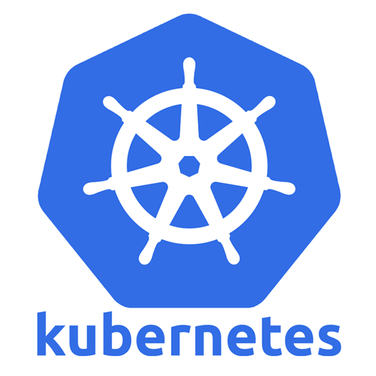
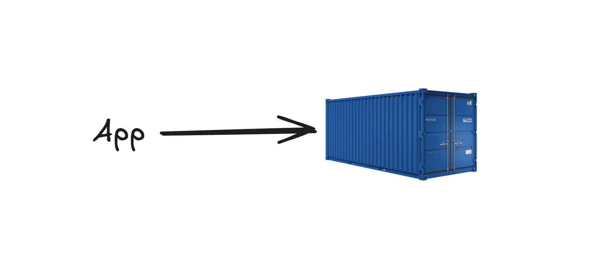
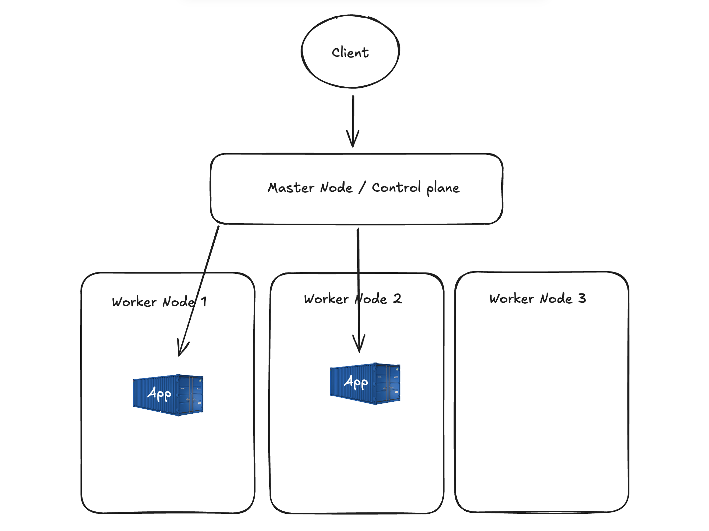
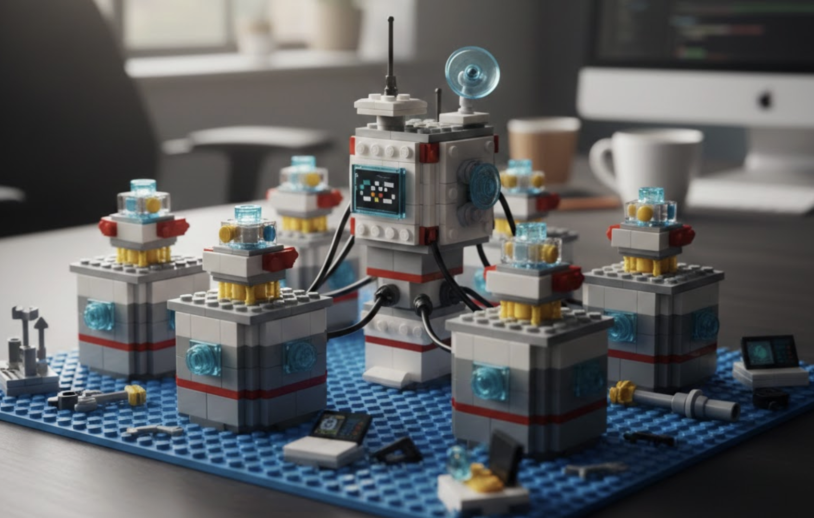

## The year of Kubernetes
There's a new year, 2026. And there is one thing I've heard many many times last
year, which is is: If there is one thing or technology your should learn to be
relevant as a DevOps engineer, it is Kubernetes. So that is what I intend to do
this year, learn Kubernetes. And I am going to document my journey from knowing
next to nothing to hopefully becoming a Kubestronaut.

To be honest I actually started last year. I did the KCNA, which is the
fundamental Kuberenetes certification, and also landed a new assignment in a
company where we use Kubernetes. So learning more is highly relevant.

So this will be the year I take my Kuberenetes knowledge to the next level and
then some. Can't wait!

## Why do we need Kubernetes?
Now days most applications are run as micro services. You have many decoupled
services talking working together in stead of the old way of programming one
big monolith. These services and applications are usually containerized and
expected to always be up and available.

But when you get more and more containers and distribute them over multiple VMs
or computers you often run into some problems. The setup becomes more and more
complex as it grows. Where should the containers run? What happens if one
crash? How do the services talk to each other? How to we scale? How do we roll
out changes and upgrade without downtime?

These are the problems Kubernetes solves. Kubernetes is a container
orchestration platform. A framework to run distributed systems resiliently.
Kubernetes handles scheduling, failover, scaling and deployment.

## Example story
Let's say you have made an app. A cool new years resolution app where members
can make profiles, add resolutions and so on. Sounds cool right? Ha-ha, it
doesn't matter. You containerize the app using Docker. 

Your app is popular and you want to run multiple copies of the app, to handle
the traffic. With Kubernetes you can run your app on multiple nodes, and the
containers will automatically be places on nodes with available CPU and memory.
Then you can have a service handling discovery and routing traffic. Spreading
it evenly on the nodes. Having one entry point users can access the app through
instead of needing the IP to what ever node the app is running on. This means
if the app should crash or a the worker node where the app is running (the
computer) goes down, Kubernetes will restart the app on another node. Making
sure the app is always available.

For some reason your app gets really really popular and gets more traffic. And
in the weekends the traffic spikes. Kubernetes will notice the CPU usage and
scale horizontally, creating more pods running the app. Then when the traffic
drops, it will scale down again. This means you only use the resources you need 
at any given time. Which can be translated to money saved.

You can store configurations and secrets like API passwords and environment
variables in secrets and configmaps. These can be updated without rebuilding
container images. Kubernetes does storage orchestration to attach persistent
volumes to apps. Making the storage move with the pod if a pod moves to another
node.

When you need to update your app, you can do blue/green, canary or other update
strategies. This means you can keep your app available at all times during
updates. And if there is an error, you just roll back to the previous version.
You also get reliability with a self healing system. If a node fails or a pod
crashes, Kubernetes detects is and restart or reschedules the pod. 

This way you have a reliable, available, scalable application that is easy to
develop further.

## Kubernetes is like Lego

One of the reasons i think Kubernetes is as popular as it is and will keep on
being used, is the extensibility. It is like Lego. You can build and add on or
change out parts as you wish. Kubernetes is a framework where everything is and
API object and you declare the state you want. With Custom Resource
Definitions (CRDs) you can make your own objects. You can create your own
controller, watching the resources controlling the state. Most of the systems
inside are interfaces, which means you can swap out and change the systems for
networking, storage or even the container runtime. And since it’s open source,
anyone can create new parts fitting this great framework.

## Conclusion
Kubernetes sounds pretty awesome. It is used to orchestrate your docker
containers. Making sure they're always up and running. But it is also so much
more. Pretty complex and it feels like there is an endless amount of stuff to
learn and understand. All the different parts and how they work together. The
networking and not to mention the security bit. You also have the GitOps
aspect, how to develop your cluster. And the observability part, how you will
get information about everything running and the cluster and getting notified
if anything goes wrong.

I'm ready for the year of Kubernetes! My next post will be the first in a
series about how I set up Kubernetes in my homelab. I just installed 3
computers and I am ready to run Kubernetes on bare metal. Let's go!

