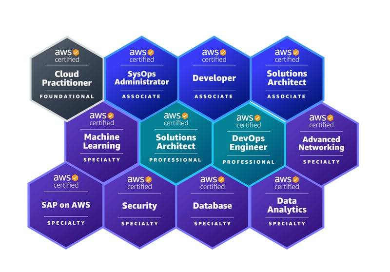
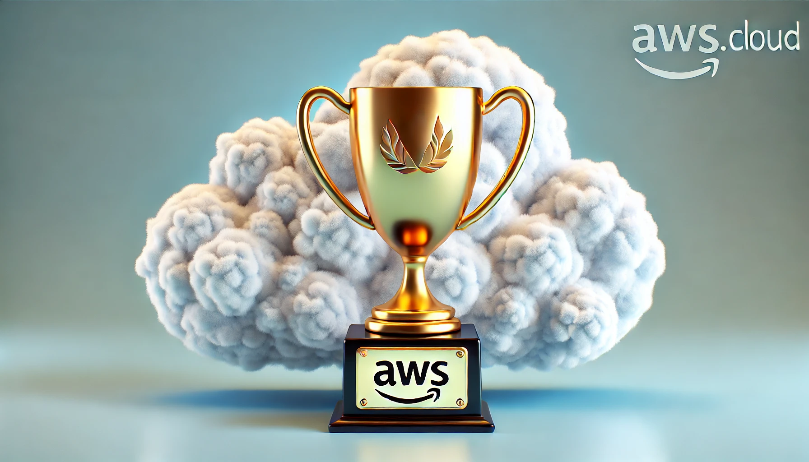

### Complete The Cloud Resume Challenge
[The Challenge](https://cloudresumechallenge.dev/docs/the-challenge/aws/)

- **--> Part 1: Get AWS Certified and complete The Cloud Resume Challenge <--**
- [Part 2: HTML - Create a website](/blog/part02-html)
- [Part 3: CSS - Style your website](/blog/part03-css)
- [Part 4: Static Website - Amazon S3](/blog/part04-static)
- [Part 5: HTTPS - Set up Amazon CloudFront](/blog/part05-https)
- [Part 6: DNS - Custom domain name with Amazon Route 53](/blog/part06-dns)
- [Part 7-12: Backend - Creating a serverless API and requesting it with JS](/blog/part07-api)
- [Part 13-16: CI/CD - Commit, Build and Deploy with AWS CodePipeline](/blog/part13-cicd)
---

**tl;dr:** Complete an AWS Certification Exam and create an AWS Account. Next we'll create a website using different AWS services. Following the steps of [The Cloud Resume Challenge](https://cloudresumechallenge.dev/docs/the-challenge/aws/)

## Complete The Cloud Resume Challenge
This is the first post in a series on our journey completing [The Cloud Resume Challenge](https://cloudresumechallenge.dev/docs/the-challenge/aws/). In short The Cloud Resume Challenge is a challenge to create a website and to host it using a cloud provider. It's a great way to learn about AWS. My first though was just to rush through it by my self, then write about how I did it afterwords. But I felt it would be to general and high level so I changed my mind. Now the plan is to do one post pr step. This way I can go a bit more into details on each step and all the great AWS services that we will be using throughout this challenge. I can wait to get started. Let's go!

In this post I will write about my thoughts on the journey ahead and what tools we will be using. I'm writing this step by step while completing the steps myself, so things might change along the way.

## Get Certified

First things first, we need an AWS Certification. You can sign up for an exam at [https://aws.amazon.com/certification/](https://aws.amazon.com/certification/). If you have no experience with AWS the exam you want to sign up for is Cloud Practitioner. Feel free to read more about [the 12 different AWS Certification exams](https://aws.amazon.com/certification/exams/).
My tips, and also everyone on Reddit it seems, is to use [Udemy](https://www.udemy.com/) and [Tutorials Dojo](https://tutorialsdojo.com/aws-study-path-notes/) to prepare for the exam. For the SAA, SOA and DVA, I completed Stephane Maareks udemy course and did the Jon Bonso Practice Exams which are also on udemy. The practice exams is harder than the real thing, with more questions going deeper into the material. So it's great for learning and getting a more complete understanding on how everything works. It's very important to go through all the questions and read ALL the explanations when reviewing the practice exam. Also the ones where you answered correct. This is where you will be learning the most. If you can pass the practice exam, you are ready to take the real one.

## The Challenge

So, we're certified, we got that bright shining badge. Yay us! Let's create a website to show it off to the world, while also getting our hands dirty with some of the AWS services we have learned so much about preparing for the certifications.

Before we really get started, I have some thoughts on how we will complete this challenge. For each step I do a short explanation of the topic, then we create it. Maybe we also discuss some different approaches. I wanna practice Terraform, so I'll throw that in to the mix. For each step we can do ClickOps, then recreate it with IaC afterwords. Sounds good?

By the way, the goal of this series is for me to get some practice with AWS services, blogging, writing English and teaching. My goal for you to is to complete this challenge. I will hold you hand for most of it, but a lot of it you'll manage fine by you self. What I mean is I don't want this to be a copy paste challenge.

## Our tools and construction sight

So what do we need to get started with this challenge? Our construction sight will be AWS Console. If you don't have an AWS account already, get one. Just google AWS, click *sign in to the console*, then *create a new AWS account*.

In the next step we will be coding so you'll need a text editor. Any will do. It does not matter. [VS Code](https://code.visualstudio.com/) is the most popular, so choose that one if you're not sure what to pick. I'll be using Vim. I also wanna use Git for version control. If you want to really learn git, you can complete ThePrimeagens [course](https://www.youtube.com/watch?v=rH3zE7VlIMs).

Other tools we will be using throught this challenge is Terraform and lots of different services from AWS. But more on that when we get there.

Ok, I guess we're ready to take on this challenge. Let's continue our adventure with the next step on this journey through the AWS cloud!
