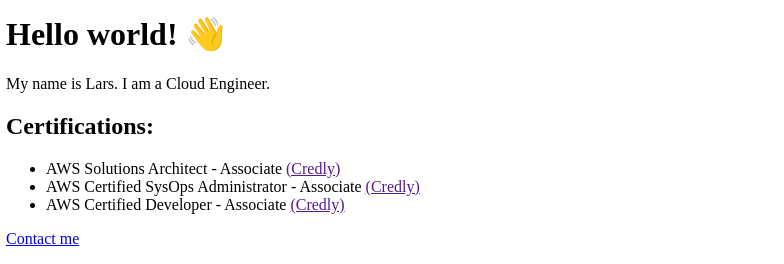

### Complete The Cloud Resume Challenge
[The Challenge](https://cloudresumechallenge.dev/docs/the-challenge/aws/)

- [Part 1: Get AWS Certified and complete The Cloud Resume Challenge](/blog/part01-crc)
- **--> Part 2: HTML - Create a website <--**
- [Part 3: CSS - Style your website](/blog/part03-css)
- [Part 4: Static Website - Amazon S3](/blog/part04-static)
- [Part 5: HTTPS - Set up Amazon CloudFront](/blog/part05-https)
- [Part 6: DNS - Custom domain name with Amazon Route 53](/blog/part06-dns)
- [Part 7-12: Backend - Creating a serverless API and requesting it with JS](/blog/part07-api)
- [Part 13-16: CI/CD - Commit, Build and Deploy with AWS CodePipeline](/blog/part13-cicd)
---

**tl;dr:** Create a website using HTML

## What is HTML?
> HTML is the standard markup language for Web pages.
>
> With HTML you can create your own Website.
>
> HTML is easy to learn - You will enjoy it!

*[w3schools.com](https://www.w3schools.com/html/default.asp)*

## Crossroads

When building our website I see three choices:
- Use a template
- Get ChatGPT to do the work
- Code it from scratch

I think all of them are fine. With pros and cons.

**Template:** There are some nice ones at [html5up](https://html5up.net/). Just download one and edit the text to be what you want. Very quick, very easy. This will also complete the next step "CSS".

**AI:** If you want to get some experiense using AI, you can use ChatGPT to create a website. Then edit it to be the way you want. Also very quick and easy. Though you have to be on the lookout for errors since ChatGPT usally make alot of them. You can ask ChatGPT to include CSS as well if you want to skip the next step. This could also be a very good starting point for the next approach which is coding it from scratch.

**DIY:** If you're already a frontend developer or just know basic HTML it is very easy to throw something together here to get a working page.

## What should be included?
As the name of the challenge suggests, the website should include some type of resume. Write something about your self and make sure to include your AWS certification.

I'm going to write the HTML code myself since i'm not looking for a super flashy website. Also I haven't written any HTML in a while, so i'll have some fun refreshing my HTML skills.

## Creating the website
So to start we should make a directory for our project. I'm using Linux and will be doing most of the work here from the terminal.
```bash
mkdir website && cd $_; touch index.html
```
- **mkdir:** creates a directory
- **cd:** change directory
- **$_:** the argument of last command
- **touch:** creates a file

The file index.html will be the entry point to our website. It will also be the main part of the site. Let's write some code!
```html
<!DOCTYPE html>
<html lang="en">
    <head>
        <meta charset="UTF-8">
        <title>my resume</title>
        <link rel="stylesheet" type="text/css" href="css/style.css"> <!-- This will be used in the next step -->
    </head>
    <body>
        <div class="main-container">
            <h1>Hello world! 👋 </h1>
            <p>
                My name is Lars. I am a Cloud Engineer.
            </p>
            <h2>Certifications:</h2>
            <p>
                <ul>
                    <li>
                        AWS Solutions Architect - Associate <a href="https://www.credly.com/users/lars-magelssen">(Credly)</a>
                    </li>
                    <li>
                        AWS Certified SysOps Administrator - Associate <a href="https://www.credly.com/users/lars-magelssen">(Credly)</a>
                    </li>
                    <li>
                        AWS Certified Developer - Associate <a href="https://www.credly.com/users/lars-magelssen">(Credly)</a>
                    </li>
                </ul>
            </p>
            <a href="mailto:contact@magelssen.io">
                <div id="contact">
                    Contact me
                </div>
            </a>
        </div>
        <script src="js/script.js"></script> <!-- This will be used later in the series -->
    </body>
</html>
```

I have added some extra stuff here that I think we will need later. Let's save this file and open it in a browser to make sure everything is working as expected.

It sure looks good, doesn't it? No? Haha, don't worry. We'll fix up the styling in the next step.

Work on your website and resume until you're happy and let's go to the next step and add some style to our new website. 
