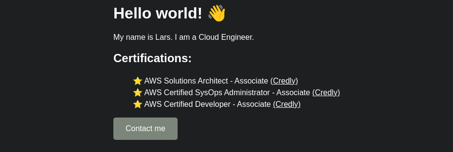

### Complete The Cloud Resume Challenge
[The Challenge](https://cloudresumechallenge.dev/docs/the-challenge/aws/)

- [Part 1: Get AWS Certified and complete The Cloud Resume Challenge](/blog/part01-crc)
- [Part 2: HTML - Create a website](/blog/part02-html)
- **--> Part 3: CSS - Style your website <--**
- [Part 4: Static Website - Amazon S3](/blog/part04-static)
- [Part 5: HTTPS - Set up Amazon CloudFront](/blog/part05-https)
- [Part 6: DNS - Custom domain name with Amazon Route 53](/blog/part06-dns)
- [Part 7-12: Backend - Creating a serverless API and requesting it with JS](/blog/part07-api)
- [Part 13-16: CI/CD - Commit, Build and Deploy with AWS CodePipeline](/blog/part13-cicd)
---

**tl;dr:** Learn some basic CSS at [w3schools.com](https://www.w3schools.com/css/default.asp). Style a website using CSS. 

## What is CSS?
Cascading Style Sheets or CSS is the language used to style html. It is pretty easy to understand. And with the help of google and maybe ChatGPT, you should be able to style you webpage just the way you want it.

We continue our adventure through the Cloud Resume challenge with some CSS. The next step after this is hosting the webpage as a static site on AWS. So let's not spend to much time on this step so we can get to the good part. If you already have styled your page or used an already styled template. Feel free to skip this post.

## Styling
First we need to create our CSS file and link to it in the html code.
```bash
mkdir css; touch css/style.css
```
- **mkdir:** Create a directory
- **touch:** Create a file

Ok, now let's edit that file.
```css
* {
	background-color: #1e1f21;
	color: white;
	font-family: helvetica;
}
.main-container {
    margin: auto;
    width: 800px;
}
ul li {
	list-style: none;
	padding: 3px 0 2px 0px;
}

ul li::before {
  content: "⭐ ";
}

#contact {
	background-color: #7b8579;
	color: white;
	padding: 14px 25px;
	text-align: center;
	text-decoration: none;
	display: inline-block;
	border-radius: 5px;
}

#contact:hover, #contact:active {
	background-color: #849188;
}
```
It is by no means any master piece. But at least it looks better. 


Now let's get to the good part and get going with some AWS action hosting this website!
