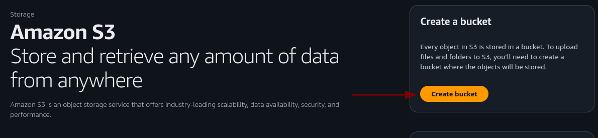
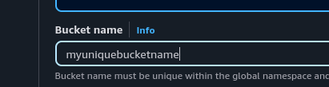
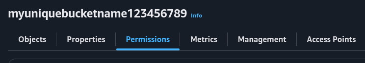
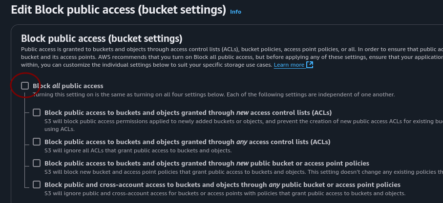
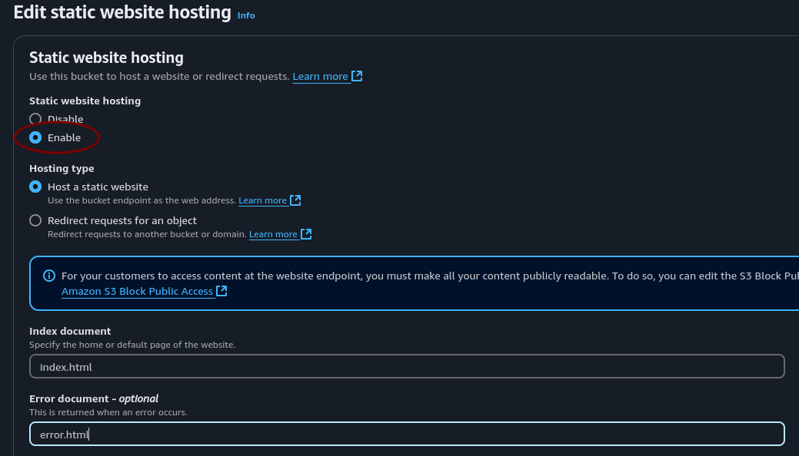
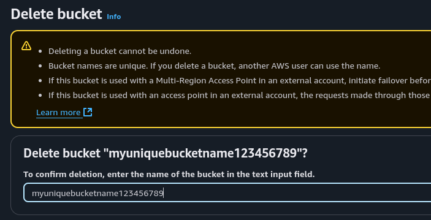
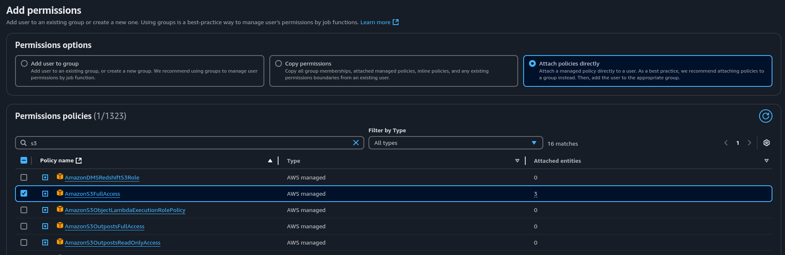
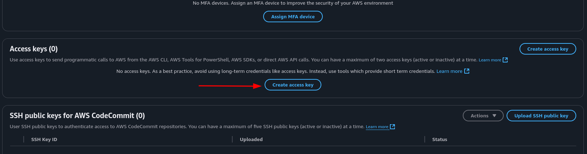
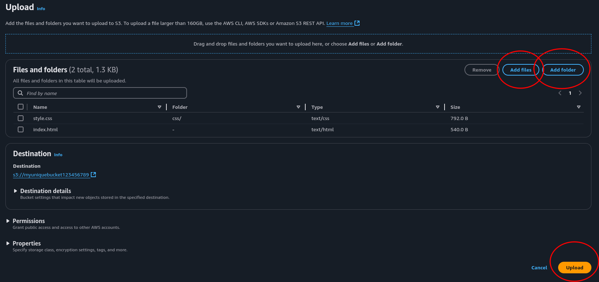
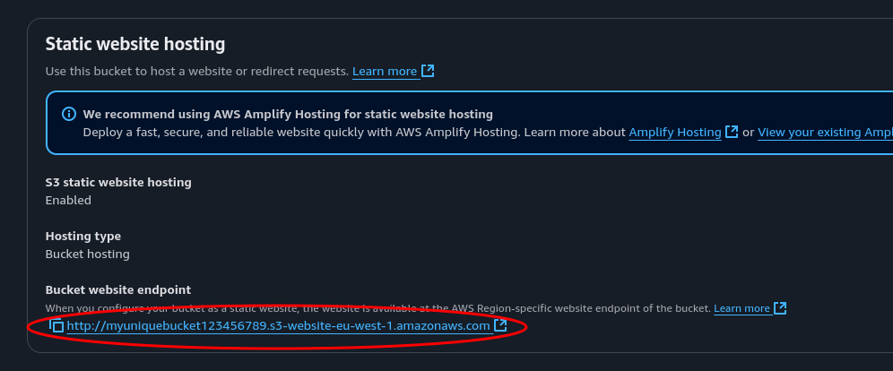

### Complete The Cloud Resume Challenge
[The Challenge](https://cloudresumechallenge.dev/docs/the-challenge/aws/)

- [Part 1: Get AWS Certified and complete The Cloud Resume Challenge](/blog/part01-crc)
- [Part 2: HTML - Create a website](/blog/part02-html)
- [Part 3: CSS - Style your website](/blog/part03-css)
- **--> Part 4: Static Website - Amazon S3 <--**
- [Part 5: HTTPS - Set up Amazon CloudFront](/blog/part05-https)
- [Part 6: DNS - Custom domain name with Amazon Route 53](/blog/part06-dns)
- [Part 7-12: Backend - Creating a serverless API and requesting it with JS](/blog/part07-api)
- [Part 13-16: CI/CD - Commit, Build and Deploy with AWS CodePipeline](/blog/part13-cicd)
---

**tl;dr:** Host a static website from AWS S3

## Hosting a static website
Finally we get to the good part. Now we get to play with some AWS services. And by the end of this post we will have our personal cloud resume webpage out on the world wide web.

### Todo
1. [ ] Create a bucket
2. [ ] Configure the bucket for website hosting
3. [ ] Upload our website to the bucket

## What is S3?
> Amazon Simple Storage Service (Amazon S3) is an object storage service that offers industry-leading scalability, data availability, security, and performance. You can use Amazon S3 to store and retrieve any amount of data at any time, from anywhere.

[*aws.amazon.com/s3*](https://aws.amazon.com/s3/getting-started/)

So S3 is a storage service on AWS. Here you can store objects like files in what they call buckets. Then you can set a policy on the bucket, controlling who's allowed to read, write and delete the bucket.
S3 buckets can also be used to host static websites, which is exactly what we are going to do. Let's go!

## Creating a bucket
The first thing we will need to do is creating a bucket. This can be done in many ways. Everything we do on AWS is through an API, and there are many different ways to call this API. I'll go through three:
- AWS console
- AWS CLI
- Terraform

### AWS Console
First lets create and delete a bucket through the console. This should be pretty straight forward. 

From the AWS Console navigate to S3 and click the 'Create bucket' button


Enter a unique name

Scroll to the bottom of the page and click *create bucket*.

That's it, we have a bucket. Now we just need to make it accessible, add a policy that permits getObject requests and enable it for static website hosting.

First lets make it accessible. From the S3 console, click the bucket you just created and navigate to the permissions tab.


On *block all public access* click edit and uncheck the "block all public access" box and click *save changes*.


In the box bellow click the edit button on bucket policy. Add this, make sure to enter the name of YOUR bucket and click save changes.
```json
{
    "Version": "2012-10-17",
    "Statement": [
        {
            "Sid": "PublicReadGetObject",
            "Effect": "Allow",
            "Principal": "*",
            "Action": "s3:GetObject",
            "Resource": "arn:aws:s3:::<BUCKET_NAME>/*"
        }
    ]
}
```

Now let's go back to the bucket and enter the properties tab. Scroll all the way to the bottom and edit *Static website hosting*.
Make sure to check *enable*, and enter a file name for index and error. ``index.html`` and ``error.html``.


Great! Now all we need to do is upload the files from our project folder and we have a static website hosted on the world wide web. But before we do that, let's delete this bucket and create it two more times.

You can of course just keep it as is and skip the next part if you don't wanna use the CLI or Terraform for IaC, but I recommend reading on to take a look at the process.

To delete it, select the bucket and click the *delete* button located next to the *create bucket* button. Then you need to type in the name of the bucket to confirm the delete action.


### AWS CLI
ClickOps, creating resources and operation through the console by clicking, is great for prototyping and quickly throwing stuff together. Maintaining in the long run however is difficult. Our goal is using Infrastructure as Code, but first, let's check out the AWS CLI which also can be used in scripts.

First we need the AWS CLI. I'm not gonna copy paste all the ways to install it. If you're not on a debian type linux distro, follow the [aws install guide](https://docs.aws.amazon.com/cli/latest/userguide/getting-started-install.html)

```bash
sudo apt install awscli
```

Now we need to create and set up a user we can use as a profile when calling the AWS API through the AWS CLI. Sound complicated, but it is not.
- Navigate to the IAM console > Users and click the *Create user* button.
- Set a user name and click *next*
- Select *Attach policies directly*, search for S3 and select full access and click *next*

- Click *Create user*

Now our user needs some credentials. We will use these for authorization when calling the AWS API.
- Select your newly created user from the list at IAM > Users
- Go to the *Security credentials* tab and at *Access keys* click *Create access key*

- Use case: *Command Line Interface*, check box and click *next*
- Add a description, click *next*
- Download the .csv file which holds your credentials, and click *done*.

From the terminal we can now configure our credentials with ``aws configure`` where we will be prompted for the access key id and secret access key.

However, this just creates a file in a hidden folder. So let's just create that our selves instead for more control.
```bash
# Create a .aws folder if none exists
mkdir ~/.aws

# Change directory to .aws
cd ~/.aws

# Create a credentials file called 'credentials'
vim credentials
```

This file is structured with a profile name ``[<PROFILENAME>]`` followed by credentials. When using the AWS CLI, it will look in this file under ``[default]`` unless you add the flag ``--profile <PROFILE>``, then it will use the profile you choose.

Let's add our new user as default, and also as a specific user so it's already done when we in the future might add more users. Paste in the id and secret from the csv file you downloaded.
```txt
[default]
aws_access_key_id = ASDFASDFASDFASDFASDF
aws_secret_access_key = Aasdfasdfasdfasdfasdf

[my-demo-user]
aws_access_key_id = ASDFASDFASDFASDFASDF
aws_secret_access_key = Aasdfasdfasdfasdfasdf
```
*~/.aws/credentials*

Ok, now we're ready to use our user. To create a bucket you can use the s3api API.

For regions outside of the US you need to add LocationConstraint: ``--create-bucket-configuration LocationConstraint=<REGION>``

```bash
aws s3api create-bucket \
--bucket myuniquebucket123456789 \
--region eu-west-1 \
--create-bucket-configuration LocationConstraint=eu-west-1 \ 
--profile my-demo-user
```

You can also use ``aws s3 mb <path>``

You should get a json response with the path of the bucket you just created
```json
{
    "Location": "http://myuniquebucket123456789.s3.amazonaws.com/"
}
```

Great. Now we know two ways of creating buckets. Let's delete this bucket and create it one last time. This time with Terraform.

Let's delete it through the CLI. We can use the ``s3`` command now, which is build on top of the json model driven ``s3api``
```bash
# list your buckets
aws s3 ls --profile my-demo-user

# Note the bucket name and remove it with the remove bucket command
aws s3 rb s3://myuniquebucket123456789 --profile my-demo-user
```

### Terraform

This is not a Terraform guide. I'll make one later that I can link to. But for now, you're on your own. The commands we will be using are:
- ``terraform  init``: Initiate the terraform project
- ``terraform  apply``: Apply the configuration
- ``terraform  destroy``: Destroy the resources created by terraform

In our project directory, let's create a new directory that we call ``infra`` as in infrastructure. This is where our Terraform files will live. To start we will create one file and put everything there for simplicity. Then we will refactor improve it as it grows.

```bash
mkdir infra && cd $_; vim main.tf
```
- **mkdir:** make directory
- **cd:** change directory
- **$_:** argument of last command
- **;:** end command
- **vim:** a text editor

```hcl
# main.tf
terraform {
  required_providers {
    aws = {
      source  = "hashicorp/aws"
      version = "~> 5.0"
    }
  }
}

provider "aws" {
  region = "eu-west-1"
  profile = "my-demo-user"
}

resource "aws_s3_bucket" "my_bucket" {
  bucket  = "myuniquebucket123456789"
  tags    = {
	  Owner          = "my-demo-user"
	  Environment    = "dev"
  }
}
```

After creating this file, while in the *infra* directory, run ``terraform init`` to initiate terraform. Now let's test it out and see if it will run. Run ``terraform apply`` to apply the configuration we just wrote.

You should be prompted with a json with everything about to be created.
```
Plan: 1 to add, 0 to change, 0 to destroy.

Do you want to perform these actions?
  Terraform will perform the actions described above.
  Only 'yes' will be accepted to approve.

  Enter a value:
```

Enter yes. 

```
Apply complete! Resources: 1 added, 0 changed, 0 destroyed.
```

Now, how will you check if the bucket has been created? Yes, you could log in to the console and navigate over to S3 and have a look. But even easier is just using the CLI as we just did.
```
aws s3 ls
```

You see it? Great. Let's continue with the infrastructure. We need to add those bucket configurations we did in the console with terraform as well. Then we are ready for uploading our website. Let's update our ``main.tf``.

By the way, as of writing this, I don't know how to do this. Let's find out together. Terraform has great documentation. We should be able to find everything we need at the terraform registry, under [AWS Provider](https://registry.terraform.io/providers/hashicorp/aws/latest/docs).

If you remember from earlier, what we need is:
- Unblock public access
- A policy allowing ``getObject``
- Enable static website hosting

Let's start with the public access. This will stop us from adding a policy, so we need to do this first. Trust me, I'm rewriting this, changing the order, after going in a circle. I got this from ``aws_s3_bucket_acl`` in the terraform docs.

```hcl
resource "aws_s3_bucket_ownership_controls" "example" {
  bucket = aws_s3_bucket.my_bucket.id
  rule {
    object_ownership = "BucketOwnerPreferred"
  }
}

resource "aws_s3_bucket_public_access_block" "example" {
  bucket = aws_s3_bucket.my_bucket.id

  block_public_acls       = false
  block_public_policy     = false
  ignore_public_acls      = false
  restrict_public_buckets = false
}

resource "aws_s3_bucket_acl" "example" {
  depends_on = [
    aws_s3_bucket_ownership_controls.example,
    aws_s3_bucket_public_access_block.example,
  ]

  bucket = aws_s3_bucket.my_bucket.id
  acl    = "private"
}
```

The ``aws_s3_bucket_ownership_controls`` will allow us to enable ACL. The ``aws_s3_bucket_public_access_block`` is the same list that we unchecked in the console for public access. And the ``aws_s3_bucket_acl`` is adding the ACL to the bucket.

Let's continue with the policy. The resource I found is called ``aws_s3_bucket_policy``, this is what I got from reading the docs. Let's add it to our ``main.tf``

```hcl
resource "aws_s3_bucket_policy" "allow_get_object" {
  bucket = aws_s3_bucket.my_bucket.id
  policy = data.aws_iam_policy_document.allow_get_object.json
}

data "aws_iam_policy_document" "allow_get_object" {
  statement {
    principals {
      type        = "AWS"
      identifiers = ["*"]
    }

    actions = [
      "s3:GetObject",
    ]

    resources = [
      "${aws_s3_bucket.my_bucket.arn}/*",
    ]
  }
}
```

When ever I'm programming or creating stuff with AWS, I like to take small steps and test a lot along the way, always making sure that everything is working as expected. It is really frustrating when you have been working on something for a while then then you try to run it you end up with an error, not knowing what broke since you've added 10 new things.

Run ``terraform apply``. Phew! Everything works, and we got 5 resources.

Last part before we can upload our files. We need to enable the bucket for *static website hosting*. Let's see what we can find in the terraform registry.

I found a resource called ``aws_s3_bucket_website_configuration``. That looks like what we're looking for. Add this to ``main.tf``.
```hcl
resource "aws_s3_bucket_website_configuration" "example" {
  bucket = aws_s3_bucket.my_bucket.id

  index_document {
    suffix = "index.html"
  }

  error_document {
    key = "error.html"
  }
}
```

Feel free to checkout the [documentation](https://registry.terraform.io/providers/hashicorp/aws/latest/docs/resources/s3_bucket_website_configuration). There might be other stuff there you want to use. Like routing and redirecting.

## Uploading the website

Let's do a status check:
1. [x] Create a bucket
2. [x] Configure the bucket for website hosting
3. [ ] Upload our website to the bucket

We have gone back and forth on step 1 and 2 for a while. Let's take a shot at step 3. We have some choices on how we are going to do this. We can use the console, or we can use terraform. 

Using Terraform can be a bit messy when ever we make updates to the website. So I don't think this is that way. Console doesn't really feel right either after doing all this work trying to get away form the console.

Let's just do this the easiest, fastest way we can to see some results by using the console. **Spoiler alert:** We will improve this in a later step with something called CI/CD.

Navigate over to the S3 console, click you bucket and click *upload*. *Add files* add ``index.html``, and *add folder* adding the ``css`` folder and it's content. Then hit *upload* in the bottom right.


1. [x] Create a bucket
2. [x] Configure the bucket for website hosting
3. [x] **Upload our website to the bucket**

Now go to the *properties* tag, scroll all the way to the bottom and check out your freshly deployed website. Yay!


## Conclusion
We have just created an Amazon S3 bucket, enabled static website hosting and uploaded our own website to be hosted. We have used the AWS console, the AWS CLI and even created AWS resources through IaC with Terraform.

Join me for the next step where we will swap out the HTTP protocol for HTTPS. This will secure our website by encrypting the data we send in transit using Amazon CloudFront with an SSL Certificate provided from Amazon Certificate Manager.
