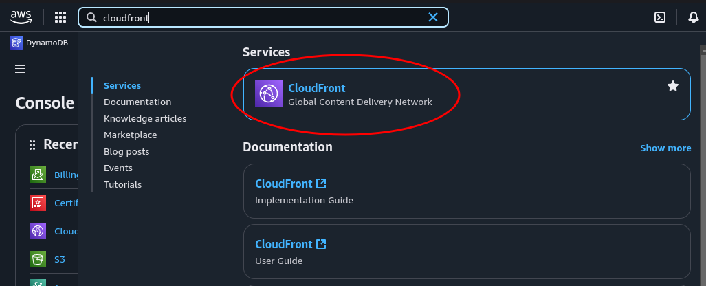
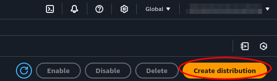
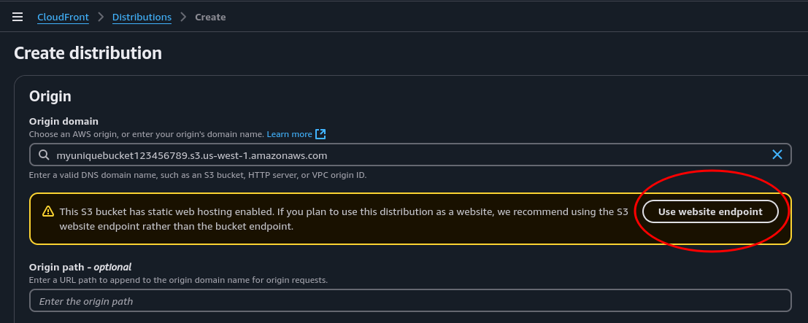
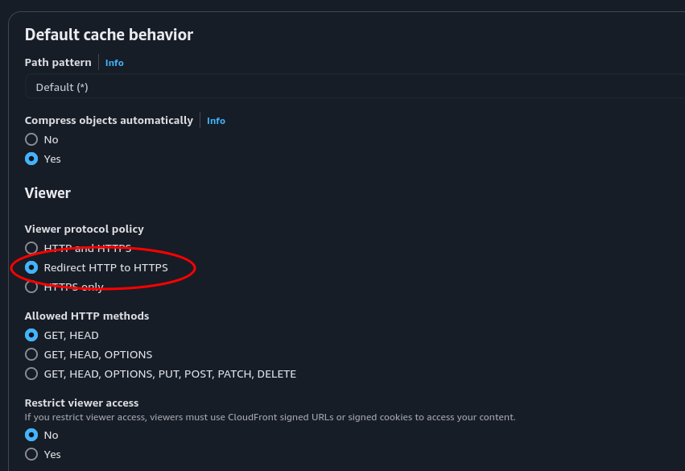
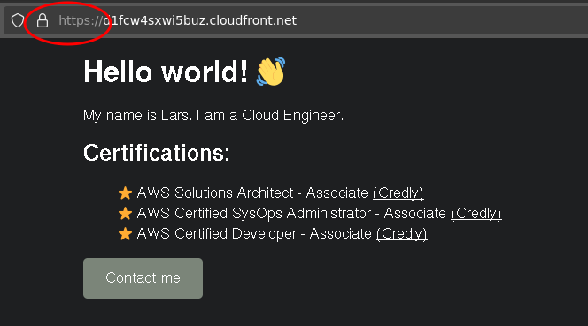

### Complete The Cloud Resume Challenge
[The Challenge](https://cloudresumechallenge.dev/docs/the-challenge/aws/)

- [Part 1: Get AWS Certified and complete The Cloud Resume Challenge](/blog/part01-crc)
- [Part 2: HTML - Create a website](/blog/part02-html)
- [Part 3: CSS - Style your website](/blog/part03-css)
- [Part 4: Static Website - Amazon S3](/blog/part04-static)
- **--> Part 5: HTTPS - Set up Amazon CloudFront <--**
- [Part 6: DNS - Custom domain name with Amazon Route 53](/blog/part06-dns)
- [Part 7-12: Backend - Creating a serverless API and requesting it with JS](/blog/part07-api)
- [Part 13-16: CI/CD - Commit, Build and Deploy with AWS CodePipeline](/blog/part13-cicd)
---

**tl;dr:** HTTPS is like HTTP, but secure. Use CloudFront to front your website redirecting HTTP to HTTPS.

## Encrypt your data in transit with HTTPS
Have you notised that ugly triangle saying "Not Secure" where there usally is a pretty lock icon in the address bar? 

In this part of the challenge we're setting up HTTPS for our website to fix that problem. If you don't have any experience with this, it may all sound a bit technical and complicated. It is technical, but it does not have to be complicated to set up.

Hypertext Transfer Protocol (HTTP) is a protocol used to send data over the internet. It is what we use to request and receive websites. How ever when data is traveling from a one place to your computer, it could be picked up and read on the way. Like a postman reading your mail.

This is why you want to use the Secure version of this protocol HTTPS. Here all data is encrypted in transit, so no one can read it while traveling over the internet. To set this up on our website, we will use Amazon CloudFront.

## CloudFront

CloudFront is a Content Delivery Network (CDN) service provided by AWS. Think of it like servers in different locations all over the world. They are used to cache and deliver your website to users. This makes your website load faster, as the data is stored closer to the users requesting the data.

This means that each time someone request a website, CloudFront will first check if it has a copy of the website at the closes location to the requester. If it does, it will deliver that copy. If not, it will get the website from the origin (S3 bucket) and store a copy for the next time it gets a similar request.

This is great. Not only will our website load faster, but CloudFront will also be able to redirect HTTP to HTTPS.

### Setting up CloudFront
1. Go to the AWS Management Console and search for CloudFront

2. Click on Create Distribution

3. In Origin domain we select our S3 bucket. Then click *Use website endpoint* to get the correct URL

4. At *Viewer Protocol Policy* select *Redirect HTTP to HTTPS*. This will make sure that all requests to the website are redirected to HTTPS, thus encrypting the traffic.

5. Feel free to check out all the other configurations that can be selected, but for now we can leave the rest as default and click *Create Distribution*

And that's is! Now we have set up a CDN with HTTPS for our website. It take a little while for the distribution to be deployed. You can see the status in the CloudFront *Distributions* console, as well as the url to your website under *Domain name*. When the status is *Enabled* let's check it out.

Now, we can see that the pretty lock icon is back in the address bar. And it says *HTTPS* instead of *HTTP*. This means that all data is encrypted in transit, and no one can read it while traveling over the internet. Yay!
