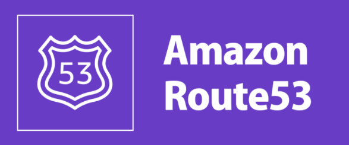
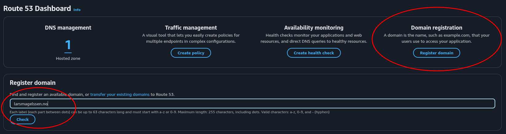
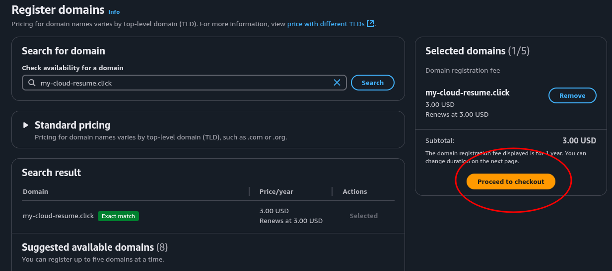
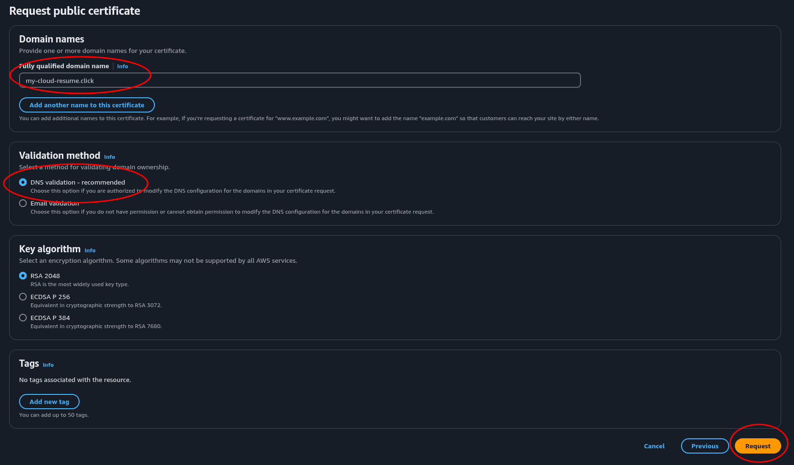
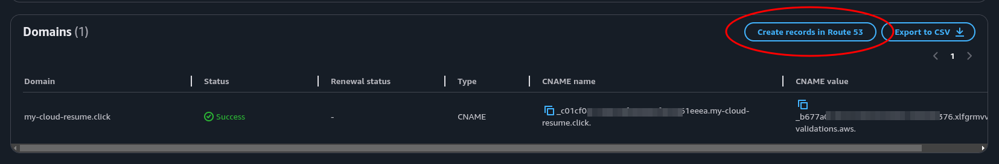
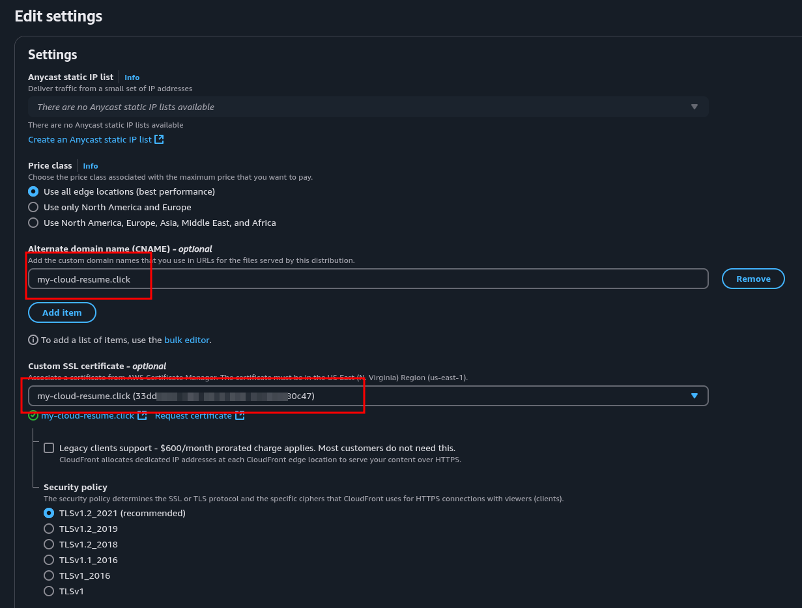
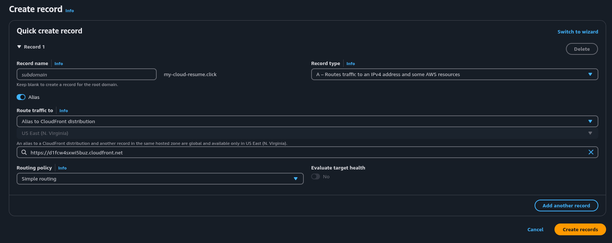
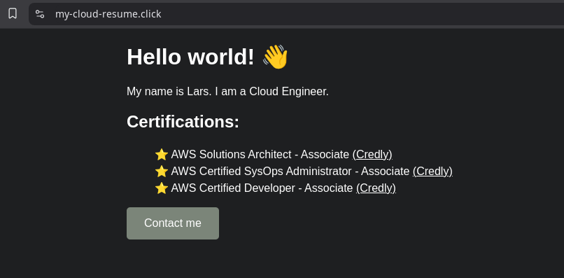

### Complete The Cloud Resume Challenge
[The Challenge](https://cloudresumechallenge.dev/docs/the-challenge/aws/)

- [Part 1: Get AWS Certified and complete The Cloud Resume Challenge](/blog/part01-crc)
- [Part 2: HTML - Create a website](/blog/part02-html)
- [Part 3: CSS - Style your website](/blog/part03-css)
- [Part 4: Static Website - Amazon S3](/blog/part04-static)
- [Part 5: HTTPS - Set up Amazon CloudFront](/blog/part05-https)
- **--> Part 6: DNS - Custom domain name with Amazon Route 53 <--**
- [Part 7-12: Backend - Creating a serverless API and requesting it with JS](/blog/part07-api)
- [Part 13-16: CI/CD - Commit, Build and Deploy with AWS CodePipeline](/blog/part13-cicd)
---

**tl;dr:** Use Amazone Route 53 to register a custom domain name and point it to your CloudFront distribution.

## DNS
A Domain Name System is how a machine translates human domain names or website addresses to what they prefer: IP addresses, which is numbers.
This way when you enter www.google.com in your web browser your computer will ask a DNS resolver "hey, I want the content of *www.google.com*". The resolver will respond: "Sure that is *142.250.74.68*". They your machine will check that IP address.
For more info about DNS, check out AWS Route 53 documentation [what is DNS](https://aws.amazon.com/route53/what-is-dns/)

So what we want to do today, is buying a domain name, then pointing it to our CloudFront Distribution (which again points to the bucket where our website resides).

## Amazone Route 53

[Route 53](https://aws.amazon.com/route53/) is a Domain Name System you can use to route traffic to your website. But you can also use it to register domain names and do health checks on cloud services. You can also use [Amazon Route 53 Resolver DNS Firewall](https://aws.amazon.com/route53/resolver-dns-firewall/) to block traffic.

## Buying our domain name
First navigate to Amazon Route 53. Here on the dashboard we can check what domain names are available. If you have none from before you can click on *Register domain", or you can just type in the name you want and click *check*.
Or you can from the left side menu, under Domains, select *Registered domains*, and click the button on the right side that says *Register domains*

Then choose the period you want the domain name and if you want to turn on auto-renew or not. Fill in all the contact information, review and submit.

Ok, we now own a domain name. Yay! Let's point it to our CloudFront distribution.

## CloudFront and SSL Certificate
Before we can point our new domain name to the CloudFront distribution, we need to request an SSL certificate so that we can use HTTPS with our domain name. To do this let's navigate to AWS Certificate Manager (ACM) and click the *request* button on the right side.
Fill in the domain name, choose DNS validation and click *request*. DNS validation means that we will prove that we own the domain by adding a DNS record.

To do the DNS validation we need to create records in route 53. Let's make sure we're on the certificate we just created in the AWS Certificate Manager Console and click *Create records in route 53*. (The status will say pending validation). Then click *Create records*.

Now everything should be in ready. Confirm that the certificate status is *Issued*.

## Create a record pointing to CloudFront
Navigate to CloudFront, choose your distribution and click the *edit* button on the right side. *Add item*, fill in the domain name and choose our newly created certificate.

Final step. Let's navigate back to Route 53, *Hosted Zones* and select our domain name. Click the *Create record* button. Leave sub name blank, choose *A* as record type and click the *Alias* toggle.
From the drop down menu choose *Alias to CloudFront distribution*, and from the drop down menu underneath choose your distribution. Hit *Create records* and we should be done.

## Success
We now have a working website on our own personal domain. From here we can just continue adding to our resume or improving our website in any way we want.

We could stop here, but The Cloud Resume Challenge still has a lot of steps left. So let's keep going and complete it! See you in the next step!
