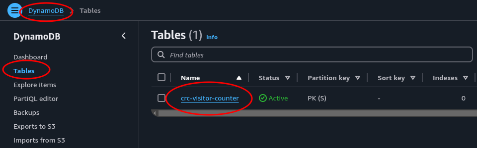
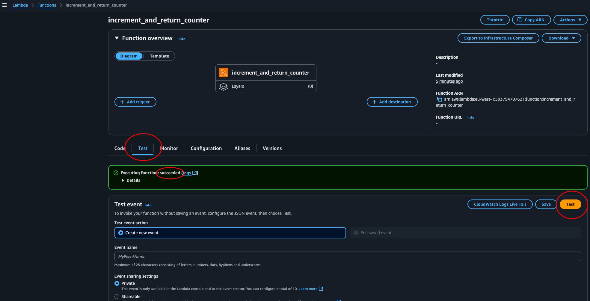
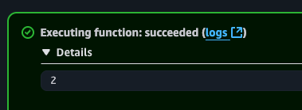
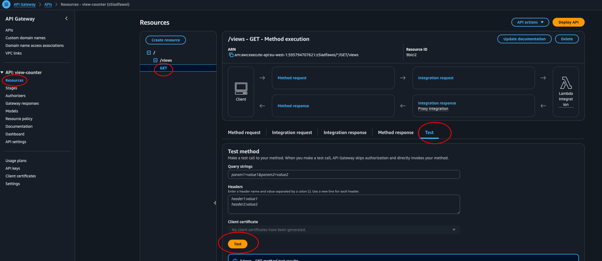
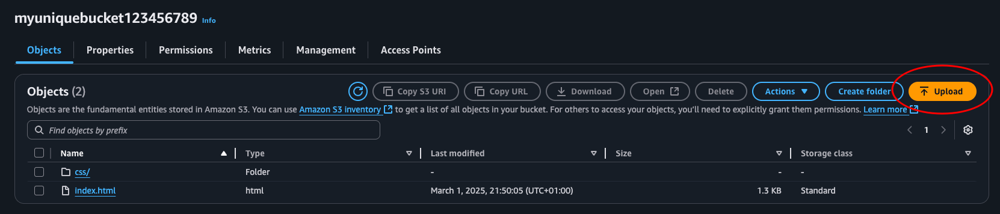
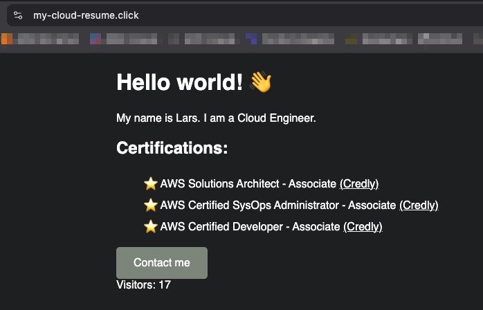

### Complete The Cloud Resume Challenge
[The Challenge](https://cloudresumechallenge.dev/docs/the-challenge/aws/)

- [Part 1: Get AWS Certified and complete The Cloud Resume Challenge](/blog/part01-crc)
- [Part 2: HTML - Create a website](/blog/part02-html)
- [Part 3: CSS - Style your website](/blog/part03-css)
- [Part 4: Static Website - Amazon S3](/blog/part04-static)
- [Part 5: HTTPS - Set up Amazon CloudFront](/blog/part05-https)
- [Part 6: DNS - Custom domain name with Amazon Route 53](/blog/part06-dns)
- **--> Part 7-12: Backend - Creating a serverless API and requesting it with JS <--**
- [Part 13-16: CI/CD - Commit, Build and Deploy with AWS CodePipeline](/blog/part13-cicd)
---

**tl;dr:**: Creating a serverless counter for our website using Lambda,
DynamoDB, Api Gateway and Terraform then displaying it on our website using
javascript.

## The backend: A combination of the next 6 steps

When looking at the next steps in the Cloud Resume Challenge, I think this
would be a nice way to progress if everything is new to you, but for these
posts I'm not gonna suddenly create an entire Javascript tutorial. What we will do
instead is combining the next few steps into one big step.

So in this post we will create a counter to our website. Displaying the number
of visitors to the site. To do this we will use some AWS resources that we will
provision with terraform (Step 12): 
- **DynamoDB:** Database. Here we will store number of visitors. (Step 8)
- **Lambda:** This will get and update the visitor count from the database (Step 9)
- **API Gateway:** An endpoint routing http requests to our lambda (Step 9)

We will write our lambda function in Python (Step 10) because I think that is
what most people know (except me, but I'll figure it out). Then we will add
some Javascript to our website (Step 7) making a request to our API Gateway. This will
run our lambda which will update the visitor data and return it to us so we can
display it on our website. And to not skip anything we'll make a unit test as
well (Step 11). We will make use of this in the next part where we create a
CI/CD pipeline.

Let's get started.

## Create AWS resources with terraform
We start by creating a directory for our backend infrastructure.

```bash
mkdir crc-backend-infrastructure && cd $_
```

Then we create files for our terraform code. It doesn't matter if we put all
the code in one file or split it up into multiple files. So let's create
multiple files so we can sort out the different parts to make it a bit more
structured and easy to navigate.
If we go to the [terraform registry](https://registry.terraform.io/) we will find all the information we
need to create the AWS resources needed for this part. Here is what I ended up
with after some research:

**main.tf:**  
Here we set the provider to AWS and the region to ``eu-west-1``. Profile is the
"user" that will be used to run the commands. As the same user you would use
for ``--profile`` in the AWS CLI.

```hcl
terraform {
    required_providers {
        aws = {
            source  = "hashicorp/aws"
            version = "~> 5.0"
        }
    }
}

provider "aws" {
    region = "eu-west-1"
    profile = "my-demo-user"
}
```

**dynamodb.tf:**  
Here we create a DynamoDB table with a primary key called PK. We only need PK
for now. Then we can add an item with an id like "1" or maybe "view-counter"
and add a number attribute which we will increase by one when ever our lambda
is triggered.

```hcl
resource "aws_dynamodb_table" "basic-dynamodb-table" {
    name           = "crc-visitor-counter"
    billing_mode   = "PROVISIONED"
    read_capacity  = 5
    write_capacity = 5
    hash_key       = "PK"

    attribute {
        name = "PK"
        type = "S"
    }
}
```

Great. Now let's run terraform apply and check out the AWS console to make sure everything is created as planned.

```bash
# Initiate terraform
terraform init

# Create our resources
terraform apply
```

In the console, navigate to dynamodb and select *tables* from the left hand side menu. Make sure we're in the correct region.


There it is. Perfect. Let's create a lambda function to trigger our counter.

## Create an API with Python
In the [AWS documentation](https://docs.aws.amazon.com/) you can find different [examples](https://docs.aws.amazon.com/amazondynamodb/latest/developerguide/getting-started-step-4.html) of how to work with DynamoDB from a lambda.
Navigating the documentation can be frustrating. It is not always easy to find what you're looking for. Google is your friend.
Here's what we're starting with.

Create a folder for our source code
```bash
mkdir src && cd $_

touch inc_and_return_counter.py
```

**inc_and_return_counter.py:**
```python
import boto3

dynamodb = boto3.resource("dynamodb", region_name="eu-west-1")
table = dynamodb.Table("crc-visitor-counter")

def increment_counter(event, context):
    response = table.update_item(
        Key={"PK": "view-counter"},
        UpdateExpression="ADD #v :incr",
        ExpressionAttributeNames={"#v": "views"},
        ExpressionAttributeValues={":incr": 1},
        ReturnValues="UPDATED_NEW"
    )
    views = response["Attributes"]["views"]
    print(f"Updated view count: {views}")
    return views
```

Cool, we have some code. This is not a python tutorial, but the interesting parts here is:
- ``update_item()`` automatically creates the item if it doesn't already exist.
- ``ExpressionAttributeNames={"#v": "views"}``: views is a reserved word so we need to create an alias for our attribute name.
- ``ReturnValues="UPDATED_NEW"``: This makes ``update_item()`` return the affected attributes as they appear after the update.
- ``print()`` will log what we print in CloudWatch. We're not doing much complex stuff here, but logging is great when we need to debug if anything isn't working as we want.

It is good practice to write tests. And we will do it here too, just to see how
we can do it. Even though there really isn't anything to test here. We're only
calling ``dynamodb.Table().update_item()`` and it is not our job to test if
that function works. We could refactor the code so that we through dependency
injection inject the database function into a class where we will increment a
counter. This way we could inject a dummy database in the test. We could also
use mocking or a library called moto. But I don't want to spend any more time
on this incredible small function. So we will write a test that checks that our
function exists and is callable.

```bash
# Create a test directory and cd into it
mkdir tests && cd $_

# Create a test file
touch test_inc_and_return_views.py __init__.py
```

```python
import pytest

from src import inc_and_return_counter

def test_increment_views_exists():
    assert hasattr(inc_and_return_counter, 'increment_counter'), "No such function 'increment_counter'"

def test_increment_views_is_callable():
    assert callable(inc_and_return_counter.increment_counter), "'increment_counter' is not callable"
```

Our structure not should be something like this:

```bach
.
├── dynamodb.tf
├── main.tf
├── src
│   ├── inc_and_return_counter.py
│   └── inc-and-return-views.py
└── tests
    ├── __init__.py
    └── test_inc_and_return_counter.py
```

The file ``__init__.py`` can just be left empty. It is only there to help pytest find our files. Let's make sure our test works before we go any further. While inside tests/ or in the directory outside run ``pytest``.

```bash
================================ test session starts =================================
platform darwin -- Python 3.9.6, pytest-8.3.5, pluggy-1.6.0
rootdir: /Users/lars.magelssen/projects/terraform/crc-backend
collected 2 items

tests/test_inc_and_return_counter.py ..                                        [100%]

================================= 2 passed in 0.16s ==================================
```

Looks good (In the terminal at least, my website color scheme makes it look like it failed, haha). Let's test it for real now in AWS.

## Provision the API with terraform
To get our lambda function running in the cloud we need a couple of things. We
need to compress our code into a zip file, upload it to AWS, and give it a role
with permissions to access DynamoDB.

Start by creating the role with permissions. Create a new terraform file **iam.tf**:

```hcl
data "aws_iam_policy_document" "assume_role" {
  statement {
    effect = "Allow"

    principals {
      type        = "Service"
      identifiers = ["lambda.amazonaws.com"]
    }
    actions = ["sts:AssumeRole"]
  }

}

data "aws_iam_policy_document" "lambda_logs" {
  statement {
    sid     = "AllowCloudWatch"
    effect  = "Allow"
    actions = [
      "logs:CreateLogGroup",
      "logs:CreateLogStream",
      "logs:PutLogEvents"
    ]
    resources = ["*"]
  }
}

resource "aws_iam_policy" "logs" {
  name        = "lambda-logs"
  description = "Allow Lambda to write logs to CloudWatch"
  policy      = data.aws_iam_policy_document.lambda_logs.json
}

data "aws_iam_policy_document" "lambda_dynamodb" {
  statement {
    sid     = "AllowDynamoDB"
    effect  = "Allow"
    actions = [
      "dynamodb:GetItem",
      "dynamodb:PutItem",
      "dynamodb:UpdateItem"
    ]
    resources = [
      aws_dynamodb_table.crc_visitor_counter.arn
    ]
  }
}

resource "aws_iam_policy" "dynamodb" {
  name        = "lambda-dynamodb"
  description = "Allow Lambda to interact with the visitor counter table"
  policy      = data.aws_iam_policy_document.lambda_dynamodb.json
}

resource "aws_iam_role" "iam_for_lambda" {
  name               = "iam_for_lambda"
  assume_role_policy = data.aws_iam_policy_document.assume_role.json

  managed_policy_arns = [
    aws_iam_policy.logs.arn,
    aws_iam_policy.dynamodb.arn,
  ]
}
```

Ok, let's see what we got here. First we create a policy saying this role can be
assumed by a lambda function. Next thing are the policies. One for logging to
CloudWatch and one for accessing DynamoDB. Then we attach those policies to a
role. 

Next let's create the lambda.

Create a new terraform file **lambda.tf**:

```hcl
data "archive_file" "lambda_zip" {
  type        = "zip"
  source_dir  = "src/"
  output_path =  "lambda.zip"
}

resource "aws_lambda_function" "increment_view_counter" {
  function_name = "increment-and-return-views"
  role          = aws_iam_role.iam_for_lambda.arn
  handler       = "inc_and_return_counter.increment_counter"
  runtime       = "python3.12"
  timeout       = 5

  filename         = data.archive_file.lambda_zip.output_path
  source_code_hash = filebase64sha256(data.archive_file.lambda_zip.output_path)
}
```

Here we create a zip of our code, then the lambda. Here we need to reference the IAM role we just created.

Let's run ``terraform apply`` to create the AWS resources in the cloud. Approve with ``yes``. Apply completed. Let's navigate over to the lambda console. Here we find our function. Click it and enter the *test* tab and click the *test* button.


Success! Now we use API Gateway to set up an endpoint routing it to our lambda.

Create a new file, **apigw.tf**:
```hcl
resource "aws_api_gateway_rest_api" "api_gw" {
  name        = "view-counter"
  description = "API Gateway for view counter"
}

resource "aws_api_gateway_resource" "counter" {
  rest_api_id = aws_api_gateway_rest_api.api_gw.id
  parent_id   = aws_api_gateway_rest_api.api_gw.root_resource_id
  path_part   = "views"
}

resource "aws_api_gateway_method" "get_counter" {
  rest_api_id   = aws_api_gateway_rest_api.api_gw.id
  resource_id   = aws_api_gateway_resource.counter.id
  http_method   = "GET"
  authorization = "NONE"
}

resource "aws_api_gateway_integration" "lambda_integration" {
  rest_api_id             = aws_api_gateway_rest_api.api_gw.id
  resource_id             = aws_api_gateway_resource.counter.id
  http_method             = aws_api_gateway_method.get_counter.http_method
  integration_http_method = "POST"
  type                   = "AWS_PROXY"
  uri                    = aws_lambda_function.increment_view_counter.invoke_arn
}

resource "aws_api_gateway_deployment" "api_gw_deployment" {
  depends_on = [aws_api_gateway_integration.lambda_integration]
  rest_api_id = aws_api_gateway_rest_api.api_gw.id
}

resource "aws_api_gateway_stage" "api_gw_stage" {
  rest_api_id   = aws_api_gateway_rest_api.api_gw.id
  deployment_id = aws_api_gateway_deployment.api_gw_deployment.id
  stage_name    = "counter"
}

# Lambda permissions
resource "aws_lambda_permission" "allow_api_gateway" {
  statement_id  = "AllowExecutionFromAPIGateway"
  action        = "lambda:InvokeFunction"
  function_name = aws_lambda_function.increment_view_counter.function_name
  principal     = "apigateway.amazonaws.com"
  source_arn = "${aws_api_gateway_rest_api.api_gw.execution_arn}/*/*"
}

output "api_url" {
  value = "${aws_api_gateway_stage.api_gw_stage.invoke_url}/views"
  description = "The URL of the API Gateway endpoint"
}
```

A quick break down or what we're creating:
- The API Gateway
- The counter endpoint */views*
    - Defining the endpoint method as GET
    - Link the method to our lambda function
    - Creates a deployment to deploy the API
    - Deploy to stage *counter*
- Permit API Gateway to invoke the lambda
- Output the endpoint URL hitting our lambda *https://.../counter/views*

Let's test it. ``terraform apply``. Apply complete. Now we copy the output link and try it out in a browser.

*Internal server Error...* 

Hmm... Let's look at the CloudWatch logs. Seems fine. Let's take a look at DynamoDB. Looks like the counter was created. Views 1.
Let's test our lambda again.


To find the reason it's not working we need to go to API Gateway and test it.


Looking at the log, it says:
```bash
Mon Jun 23 12:07:55 UTC 2025 : Execution failed due to configuration error: Malformed Lambda proxy response
Mon Jun 23 12:07:55 UTC 2025 : Method completed with status: 502
```

Our lambda returns a number, the view count, when it should return an Api Gateway response. This is an easy fix though. Let's fix our code:
```python
# src/inc_and_return_counter.py
# ...
    views = int(response["Attributes"]["views"])
    print(f"Updated view count: {views}")
    return {
        "statusCode": 200,
        "headers": {
            "Content-Type": "application/json",
        },
        "body": json.dumps({"views": views})
    }
```

Return this JSON object instead of views. Remember to also import JSON ``import json`` at the top of the code.

Now we ``terraform apply`` again. It should change 1 resource. Then we can test the output URL.

```json
{"views": 3}
```

Yes! Let's go! Our serverless API is up and running, provisioned by terraform. All that is left to do now is adding the counter to our website HTML code, requesting the API. It's all downhill from here.

## Requesting our API with JS
Let's navigate over to the source code of our website. This is the frontend,
compared to our API and DynamoDB which is the backend. Here we need to add some
Javascript to communicate with our API. If we look at [step 2](/blog/part02-html),
where we created the HTML, we see that we added a ``<script>`` tag. This loads
the file ``js/script.js``. So what we will do is create a function that fetches
the view counter from our API and updates the DOM.

First we create the Javascript file.

```bash
mkdir js
cd $_
touch script.js
```

Now open the file and let's write some code.
```js
async function fetchViews() {
    try {
        const res  = await fetch('https://z5iadfawoi.execute-api.eu-west-1.amazonaws.com/counter/views');
        const viewsJson = await res.json();
        const views = viewsJson.views;
        const text = `Visitors: ${views}`;

        document.getElementById('visitors').textContent = text;
    } catch (err) {
        console.error(err);
        document.getElementById('visitors').textContent = 'Visitors: (unavailable)';
    }
}

document.addEventListener('DOMContentLoaded', fetchViews);
```
What happens here is that we fetch the data from the API asynchronously. Store the
JSON we get from the response (``{"views": 3}``). Then take the value from the
views key (``3``) and use this in a string. Then we update the element with ID
equal to visitors with this string. If there is an error, we show it in the
console. The final line tells the script to run the ``fetchViews()`` function
when the DOM had been loaded.

Then in **index.html** we add an element with ID equal to visitors that our Javascript code can update:
```html
<div id="visitors">Visitors: ...</div>
```

Open the file in a browser. 

*(Unavailable)*!?

Let's check the console error message. 

*...has been blocked by CORS policy: No 'Access-Control-Allow-Origin' header is present on the requested resource.*

If you're not familiar with CORS feel free to google is, but in short our views data
isn't allowed to travel to another space on the web. Here that is from the
backend to the frontend. This is easy to fix though.

We need to go to our lambda source code and add some headers to the http response.

```python
    return {
        "statusCode": 200,
        "headers": {
            "Content-Type": "application/json",
            "Access-Control-Allow-Origin": "*",
            "Access-Control-Allow-Headers": "Content-Type",
            "Access-Control-Allow-Methods": "OPTIONS,POST,GET"

        },
        "body": json.dumps({"views": views})
    }

```

Change the code and update the resource with ``terraform apply``

## Conclusion
Our backend is set up. We have a serverless API with persistent data ready to
be fetched by our frontend. Let's update our frontend manually one last time
before we take on CI/CD in the next and final chapter of this challenge
walkthrough.

Navigate over to the S3 console, select our bucket and click *upload*. Select
the js folder and the index.html file and *upload*.



Then let's invalidate the cache in CloudFront so we can see the update right
away. To do this navigate to the CloudFront console, *Distributions*, select
our distribution. Click the *Invalidations* tab and *Create Invalidation*
button. Set the object paths to ``/*`` and click *Create invalidation*. This
will clear out the cache at the CloudFront edge server making your browser get
the new files from the S3 bucket and not the old cached version.



And there we go. We have officially completed step 7, 8, 9, 10, 11 and 12. Yay!

Next part will be the last one ending our cloud resume challenge journey. We
will implement source control and create a CI/CD pipeline, then make an update
to our website adding a blog post marking the end of the challenge and
beginning of the future of our own personal cloud resume website.
