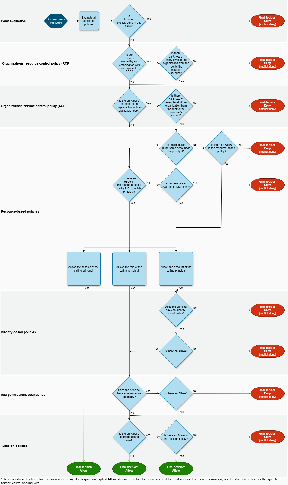

tl;dr: A small overview of AWS permissions and policies

This is some notes or a cheatsheet I wrote while reading about AWS permissions and policies. It is a collection of information from the AWS documentation and other sources.

#### Table of Contents
1. [Policy](#policy)
2. [Types of Policies](#types-of-policies)
3. [Evaluation of identity-based policies](#evaluation-of-identity-based-policies)
4. [Identity-based and resource-based policies](#identity-based-and-resource-based-policies)
5. [Cross-account access using IAM roles](#cross-account-access-using-iam-roles)
6. [Service Control Policies (scps)](#service-Control-Policies-(scps))
7. [How AWS evaluates policies](#how-aws-evaluates-policies)

## Policy
- Consists of:
    - **Version:** policy language version
    - **Id:** optional identifier for policy (optional)
    - **Statement:** One or more individual statements (required)
- Statements consists of:
    - **Sid:** Identifier for the statement (optional)
    - **Effect:** allow or deny
    - **Principal:** account/user/role/service to which this policy applies
    - **Action:** list of actions this policy allows/denies
    - **Resource:** list of resources to which the actions applies
    - **Condition:** conditions for when this policy is in effect (optional)

```json
{
  "Version": "2012-10-17",
  "Id": "ExamplePolicyWithCondition",
  "Statement": [
    {
      "Sid": "AllowS3AccessWithCondition",
      "Effect": "Allow",
      "Principal": {
        "AWS": "arn:aws:iam::123456789012:role/MyExampleRole"
      },
      "Action": "s3:GetObject",
      "Resource": "arn:aws:s3:::example-bucket/*",
      "Condition": {
        "IpAddress": {
          "aws:SourceIp": "203.0.113.0/24"
        }
      }
    }
  ]
}
```

## Types of Policies
- Organizations resource control policies (RCPs): used to set permissions on AWS Organizations resources
- Organizations service control policies (SCPs): used to set permission guardrails across multiple AWS accounts
- Permissions boundaries: used to set the maximum permissions that an identity-based policy can grant to an IAM entity
- Resource-based policies: attached to resources (S3 bucket, SNS topic, SQS queue)
- Identity-based policies: attached to IAM identities (users, groups, roles)
- Session policies: passed when an IAM role is assumed

## Evaluation of identity-based policies:
- **With resource-based policies:** The resulting permissions are the union of the permissions. So only one, the other or both are needed for the action to be allowed.
- **With permissions boundaries:** The resulting permissions are the intersection of the permissions. So both the identity-based policy and the permissions boundaries must allow the action for the action to be allowed.
- **With SCPs or RCPs:** The resulting permissions are the intersection of the permissions. So both the identity-based policy and the SCPs or RCPs must allow the action for the action to be allowed. The only exceptions are principals that are part of the management account, which are not affected by SCPs or RCPs.

## Identity-based and resource-based policies
In some cases resource-based policies are required as well as identity-based policies. 
- **KMS Key Policy**: Even if an IAM role has ``kms:Decrypt``, the KMS Key needs a key policy that must allow the role to decrypt.
- **Cross-account access to AWS resources**: If you want to allow another account to access a resource in your account, you must attach a resource-based policy to the resource that allows the other account to access the resource.

## Cross-account access using IAM roles
You can use the Security Token Service (STS) to assume a role in another account. This is useful when you need to access resources in another account.

**How to access a resource in another account:**
- Create a policy that allows the actions on the resource in the destination account.
- Create a role of type ``AWS account`` in the destination account that owns the resource. 
    - Choose ``Another AWS account`` as the trusted entity and enter the account ID of the source account.
    - Attach the newly created policy to the role.
- Note the ARN of the role in the destination account.
- In the originating account create a role if you don't have one already
    - Create inline policy that allows the sts:AssumeRole action on the ARN of the role in the destination account.

## Service Control Policies (SCPs)
- Policies set on the organization level to restrict access to services and actions in the organization. 
- In an Organization your management account will have FullAWSAccess, which allows you to do anything in any account in the organization.
- SCPs are applied to OUs and accounts and are inherited by all child OUs and accounts.
- SCPs are evaluated before identity-based policies.

- **Allow:** For a permission to be allowed for a specific account, there must be a explicit allow statement at every level from the root through each OU in the direct path to the account.
    - Deny-by-default: If any permission is not explicitly allowed in the SCP, it is denied.
    - Like a whitelist
- **Deny:** For a permission to be denied for a specific account, any SCP from the root through each OU in the direct path to the account (including the target account itself) can deny that permission.
    - Allow-by-default: If any permission is not explicitly denied in the SCP, it is allowed (if allowed by parent).
    - Like a blacklist

## How AWS evaluates policies
By default, all requests are denied, except for the AWS account root user, which has full access. Requests must be explicitly allowed by a policy to be granted access. An explicit deny in any policy overrides any allow.
Here is the flow chart from the AWS documentation that show in detail how AWS evaluates policies:
[](aws-policy-evaluation-logic.png)

