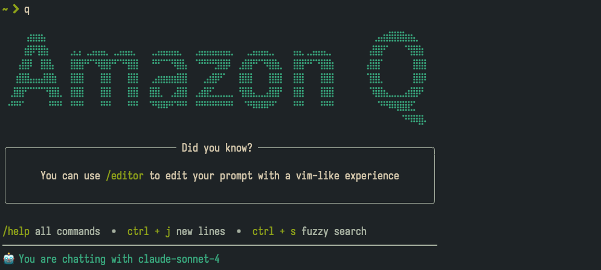
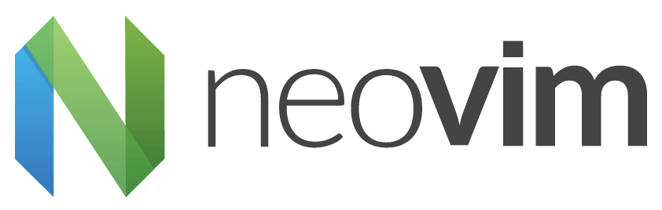
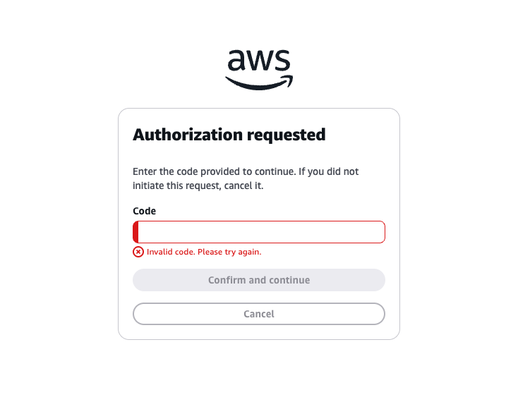
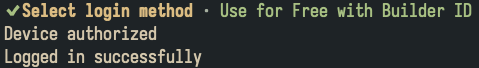

tl;dr: Amazon Q is a gen-AI assistant from AWS. [Amazon Q Developer - Getting started](https://aws.amazon.com/q/developer/getting-started/). AWS has also made a [Neovim plugin](https://github.com/awslabs/amazonq.nvim).

---

AI, Gen-AI, LLMs, Agents, MCP. There is so much AI hype. Everywhere I look they
talk about AI. "AI is the future. If you don't learn to use it right now you
will never catch up."

I've been kinda sceptical to AI. As a developer I have used AI since the
beginning of ChatGPT and GitHub Co-pilot, which feels like forever ago even though it
has only been about 2 years. It is nice to save time by making it write boiler
plate code and it is fun to make it create stories and song lyrics.

To be honest I haven't understood exactly how it will revolutionize the world
and how everything works, but I'm starting to realize that it will in some way.
And it is actually true what people say, you should if nothing else at least try
to stay somehow up to date on what is happening and how AI can help you in your
daily tasks and workflow.

I use ChatGPT every day. It has taken over a lot of the tasks google.com used
to do. I get a Co-pilot license from work, so that has also become a part of my
workflow when writing code.

Now I want to learn more about AI. I want to make an educated choice of what
engine I want to use and for what. And who deserves my hard earned cash. I am
starting today by checking out Amazon Q Developer.


## Amazon Q


Ok, first, let's get orientated. There are a lot of names. Well, actually just two. But anyways.

Amazon Q is a generative AI assistant from AWS. This is the umbrella brand.
Then you have two different assistants depending on the use case.

Amazon Q Business is, like the name suggests, for businesses. This is when you
need Q for multiple users with role-based permissions. You can connect it with
company data and a lot of different applications like Jira, Confluence, Google
Drive, Microsoft Sharepoint, etc.

Amazon Q Developer is targeting developers and engineers. This is used to write
code, test, debug etc. It also have AWS expertise and insight to your AWS
resources. When you are in the AWS console you always have the possibility to
click the icon on the right hand side which says Amazon Q. This opens a
conversation with Amazon Q Developer.

Amazon Q Business has a lite version at $3 per user per month and a pro verison at $20 per user per month.

Amazon Q Developer has a free tier and a pro at $19 per month.

Amazon Q Developer can be used in the AWS Console, your IDE or the CLI. To use it you need a AWS BuilderID. Read more about it in the [AWS documentation](https://docs.aws.amazon.com/signin/latest/userguide/sign-in-aws_builder_id.html).

### Pricing

| **Free Tier (Zero cost)** | **Pro Tier ($19 per month)**  |
|-------------------------------|-----------------------------------------------------------------------------------------------|
| 50 agentic requests per month | Included                                                                                      |
| 1000 lines of code per month  | 4000 lines of code per month per user pooled at account level. (Then $0.003 per line of code) |

### Download the CLI
To get the Amazon Q Developer CLI, simply download it from [AWS](https://docs.aws.amazon.com/amazonq/latest/qdeveloper-ug/command-line-installing.html?b=cli&p=overview&s=tiles)
or if you're running macOs you can install it with Homebrew ``brew install --cask amazon-q``

- Verify the installation ``q doctor``
- Login with your AWS BuilderID ``q login``

### Agents and MCPs (Model Context Protocol)
You can create an AI agent directly in the chat by running the command ``/agent create --name my-test-agent``.
This will create a file *~/.aws/amazonq/cli-agents/my-test-agent.json*
```json
{
      "$schema": "https://raw.githubusercontent.com/aws/amazon-q-developer-cli/refs/heads/main/schemas/agent-v1.json",
      "name": "my-test-agent",
      "description": "",
      "prompt": null,
      "mcpServers": {},
      "tools": [
            "*"
          ],
      "toolAliases": {},
      "allowedTools": [
            "fs_read"
          ],
      "resources": [
            "file://AmazonQ.md",
            "file://README.md",
            "file://.amazonq/rules/**/*.md"
          ],
      "hooks": {},
      "toolsSettings": {},
      "useLegacyMcpJson": true
}
```
You may now add a description, tools and resources as well as pre-approving tools you use frequently.

You can also add MCP servers. Q will look for these in ``.aws/amazonq/mcp.json``. Here is a list from AWS with [MCP servers](https://awslabs.github.io/mcp/).

## Run Amazon Q Developer in Neovim

Q can be installed as a plugin and run in your IDE. The supported IDEs are IntelliJ, VS Code, Visual Studio and Eclipse.
Installing any of these is as simple as clicking a button in the [install guide](https://aws.amazon.com/q/developer/getting-started/#ide).
So instead of looking at that, let's install it in vim.

You can find the plugin at [awslabs github](https://github.com/awslabs/amazonq.nvim).
If you are using lazy.nvim simply create a new file in your plugin directory named ``q-developer.lua`` and add the plugin.
```lua
return {
    {
        name = 'amazonq',
        url = 'https://github.com/awslabs/amazonq.nvim.git',
        opts = {
            ssoStartUrl = 'https://view.awsapps.com/start'
        },
    },
}
```

Since I am using the free tier I didn't want to enable suggestions, so I disabled it. I also moved the split where the chat opens up.
```lua
return {
    'awslabs/amazonq.nvim',
    config = function()
        require('amazonq').setup({
            ssoStartUrl = 'https://view.awsapps.com/start', -- Authenticate with Amazon Q Free Tier
            -- Enable inline code suggestions.
            inline_suggest = false,
            -- Customize how the chat window is set up.
            on_chat_open = function()
                vim.cmd[[
                    botright split
                    set wrap breakindent nonumber norelativenumber nolist
                ]]
            end,
        })
    end
}
```

Then re-open vim and you should be prompted to go to a website and enter a key. 

*Confirm and continue*, then click *allow access*.


Now you can open the chat from normal mode by pressing ``zq`` or ``:AmazonQ``.

You can start by selecting lines before running the command. This will open the
selected lines as part of the prompt. Perfect for when you want to comment,
explain or refactor part of your code.

And for those cases you actually already have pre made commands.
| **Command**           | **Action**                          |
|-------------------|----------------------------------|
| :AmazonQ explain  | Explain the selected code block  |
| :AmazonQ fix      | Fix the selected code block      |
| :AmazonQ optimize | Optimize the selected code block |
| :AmazonQ refactor | Refactor the selected code block |

To see all commands and more checkout ``:help amazonq`` to see the [documentation](https://github.com/awslabs/amazonq.nvim/blob/main/doc/amazonq.txt).

You can then remap them as you want. I haven't thought of any good mappings yet,
but here is a suggestion. Feel free to change them to some better mappings.
```lua
vim.keymap.set('n', '<leader>aq', ':AmazonQ<CR>', { noremap = true, silent = true })
vim.keymap.set('v', '<leader>aq', ':AmazonQ<CR>', { noremap = true, silent = true })
vim.keymap.set('v', '<leader>aqe', ':AmazonQ explain<CR>', { noremap = true, silent = true })
vim.keymap.set('v', '<leader>aqf', ':AmazonQ fix<CR>', { noremap = true, silent = true })
vim.keymap.set('v', '<leader>aqo', ':AmazonQ optimize<CR>', { noremap = true, silent = true })
vim.keymap.set('v', '<leader>aqr', ':AmazonQ refactor<CR>', { noremap = true, silent = true })
```

## Conclusion
Now we're all set up and ready to use Amazon Q Developer.
It looks promising, and I can't wait to try it out, although I might
have to open my wallet if I want to get a real experience.

I guess the next thing I need to try out is some real VIBE coding. Don't know
if I will laugh or cry. Looking forward to test Kiro later as well when it is
available. [Click here to join the waitlist](https://kiro.dev/waitlist/).

