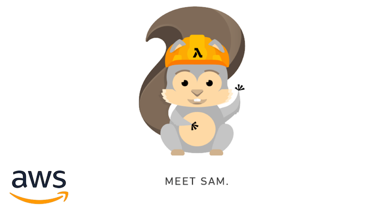
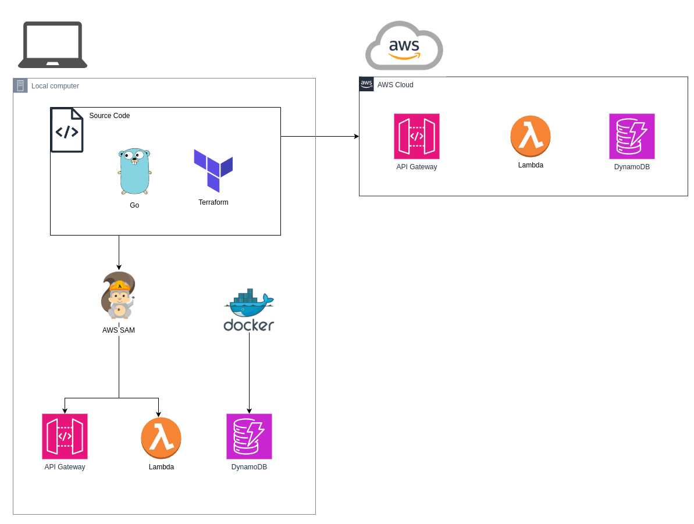

tl;dr: Use terraform as a template for SAM to run your serverless API locally with the flag ``--hook-name terraform``.

#### Table of Contents
1. [What is SAM?](#what-is-sam)
2. [Setting up Terraform for SAM](#setting-up-terraform-for-sam)
3. [Building with SAM and Terraform](#building-with-sam-and-terraform)
4. [Sam config file](#sam-config-file)
5. [Invoking a lambda function locally](#invoking-a-lambda-function-locally)
6. [Running API Gateway locally](#running-api-gateway-locally)
7. [Adding local DynamoDB with Docker](#adding-local-dynamodb-with-docker)
8. [Conclusion](#conclusion)

## Introduction
Lambdas for serverless computing is great for creating applications fast without spending time on physical infrastructure. How ever, without a good pipeline and workflow, developing can take a lot of time.

SAM to the rescue, enabling local testing of you lambda functions and IaC with Cloudformation. But what if you don't wanna use Cloudformation for IaC?

In this post I am going to take a look at how you can combine SAM with your Terraform code. 

This is just a small part of what is possible with SAM, but it is something I needed the last time I created a serverless API from scratch. I wish I knew about it then so I thought I'd share it now that I know.


## What is SAM?

- AWS Serverless Application Model
- Framework for developing and deploying serverless applications
- All config is YAML 
- Generate complex CloudFormation from simple YAML
- Supports anything from CloudFormation: Outputs, Mappings, Parameters, Resources, ...
- SAM can use CodeDeploy to deploy Lambda functions
- SAM can run Lambda, API Gateway, DynamoDB locally

## Setting up Terraform for SAM
To enable the use of SAM without creating a config in YAML, we need to create a Terraform resource SAM can use as a config referance. 
When you use the flag ``--hook-name terraform`` when you run SAMs build command, SAM will look in the terraform code for any ``null_resource`` starting with the name ``sam_metadata_`` and use the information in the ``triggers`` block to gather the location of the source code and the artifact.
```hcl
resource "null_resource" "sam_metadata_aws_lambda_function_my_lambda" {
    triggers = {
        resource_name = "aws_lambda_function.my_lambda"
        resource_type = "ZIP_LAMBDA_FUNCTION"
        original_source_code = "${local.lambda_src_path}"
        built_output_path = "${local.building_path}/${local.lambda_code_filename}"
    }
}
```

- resource_name = Lambda function resource defined in the terraform code
- resource_type = Packaging ("ZIP_LAMBDA_FUNCTION")
- original_source_code = Location of the source code. (Entry point for the lambda function i.e. "path/to/main.go")
- built_output_path = Location of the .zip package of the lambda function (i.e. "path/to/lambda_function_payload.zip")

## Building with SAM and Terraform
Now that terraform is set up, we can build the lambda function with SAM using Terraform as a template.
```bash
sam build --hook-name terraform
```
This command will prepare our build for testing or deployment by creating a ``.aws-sam`` directory with the necessary files for the lambda function.
These files includes build information and the build which is a directory containing a template.yaml with CloudFormation (based on the terraform code), and the lambda function binary.
```
Apply complete! Resources: 1 added, 0 changed, 0 destroyed.

Build Succeeded

Built Artifacts  : .aws-sam/build
Built Template   : .aws-sam/build/template.yaml

Commands you can use next
=========================
[*] Invoke Function: sam local invoke --hook-name terraform
[*] Emulate local Lambda functions: sam local start-lambda --hook-name terraform
```

### Sam config file
Since we are lazy programmers striving for efficiency, we don't want to write the flag ``--hook-name terraform`` every time we run the build command.
It is possible to set it in the SAM configuration file ``samconfig.toml``. So let's do that.

```toml
version = 0.1

[default.build.parameters] 
hook_name = "terraform"
```
(This file should be located in the root of your project, or where you run the SAM commands)

For more information about the SAM CLI configuration file, see [AWS docs SAM CLI configuration file](https://docs.aws.amazon.com/serverless-application-model/latest/developerguide/serverless-sam-cli-config.html)

## Invoking a lambda function locally
To test our application locally we can now run the lambda function with SAM. This command will run the lambda function locally with an event as input.

```bash
sam local invoke <lambda_function> -e <event>
```

Cool, but what is our lambda called, and what does an event look like? The name of the lambda is the resource name from our terraform code. We can also find it in the ``.aws-sam/build.toml``.
It is possible to generate an event with the SAM CLI command ``sam local generate-event <service> <event>``. These events can also be found in the lambda console under the test tab.
They are huge JSON objects with a lot of information. In my test project I was able to run the lambda successfully with only a minimum of needed information: 
```json
{
    "body": "{\"username\": \"test\", \"password\": \"hunter2\"}",
    "path": "/users/create",
    "httpMethod": "POST"
}
```
Write this to a file, and name it something like ``event.json``. Now we can run the lambda function with this event as input.

```bash
sam local invoke aws_lambda_function.my_lambda -e event.json
```

## Running API Gateway locally
If our terraform code also included some API Gateway resources, they were built when we ran ``sam build --hook-name terraform``. 
We can run API Gateway locally with SAM as well with this command:
```bash
sam local start-api

```
This will start a local server with the API Gateway endpoints and the lambda functions as the backend.
When running this command we will see all the API Gateway endpoints being mounted in the log, and a message saying ``* Running on http://127.0.0.1:3000``.
Now we can hit our endpoints with postman or curl and see the response from your lambda function as well as see the logs in the terminal similar to what we would find in CloudWatch.

## Adding local DynamoDB with Docker
We can run a local DynamoDB with docker and connect to it with our lambda function. To make this work we need to run the docker image and the sam local command on the same virtual network.

First we spin up a docker image with DynamoDB. We can use this docker-compose file:

```bash
services:
 dynamodb-local:
   image: "amazon/dynamodb-local:latest"
   container_name: dynamodb
   ports:
     - "8000:8000"
   volumes:
     - "./docker/dynamodb:/home/dynamodblocal/data"
   working_dir: /home/dynamodblocal
   networks:
     - backend

networks:
  backend:
    name: dynamodb-local
```

We must make our lambda function connect to the DynamoDB container with the endpoint ``http://dynamodb:8000``. I suggest using an environment file with the endpoint as a variable so we can easily switch between the local and the cloud DynamoDB.

Now we can run the DynamoDB container with docker-compose and the lambda function with sam local start-api on the same network.
```bash
docker-compose up -d
sam local start-api --docker-network dynamodb-local
```

Then all we need to do is create a table similar to what our API expects on our local DynamoDB. This can be done through the AWS CLI by adding the flag ``--endpoint-url http://localhost:8000`` to the command.

If we want to invoke a lambda function that connects to a local DynamnoDB we need to add the flag ``--docker-network <network>`` to the command.
```bash
sam local invoke aws_lambda_function.my_lambda -e event.json --docker-network dynamodb-local
```

## Conclusion

It is possible to run our serverless API locally with SAM and Terraform. This is a great way to test our lambda functions and API Gateway endpoints with SAM before deploying them to the cloud with Terraform.
