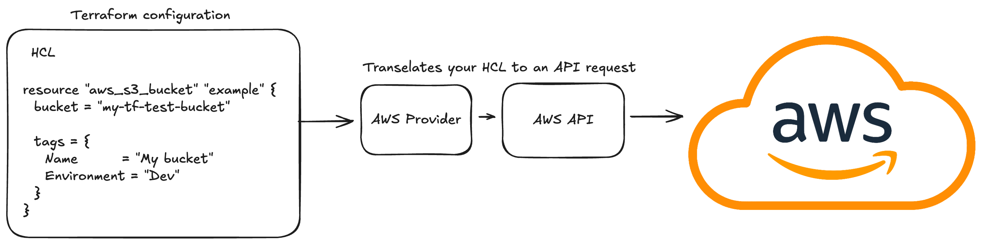
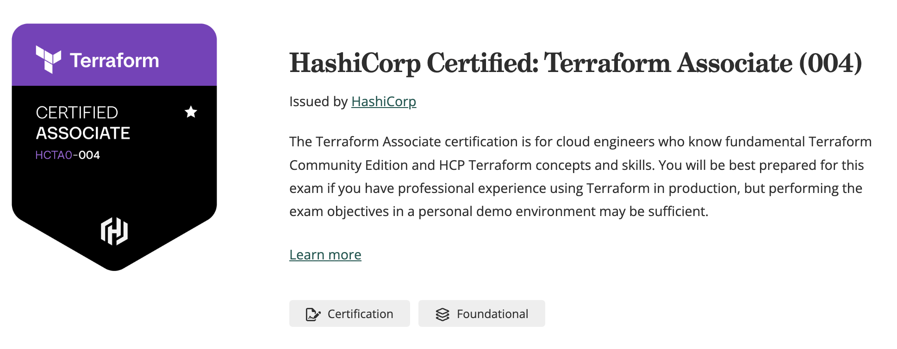

tl;dr: There is a new version of the terraform associate certification (004). It is
mostly the same as the previous version (003) but with 4 new topics added.

## Terraform?
Terraform might be the de facto standard when it comes to infrastructure as
code (IaC). It is a way of using declarative code to provision cloud resources. Today
everything has an API, but all APIs are different. With Terraform you write
simple HCL, which really doesn't feel much more complex than JSON. This gets
translated to a providers API requests. And there is a provider for everything
from Azure and AWS to Minecraft and Spotify.

Last year I wanted to learn Terraform. I had a few years of experience with
CloudFormation so I already understood the concept of IaC. And to be honest I
had been using Terraform a bit, but it didn't feel like something I really
knew.

Usually when I wanna learn something with the goal of getting certified, I'm
pulled towards getting a Udemy course. It feels nice to give the responsibility
of what to learn and how to learn it to someone else. But I was told Terraform
is pretty easy to understand and that going through a Udemy course was
overkill.

## How I learned Terraform
HashiCorp has created a really good documentation and guide to Terraform. And I
started here:
[hashicorp.com/terraform/tutorials/aws-get-started](https://developer.hashicorp.com/terraform/tutorials/aws-get-started).
After going through some guides I created my own project. A serverless rest
API in AWS. After getting used to looking up resources in the [terraform
registry](https://registry.terraform.io/providers/hashicorp/aws/latest/docs),
it gets pretty easy provisioning whatever you want. I used Terraform to
provision an IAM User, lambdas, DynamoDB database, API Gateway and policies. I
learned a lot from this project, as you usually do compared to just reading
about a topic. So I really recommend creating a real project, not just reading
through examples and doing short tutorials.

## The Terraform Associate Certification
After this I felt like I knew everything I needed and wanted to get certified.
But after looking into the [exam content
list](https://developer.hashicorp.com/terraform/tutorials/certification-004/associate-review-004)
I realised there was a lot more to learn. Not only about Terraform, but also
about HashiCorp and [HashiCorp Cloud
Portal](https://developer.hashicorp.com/terraform/cloud-docs). Luckily
HashiCorp got you covered with an extensive [exam prep](https://developer.hashicorp.com/terraform/tutorials/certification-004). And what I did was
simply just to go through that prep and sign up for the exam. I also googled to
lookup what others said about the exam and tried to get a feel for what kind of
questions would show up on the exam.

## Terraform Associate (004)

So last week I did the 004 exam. I was a bit nervous since I haven't really
touched Terraform much lately. But after postponing studying for two weeks, I
signed up for the exam just hoping for the best. This deadline got me to
finally do some last minute studying, which came in handy. All in all I felt
pretty good while doing the exam. I got a few questions where I wasn't 100%
certain, but mostly it wasn't too difficult. You get the result, PASS/FAIL,
immediately after finishing, which is nice. It was 57 questions and you have 1
hour to complete the exam. I didn't rush and had more than 10 minutes remaining
when I was done.

At 15 minutes remaining the top bar did this animation moving down and up again
to show that time was almost up. I though for a second my time was up and the
application was slowly closing. This was a bit distracting. So don't get scared
if suddenly something starts moving. You still have 25% of the time left.

## What is new on this exam?
The exam prep has been updated, and you can read all the details about the exam
[here](https://developer.hashicorp.com/terraform/tutorials/certification-004).
But to summarize, there are four new topics covered on this exam:

- 4f: depends_on and create_before_destroy lifecycle rules
- 4g: Validate configuration using custom conditions
- 4h: Ephemeral values and write-only arguments
- 8c: Describe how to organize and use HCP Terraform workspaces and projects

So if you already have the previous certification, you shouldn't need more then
an evening making sure you know these topics.

Other than that I felt that maybe a third of the questions was a bit bigger
than I remembered from the last exam. Felt more like other exams where they
create a small case and wants you to decide something. Like "You are creating a
module and want this and that, how should you reference this thing in that
place" and some code example. I enjoyed these questions since they seem a bit
more real and interesting than "Why is IaC good?" or "Something something
something..." and answer is "count".

## Conclusion
In my opinion, the exam hasn't really changed much. If you have the previous
certification and use Terraform regularly, this should be no problem for you! Go get
certified!

