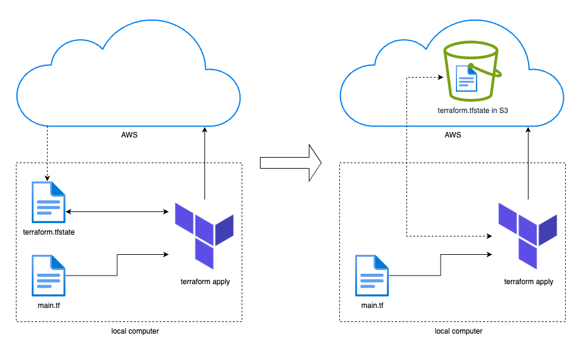
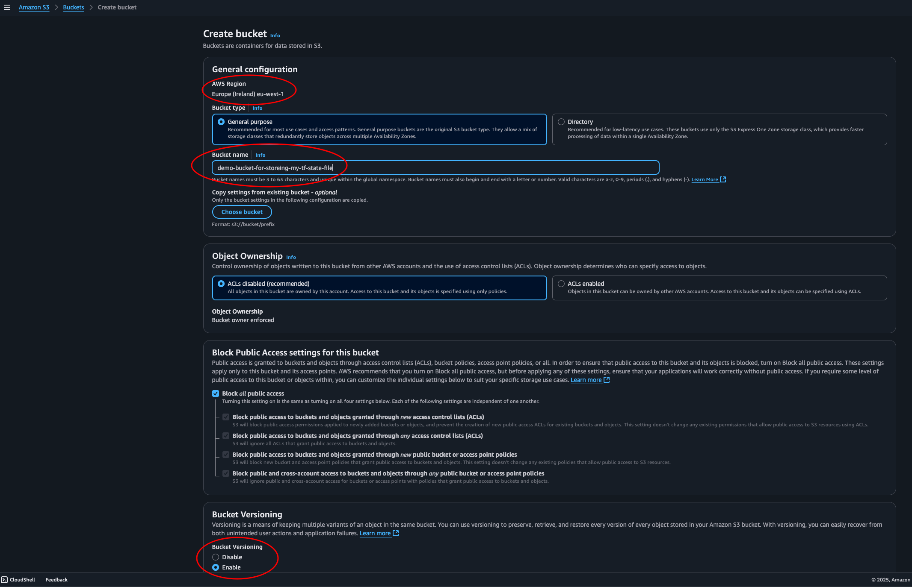
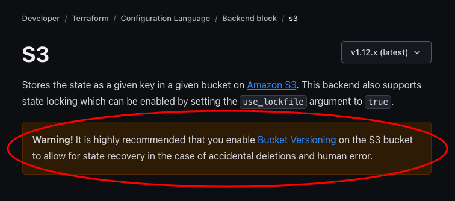
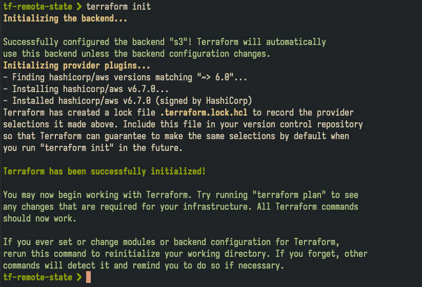
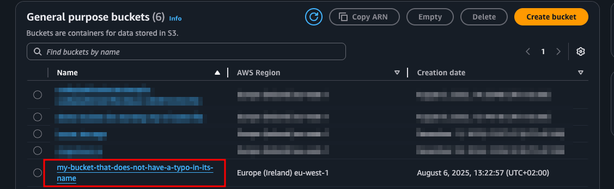
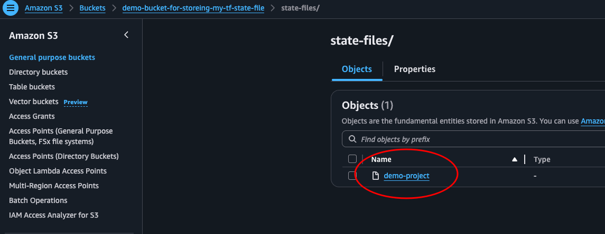
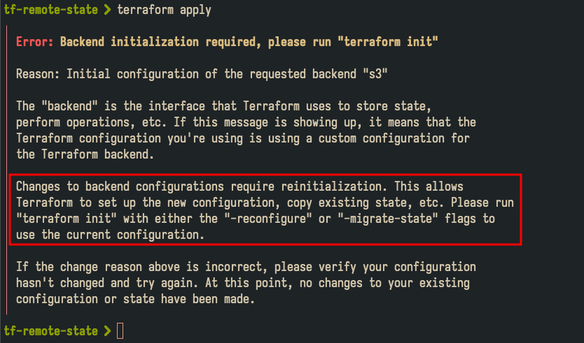
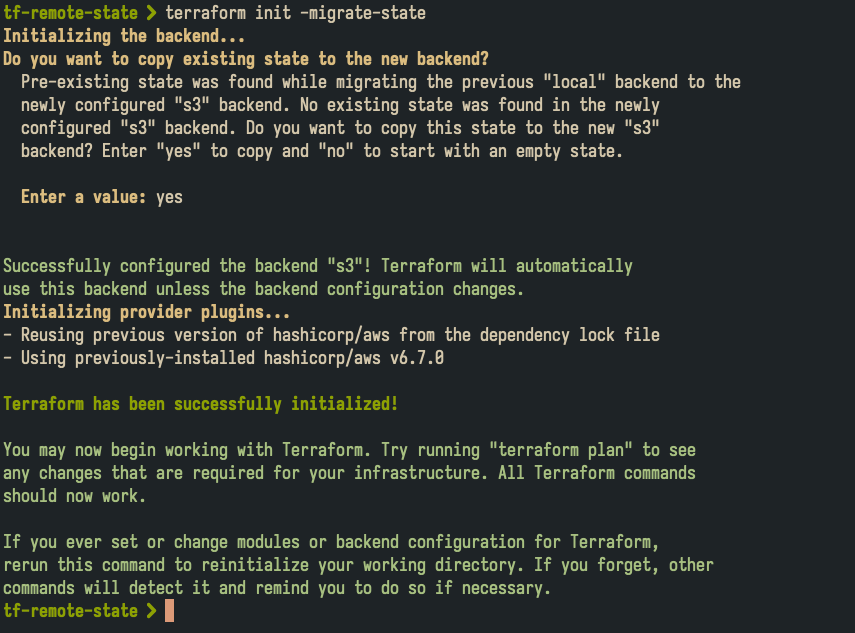
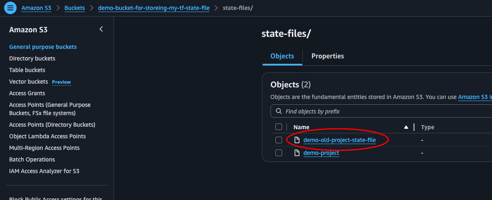

**tl;dr:** You can use S3 to store your Terraform state file remote. To migrate a local state file, add a ``backend "s3" {}`` block to your Terraform configuration and run ``terraform init -migrate-state``. You no longer need to use DynamoDB for state locking, as S3 now has native support for this with ``use_lockfile = true``.

#### Table of Contents
1. [What is remote state?](#what-is-remote-state)
2. [State locking](#state-locking)
3. [Set AWS as a Terraform backend](#set-aws-as-a-terraform-backend)
4. [Migrating local state to S3](#migrating-local-state-to-s3)
5. [Conclusion](#conclusion)

## What is remote state?
When you run ``terraform apply``, terraform will create a state file. When ever
you make a change to your terraform configuration and apply it, terraform will
check the difference between the config and the state before makeing the needed
changes.

By default this state file is created in the same directory you ran the apply
command. How ever, this creates some problems when there are multiple people
working on the same project. So make it possible for multiple people to work on
the same terraform project then need to share the same state file. This can be
done by storing the state file in the cloud.


In this post I will go over how to use AWS as a backend and store the terraform
state file in Amazon S3. I will also go over how to migrate the state if you
already have a local state file.

## State locking
Let's say you have multiple people working on the same terraform configuration
sharing a remote state. There need to be made a new EC2 resource. Two people
create this and run ``terraform apply`` at the same time. They will both use
the same state which says there are no EC2 instances, and both instances will
be created. This way they ended up with twice as many instances as intended.

To prevent this we have state locking. This locks the state when an update is
made so that only one can apply changes at the time. It's like transaction
locks in SQL.

Up until early this year (2025) you had to use DynamoDB to manage the state
locking. As of Terraform version 1.11 this is no longer needed, which
makes this whole setup a lot simpler using S3 native locking.

## Set AWS as a Terraform backend
To use S3 to store the state you simply need to set AWS as a backend in you Terraform configuration.
```hcl
terraform {
  backend "s3" {
    bucket = "mybucket"         # Bucket name
    key    = "path/to/my/key"   # The state file
    region = "us-east-1"        # Region where the bucket is
    use_lockfile = true         # Enable S3 native locking
  }
}
```

If you are using a mac and installed terraform with brew, make sure you have
used the hashicorp tap to get the newest version. If you have an older version
than 1.11, you need to upgrade.
```bash
brew uninstall terraform
brew tap hashicorp/tap
brew install hashicorp/tap/terraform
terraform version
# Output
Terraform v1.12.2
on darwin_arm64
```

Ok, let's give it a go!

First we will create a bucket. I will do this in the AWS console.


Note the region, make sure it is as intended. We'll give the bucket a name and
leave everything else as default. Or on second thought, let's enable versioning.
This is suggested by Terraform to be able to restore an old state if
something should go wrong.


Now that we have our bucket ready (with a typo and everything... sigh...) let's write some terraform code.

*main.tf*
```hcl
terraform {
  required_version = ">= 1.11.0"

  required_providers {
    aws = {
      source  = "hashicorp/aws"
      version = "~> 6.0"
    }
  }

  backend "s3" {
    bucket       = "demo-bucket-for-storeing-my-tf-state-file"
    key          = "state-files/demo-project"
    region       = "eu-west-1"
    use_lockfile = true
  }
}

provider "aws" {
  region = "eu-west-1"
}

resource "aws_s3_bucket" "this" {
  bucket = "my-bucket-that-does-not-have-a-typo-in-its-name"
}
```

In our terminal we will change directory into the folder containing our
terraform project. And initiate it with ``terraform init``.


Looks good. Let's apply our configuration with ``terraform apply`` and confirm with ``yes``.

```plaintext
Plan: 1 to add, 0 to change, 0 to destroy.

Do you want to perform these actions?
  Terraform will perform the actions described above.
  Only 'yes' will be accepted to approve.

  Enter a value: yes

aws_s3_bucket.this: Creating...
aws_s3_bucket.this: Creation complete after 2s [id=my-bucket-that-does-not-have-a-typo-in-its-name]

Apply complete! Resources: 1 added, 0 changed, 0 destroyed.
```

Success. Now, back to the console to confirm everything is as expected.


Yes, here is the bucket we created with terraform. Now let's check out our state bucket.


Oh yeah! There it is, our state file.

### Clean up
Delete the bucket we created with the command ``terraform destroy --auto-approve``.

## Migrating local state to S3
Now, that was easy enough, but what about our project that we have already
started. The one with a local state file. If we have one. How can we migrate this over to our
newly created, typo-in-name-having bucket?

Let's see if we can figure this our together. In our terminal we will navigate over to our terraform project that has a local state file. 

> We can use the command ``tree`` to list the content of the directory. I'll add a ``-a`` flag to show hidden files, and a ``-L 1`` flag to only show the first level of the directory tree.

```bash
tree -a -L 1
.
├── .terraform
├── .terraform.lock.hcl
├── main.tf
└── terraform.tfstate

2 directories, 3 files`
```
In our *main.tf* file we add the backend part in the terraform block. Just as we did before.
```hcl
terraform { 
  # ...
  backend "s3" {
    bucket       = "demo-bucket-for-storeing-my-tf-state-file"
    key          = "state-files/demo-old-project-state-file"
    region       = "eu-west-1"
    use_lockfile = true
  }
  # ...
}
# ...
```

Great, now we should simply have to run ``terraform apply`` to apply our new backend.


Hmm.. That didn't work. Ok, let's do what it tells us:
```bash
terraform init -migrate-state

```



Was that really it? That simple!? Let's have a look in our S3 bucket.


There it is! Ok, before we end this, let's test some stuff to make sure
everything works as we want it to. Then we can clean up if needed.

First, let's try to delete the local state file and apply some changes to *main.tf*.
```bash
rm terraform.tfstate terraform.tfstate.backup
```
Then we add a new bucket in our main.tf file
```hcl

#...
resource "aws_s3_bucket" "this" {
  bucket = "a-bucket-with-a-unique-name-that-i-will-soon-delete"
}
#...
```
Then let's run ``terraform apply`` and see what happens. If terraform use the state file in our S3 bucket, it should see the first bucket that we have already created and only try to add one new bucket.
```bash
Plan: 1 to add, 0 to change, 0 to destroy.

Do you want to perform these actions?
  Terraform will perform the actions described above.
  Only 'yes' will be accepted to approve.

  Enter a value: yes

aws_s3_bucket.that: Creating...
aws_s3_bucket.that: Creation complete after 2s [id=a-bucket-with-a-unique-name-that-i-will-soon-delete]

Apply complete! Resources: 1 added, 0 changed, 0 destroyed.
```

Perfect. We confirmed that terraform is looking at the state file stored in our S3 bucket, and not the local file we used to use.

### Clean up
I am going to destroy our terraform resources with ``terraform destroy``, and then navigating to the AWS S3 Console and manually deleting the bucket we created to store our state files. Make sure you do the same if you don't intent on using what we just created.

## Conclusion
We have successfully used AWS to store our terraform state file in S3 with
native state locking without using DynamoDB. We have also seen how easy it is
to migrate the state of an already initiated project. Hope this was helpful.

### Sources
- [terraform documentation - S3 backend](https://developer.hashicorp.com/terraform/language/backend/s3)
- [terraform registry](https://registry.terraform.io/providers/hashicorp/aws/latest/docs/resources/s3_bucket)
- [terraform v1.11 changelog](https://github.com/hashicorp/terraform/blob/v1.11/CHANGELOG.md)
