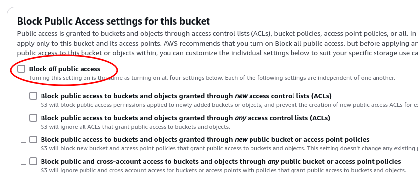

tl;dr: Script to sync github repo with S3: [https://github.com/jakejarvis/s3-sync-action](https://github.com/jakejarvis/s3-sync-action)

## Workflow
Writing this blog I want as little friction as possible. By that I mean that i want as short as possible distance/time/clicks between me writing a post in a markdown file and the blog being updated on the world wide web. My solution to this goal was version control on GitHub and creating a pipeline with GitHub Actions, that would deploy my webpage automatically on push to main. This way all I need to do is write a new blog post and push it to git 
```bash
git add .;git commit -m "new post"; git push
```

## GitHub Actions script
My plan for the script:
- Download hugo
- Download aws cli
- Build code
- Sync /public/ to S3 using the aws cli

As with most good ideas, I quickly found out that [someone has done this](https://github.com/jakejarvis/s3-sync-action) before me. So since im now trying to focus on content and not over engineering or making everything custom and from scratch I decided just to use his script, and also create a short post on how it can be used.


### What the script does
The script simply syncs the content of the github repository to an S3 bucket using the configuration you set up:
- Access key
- Secret key
- S3 bucket
- Region
- Source dir

source: [S3-sync-action](https://github.com/jakejarvis/s3-sync-action)

The difference from my plan is that when using this script I have to build the webpage and push everything to github, which isn't optimal. But in this case it's not a big problem since this is such a small page. How ever, I plan to do this the way I first planned it when I find time to prioritize it.

## Set up GitHub S3 sync in three steps
1. **Create an S3 Bucket**
    - From the AWS Console navigate to S3 and click the 'Create bucket' button
    - Enter a unique name
    - Uncheck the "block all public access" box
    
    - Create bucket
    - Once created, enter the bucket > properties and on the bottom on the page click the "edit"-button on "Static website hosting"
    - Select enable and host a static website and enter the names of the index and error page (index.html, error.html) 
    - Go to permissions and add this policy to make the bucket open to read
    ```json
    {
        "Version": "2012-10-17",
        "Statement": [
            {
                "Sid": "PublicReadGetObject",
                "Effect": "Allow",
                "Principal": "*",
                "Action": "s3:GetObject",
                "Resource": "arn:aws:s3:::<BUCKET_NAME>/*"
            }
        ]
    }
    ```
2. **Create an IAM user with permissions to access the S3 bucket**
    - From the AWS console navigate to IAM and then Users and click "Create user"
    - Add a name
    - Set permissions:
        - "Attach policies directly"
        - Search for S3 and select "AmazonS3FullAccess"
    - Create user and navigate over to the user you just created
    - On "Security credentials" click "create access key"
    - Download csv (This will be used in the script for logging in as the user just created)
3. **Set up GitHub repository with actions workflow to sync on push**
    - Add the 3 repository secrets by navigating to settings > secrets and variables > actions
        - ``AWS_S3_BUCKET``, ``AWS_ACCESS_KEY_ID``, and ``AWS_SECRET_ACCESS_KEY``
        - Enter the ids from the csv file you downloaded, and the name of the bucket you created
    - Create the script ``.github/workflows/upload-to-s3.yaml``
    ```yaml
    name: Upload website to S3

    on:
      push:
        branches:
        - main

    jobs:
      deploy:
        runs-on: ubuntu-latest
        steps:
        - uses: actions/checkout@master
        - uses: jakejarvis/s3-sync-action@master
          with:
            args: --follow-symlinks --delete --exclude '.git*/*'
          env:
            SOURCE_DIR: ./public/
            AWS_REGION: eu-west-1
            AWS_S3_BUCKET: ${{ secrets.AWS_S3_BUCKET }}
            AWS_ACCESS_KEY_ID: ${{ secrets.AWS_ACCESS_KEY_ID }}
            AWS_SECRET_ACCESS_KEY: ${{ secrets.AWS_SECRET_ACCESS_KEY }}
    ```
    - add, commit and push

Now everything should be set up and working and the GitHub Action should already be running (if you pushed to main)

## Notes
- In my case since im using Hugo i set the ``SOURCE_DIR`` to ``./public/`` in the workflow script. To sync all files set to ``public`` or ``./``
- When syncing with S3, if the webpage is hosted on a domain routed with Route 53 and CloudFront the changes may not be visible because of the CloudFront cache. In that case go in to CloudFront on AWS Console and invalidate the cache ``/*``. You can also edit the TTL for cache which defaults to 24 hours.
